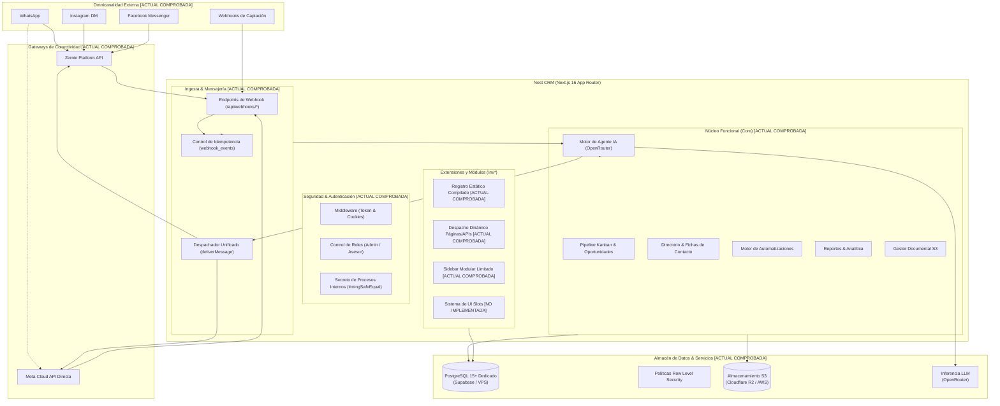

# Nest CRM — Arquitectura Técnica y Contratos del Sistema

**Versión del documento**: 2.1.0\
**Fecha de actualización**: 2026-11-09\
**Estado**: Documento rector de arquitectura técnica\
**Repositorio base**: `E:\Codigo\nest-crm` (rama `develop`, v2.1.0)\

---

## 1. Convenciones de Clasificación del Documento

- **[ACTUAL COMPROBADA]**: Funcionalidad o arquitectura implementada y comprobada en el código.
- **[OBJETIVO APROBADO]**: Decisión arquitectónica aprobada, en especificación o planificación formal.
- **[PENDIENTE DE DECISIÓN]**: Propuesta sujeta a análisis técnico o definición de producto.
- **[NO IMPLEMENTADA]**: Diseñada conceptualmente pero sin código ejecutable en el repositorio.

---

## 2. Visión General del Sistema [ACTUAL COMPROBADA]

Nest CRM es una aplicación web full-stack basada en **Next.js 16 (App Router)**, **React 19**, **Drizzle ORM** y **PostgreSQL 15+**, concebida para operar bajo el modelo de **una instalación dedicada y una base de datos aislada por empresa**.

El sistema separa la lógica genérica de negocio de las especializaciones verticales y de las personalizaciones particulares.



---

## 3. Decisiones Arquitectónicas Registradas (ADR)

| ID | Decisión Arquitectónica | Clasificación | Justificación y Regla Técnica |
|---|---|---|---|
| **ADR-001** | **Instancia y base de datos dedicada por cliente** | **[OBJETIVO APROBADO / COMPROBADA ESTRUCTURALMENTE]** | Modelo rector de despliegue. El repositorio provee las capacidades estructurales para ello (`Dockerfile` standalone, conexión a BD dedicada vía `DATABASE_URL`). Se descarta el SaaS multi-tenant compartido. *(Nota: El aislamiento de infraestructura no confiere por sí solo conformidad GDPR automática; esta exige evaluaciones jurídicas y controles operativos específicos).* |
| **ADR-002** | **Inmutabilidad del núcleo (`src/`)** | **[ACTUAL COMPROBADA en política / OBJETIVO APROBADO]** | Principio de gobernanza constitucional (`specs/CONSTITUCION.md`). La inmutabilidad es una disciplina de ingeniería y control de versiones que prohíbe introducir código particular de clientes en `src/`. |
| **ADR-003** | **Next.js Standalone Build con módulos estáticos** | **[ACTUAL COMPROBADA]** | Next.js compila únicamente código presente en el árbol de build. No existe inyección dinámica de código en caliente que no esté compilado en el artefacto. |
| **ADR-004** | **Configuración en cuatro niveles jerárquicos** | **[OBJETIVO APROBADO]** | Orden conceptual de precedencia: 1) Núcleo, 2) Plantilla, 3) Instalación, 4) Personalización cliente. |
| **ADR-005** | **Migraciones transaccionales idempotentes** | **[ACTUAL COMPROBADA]** | Todo script SQL corre dentro de una transacción registrada en `public._migraciones`. Fallo revierte completamente. |
| **ADR-006** | **Desacoplamiento de UI mediante Slots controlados** | **[OBJETIVO APROBADO / NO IMPLEMENTADA]** | Vistas del núcleo exponen slots de extensión. Módulos inyectan componentes tipados; la plantilla define la distribución. |
| **ADR-007** | **Preservación estricta de datos al desactivar módulos** | **[OBJETIVO APROBADO]** | Desactivar un módulo solo oculta rutas y desactiva tools. **Bajo ninguna circunstancia se eliminan tablas o columnas.** |

---

## 4. Estado Real del Sistema de Módulos y Extensiones de UI

Para evitar ambigüedades, se delimita con precisión el estado técnico de cada componente de extensión:

### 4.1 Lo que Existe Actualmente [ACTUAL COMPROBADA]:
1. **Despacho Dinámico de Páginas:** En `src/app/m/[modulo]/[[...ruta]]/page.tsx`, Next.js resuelve en tiempo de ejecución las páginas declaradas en `servidor.tsx` del módulo según coincidencia de patrones.
2. **Despacho Dinámico de APIs:** En `src/app/api/m/[modulo]/[[...ruta]]/route.ts`, se enrutan peticiones HTTP hacia los controladores REST del módulo, aplicando `requireMember()`.
3. **Navegación Modular Limitada:** `src/components/layout/Sidebar.tsx` concatena elementos de `manifiesto.nav` exclusivamente al final de tres secciones fijas hardcodeadas (`Operaciones`, `Productividad`, `Inteligencia`).
4. **Fusión de Campos y Tools:** Los campos de contacto y las tools de IA de los módulos activos se suman a los del núcleo al compilar o arrancar el servidor.

### 4.2 Lo que Aún NO Existe [NO IMPLEMENTADA]:
- **UI Slots Completos:** No existen puntos de anclaje para inyectar widgets en el dashboard (`dashboard.widgets`), bloques en la ficha de contacto (`contact.detail`, `contact.tabs`), vistas en oportunidades (`deal.detail`, `deal.tabs`), ni paneles laterales en el chat (`conversation.sidebar`).
- **Componente `SlotRenderer`:** No existe en el repositorio ningún despachador de slots con `Suspense` o `ErrorBoundary` para componentes modulares.
- **Contratos de Extensión de UI:** Los módulos actuales no exportan componentes para slots porque el mecanismo no ha sido implementado en el código fuente.

---

## 5. Contratos Conceptuales Unificados

Los contratos conceptuales formalizan las interfaces objetivo que regirán las plantillas y los módulos.

### 5.1 Contrato Conceptual `TemplateDefinition` [OBJETIVO APROBADO]

Este contrato define formalmente una plantilla sectorial. Es idéntico en todas las referencias documentales:

```typescript
export interface TemplateDefinition {
  /** Identificador técnico único en kebab-case (ej. "inmobiliaria", "clinica-dental") */
  id: string;

  /** Nombre comercial descriptivo de la plantilla */
  name: string;

  /** Resumen del sector de negocio y alcance funcional */
  description: string;

  /** Versión semántica de la plantilla (ej. "1.0.0") */
  version: string;

  /** Reglas de compatibilidad de versión con el núcleo de Nest CRM */
  compatibility: {
    coreMinVersion: string; // ej. ">=2.1.0"
    coreMaxVersion?: string;
  };

  /** Módulos funcionales del sistema asociados a este nicho */
  modules: {
    /** Módulos estrictamente necesarios que se activan obligatoriamente */
    required: string[]; // ej. ["propiedades", "visitas"]
    /** Módulos sugeridos o complementarios disponibles para activación opcional */
    optional: string[]; // ej. ["contratos", "comisiones"]
  };

  /** Valores predeterminados del negocio para la instalación */
  defaults: {
    marca: {
      nombreSugerido: string;
      colorPrimario: string; // Formato hex #rrggbb
      colorSidebar: string;  // Formato hex #rrggbb
    };
    moneda: string;          // Código ISO 4217 (ej. "USD", "CLP", "MXN")
    idioma: "es" | "en";
    roles: {
      etiquetaAsesor: string; // ej. "Corredor", "Agente", "Doctor"
    };
    pipeline: {
      nombre: string;
      etapas: Array<{
        clave: string;
        nombre: string;
        color: string;
        ganada?: boolean;
        perdida?: boolean;
      }>;
    };
    contacto: {
      campos: Array<{
        clave: string;
        etiqueta: string;
        tipo: "texto" | "numero" | "seleccion" | "booleano" | "fecha";
        opciones?: string[];
        enTabla?: boolean;
        requerido?: boolean;
        agente?: {
          calificar: boolean;
          descripcion: string;
        };
      }>;
    };
    agente: {
      nombre: string;
      promptBase: string;
      mensajeDerivacion: string;
    };
  };

  /**
   * Navegación y organización del menú lateral.
   * Modela el slot oficial 'sidebar.sections'.
   */
  navigation: {
    secciones: Array<{
      titulo: string;
      items: Array<{
        tipo: "core" | "modulo";
        referencia: string; // ruta del core o id de módulo
        etiqueta?: string;
      }>;
    }>;
  };

  /**
   * Configuración de widgets en la pantalla principal.
   * Modela el slot oficial 'dashboard.widgets'.
   */
  dashboard: {
    widgets: Array<{
      widgetId: string;
      moduloId?: string;
      orden: number;
      tamano: "sm" | "md" | "lg" | "full";
      config?: Record<string, unknown>;
    }>;
  };

  /**
   * Inyección de extensiones en pantallas contextuales del núcleo.
   * Modela exclusivamente los slots de detalle y conversación.
   */
  extensions?: Array<{
    slot: "contact.detail" | "contact.tabs" | "deal.detail" | "deal.tabs" | "conversation.sidebar";
    componentId: string;
    moduloId: string;
    orden: number;
  }>;

  /** Automatizaciones predefinidas del sector */
  automations?: Array<{
    key: string;
    name: string;
    trigger: string;
    filters?: Record<string, unknown>;
    actions: Array<Record<string, unknown>>;
  }>;

  /** Reportes e indicadores clave sugeridos para este nicho */
  reports?: Array<{
    key: string;
    titulo: string;
    tipo: "kpi" | "grafico_barras" | "tabla";
    origen: string;
  }>;
}
```

> [!NOTE]
> **Consistencia de los 7 UI Slots Oficiales:**
> - `sidebar.sections` está modelado en `navigation.secciones`.
> - `dashboard.widgets` está modelado en `dashboard.widgets`.
> - Los 5 slots contextuales restantes (`contact.detail`, `contact.tabs`, `deal.detail`, `deal.tabs`, `conversation.sidebar`) se agrupan en `extensions`. No existe duplicidad de responsabilidades.

---

### 5.2 Contrato Conceptual `ModuleDefinition` [OBJETIVO APROBADO]

Evolución planificada sobre el actual `ManifiestoModulo`:

```typescript
export interface ModuleDefinition {
  /** Identificador técnico único en snake_case (ej. "propiedades", "visitas") */
  id: string;

  /** Nombre comercial legible en la interfaz */
  name: string;

  /** Descripción concisa de la funcionalidad aportada */
  description: string;

  /** Versión semántica del módulo (ej. "1.1.0") */
  version: string;

  /** Compatibilidad semver con el núcleo */
  compatibility: {
    coreMinVersion: string; // ej. ">=2.1.0"
    coreMaxVersion?: string;
  };

  /** Dependencias entre módulos */
  dependencies: {
    /** Módulos que deben estar previamente activos en la instalación */
    required: string[];
    /** Módulos con los que se integra opcionalmente si están presentes */
    optional: string[];
  };

  /** Capacidades declaradas explícitamente */
  capabilities: {
    hasPages: boolean;         // Expone páginas bajo /m/[id]/*
    hasApi: boolean;           // Expone endpoints bajo /api/m/[id]/*
    hasAgentTools: boolean;    // Registra herramientas para el LLM
    hasUiSlots: boolean;       // Exporta componentes para UI slots
    hasAutomations: boolean;   // Registra disparadores o acciones
    hasReports: boolean;       // Aporta métricas a la sección de reportes
  };

  /** Gestión de persistencia y esquema propio */
  database: {
    /** Directorio relativo de scripts SQL */
    migrationsDir: string;
    /** Versión secuencial del esquema del módulo */
    schemaVersion: number;
    /** Tablas pertenecientes al módulo */
    tables: string[];
  };
}
```

---

## 6. Fuente de Verdad del Sistema de Módulos

Para erradicar contradicciones entre archivos y base de datos, se separan formalmente cuatro responsabilidades:

```
┌────────────────────────────────────────────────────────────────────────┐
│ 1. REGISTRO DE CÓDIGO COMPILADO (Build Time) [ACTUAL COMPROBADA]       │
│    - Los archivos físicos en modules/ determinan la DISPONIBILIDAD.    │
│    - Next.js solo puede ejecutar código incluido en el artefacto.      │
├────────────────────────────────────────────────────────────────────────┤
│ 2. DEFINICIÓN DE PLANTILLA (Declarativa) [OBJETIVO APROBADO]           │
│    - Declara qué módulos son obligatorios (required) y opcionales.     │
├────────────────────────────────────────────────────────────────────────┤
│ 3. BASE DE DATOS DE INSTALACIÓN (Runtime) [NO IMPLEMENTADA]           │
│    - Almacenará la ACTIVACIÓN EFECTIVA de la empresa (crm_settings).   │
│    - El administrador podrá activar módulos opcionales compilados.     │
├────────────────────────────────────────────────────────────────────────┤
│ 4. HISTORIAL DE MIGRACIONES (Runtime) [ACTUAL COMPROBADA]             │
│    - La tabla public._migraciones registra qué scripts se aplicaron.   │
└────────────────────────────────────────────────────────────────────────┘
```

> [!IMPORTANT]
> **Papel Real de `config/modulos.json`:**
> - **En el código actual [ACTUAL COMPROBADA]:** Es la fuente real que determina qué módulos se compilan y migran (`scripts/generar-registro-modulos.mjs` y `scripts/migrar.mjs`).
> - **En la arquitectura objetivo [OBJETIVO APROBADO / NO IMPLEMENTADA]:** Pasará a ser únicamente un archivo de inicialización (*seed*) para el primer arranque de la instancia. Una vez inicializada la base de datos, la activación residirá en PostgreSQL (`crm_settings`).

---

## 7. Seguridad y Gestión de Secretos

### 7.1 Segregación de Credenciales [ACTUAL COMPROBADA]
1. **Credenciales de Infraestructura:** `DATABASE_URL`, `DIRECT_URL`, `SUPABASE_SERVICE_ROLE_KEY` y `S3_*` residen exclusivamente en variables de entorno del servidor. Jamás se exponen al navegador.
2. **Secretos de Procesos Internos:** `AGENT_WORKER_SECRET` protege endpoints de background (`/api/agent/process`, sweepers) mediante validación en tiempo constante (`timingSafeEqual`).
3. **Variables Públicas del Navegador:** `NEXT_PUBLIC_*` se inyectan en tiempo de ejecución en el DOM (`src/lib/config-publica.ts`), evitando embeber secretos en el bundle estático.

### 7.2 Decisiones de Seguridad Pendientes [PENDIENTE DE DECISIÓN]
- **Cifrado Simétrico en Reposo (SEC-01):** La propuesta de implementar cifrado AES-256-GCM para tokens de Meta en `whatsapp_accounts.accessToken` está **pendiente de aprobación técnica e implementación**. Actualmente dichos tokens se almacenan en texto plano en la base de datos de la instalación.
- **Rate Limiting en Webhooks (SEC-02):** La implementación de limitadores de tasa en Next.js Middleware para endpoints de webhooks está **pendiente de diseño e implementación**.
