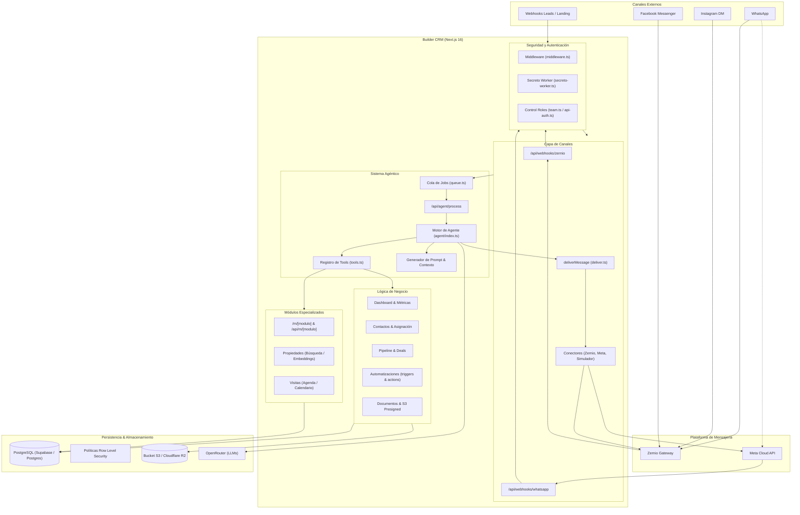
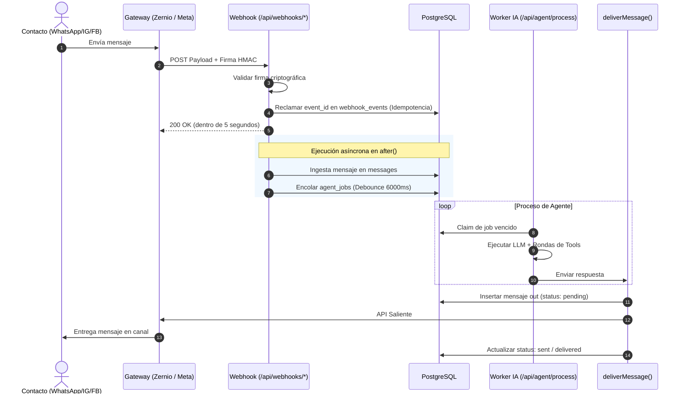
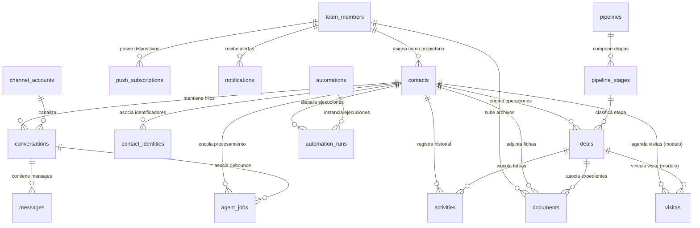
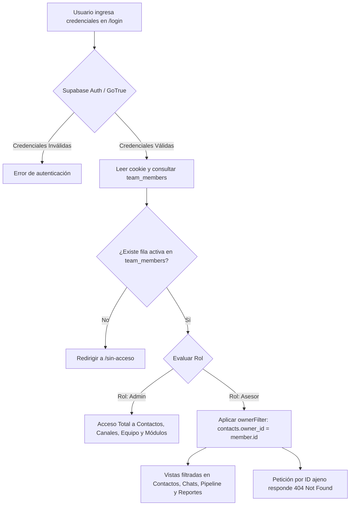
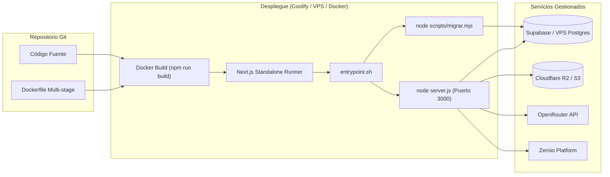

# AUDITORÍA INTEGRAL DE SOFTWARE — BUILDER CRM

---

## 1. RESUMEN EJECUTIVO

**Builder CRM** es una solución web multicanal de gestión de relaciones con clientes (CRM) concebida bajo el paradigma **"Single-Tenant per Client / Agent-First"**, diseñada para agencias de desarrollo e implementación de inteligencia artificial (nacida dentro de la comunidad *IA Builder Lab*). Su propósito central es permitir el despliegue de **una instancia aislada y dedicada por cada cliente**, dotada de una bandeja de entrada unificada (WhatsApp, Instagram DM y Facebook Messenger mediante Zernio o Meta Cloud API), un pipeline comercial drag-and-drop con etapas dinámicas, y un **agente conversacional autónomo** capaz de interactuar con clientes, calificar leads, actualizar campos personalizados, registrar actividades, transicionar etapas del pipeline, agendar citas o derivar la conversación a asesores humanos ante situaciones complejas.

El sistema se apoya en un principio de **inmutabilidad del núcleo** (*Core Immutability* regulado por `specs/CONSTITUCION.md`), donde todo el comportamiento estándar (`src/`, `supabase/migrations/`, `docker/`) permanece idéntico en todas las instalaciones, mientras que las adaptaciones de marca, flujos comerciales, campos de captura y módulos verticales (tales como catálogos inmobiliarios o agendas de visitas) se configuran de forma estrictamente declarativa en la "zona del cliente" (`config/cliente.ts`, `config/modulos.json` y `modules/<nombre>/`).

### Estado General de Madurez Técnica
- **Arquitectura:** **Excelente**. Diseño desacoplado, modularidad limpia con despacho dinámico de páginas y APIs en `/m/[modulo]` y `/api/m/[modulo]`, inyección en tiempo de ejecución de configuración pública (`src/lib/config-publica.ts`) que erradica la dependencia de compilación para variables de entorno de frontend.
- **Seguridad:** **Alta**. Modelo *fail-closed* estricto para rutas internas (`AGENT_WORKER_SECRET` validado con `timingSafeEqual`), autenticación desacoplada de Supabase Auth con rolización en base de datos (`team_members`), mitigación de auto-registro abusivo mediante trigger SQL que restringe el alta desatendida exclusivamente al primer administrador, y políticas de Row Level Security (RLS) en todas las tablas de PostgreSQL.
- **Operatividad:** **Funcional y Comprobada**. Cuenta con un modo de ejecución local de cero configuración (`npm run local`) basado en PGlite (PostgreSQL embebido en WebAssembly) con datos de demostración, y soporte de despliegue contenerizado en Docker y Coolify con ejecución automática de migraciones transaccionales en el arranque del contenedor.
- **Riesgos Principales:** Dependencia crítica de servicios externos para la operación completa (Zernio para mensajería omnicanal; OpenRouter para el agente de IA; bucket S3 para almacenamiento de documentos); falta de cola de mensajería distribuida persistente (el debounce y el procesamiento asíncrono descansan en la función `after()` de Next.js y barridos periódicos en base de datos); ausencia de pruebas automáticas de extremo a extremo (E2E) con emulación de navegador en el repositorio central.

---

## 2. IDENTIFICACIÓN DEL PROYECTO

| Atributo | Detalle Técnico |
|---|---|
| **Nombre Real del Producto** | Builder CRM (identificador de paquete: `builder-crm`) |
| **Versión Auditada** | `2.1.0` (según `package.json`) |
| **Repositorio / Rama** | `origin/develop` |
| **Licencia** | MIT (Copyright (c) 2026 Diego Vásquez; aviso de atribución en `NOTICE` a favor de `auto-crm` y `vocero-crm`) |
| **Tipo de Aplicación** | Aplicación Web Monolítica Full Stack (SSR/RSC/API Routes) y Progressive Web App (PWA) instalable |
| **Modelo Operativo** | Instancia única por cliente (*Dedicated Single-Tenant Instance*) |
| **Audiencia Objetivo** | Agencias de software/IA y sus clientes finales (equipos de venta, asesores comerciales, administradores de pymes, agentes inmobiliarios) |
| **Lenguaje Primario** | TypeScript 5 (Modo estricto activado) |

---

## 3. DESCRIPCIÓN GENERAL DEL PRODUCTO

### 3.1 Problema que Resuelve
Las pymes y negocios comerciales pierden leads por tiempos de respuesta tardíos en canales conversacionales masivos (WhatsApp, Instagram, Facebook), desorden en la gestión manual de múltiples números o bandejas, y falta de actualización oportuna de fichas de contacto y pipelines de venta por parte de asesores humanos. Los CRMs tradicionales suelen ser costosos, multi-inquilino rígidos o difíciles de adaptar a las particularidades de un nicho comercial sin incurrir en modificaciones invasivas de código.

### 3.2 Solución Implementada
Builder CRM suministra una plataforma autónoma donde:
1. **Unifica la atención:** Centraliza chats de WhatsApp, Instagram DM y Messenger en una bandeja en tiempo real con soporte de ventana de 24 horas y plantillas Meta pre-aprobadas.
2. **Automatiza la atención con IA:** Un agente impulsado por LLMs (vía OpenRouter) atiende inmediatamente, extrae datos clave, actualiza la ficha del contacto y progresa la oportunidad en el embudo comercial.
3. **Asegura la propiedad de los datos:** Cada cliente dispone de su propia base de datos Postgres (en Supabase cloud o autoalojada en VPS) y su contenedor independiente en Coolify o Docker.
4. **Desacopla la personalización:** La adaptación de marca, colores, etapas, preguntas del agente y módulos verticales (ej. propiedades, visitas) se efectúa mediante archivos de configuración estáticos y módulos aislados sin tocar el código fuente central.

---

## 4. STACK TECNOLÓGICO

```
[Cliente Web / PWA (React 19)]
           │
           ▼
[Next.js 16 (App Router / SSR / API Routes / Node.js 22)]
  ├── Autenticación: Supabase Auth / GoTrue + Cookies Seguras
  ├── ORM: Drizzle ORM (PostgreSQL Driver postgres-js)
  ├── Proveedor de IA: OpenAI SDK -> OpenRouter API
  ├── Conectividad Canales: Zernio SDK / Meta Graph API
  ├── Notificaciones: web-push (VAPID) + PWA Service Worker
  └── Almacenamiento: AWS SDK v3 S3 (Cloudflare R2 / MinIO)
           │
           ▼
[Base de Datos: PostgreSQL 15+ con Row Level Security]
  (Modo Local: PGlite Wasm Postgres en .local/db)
```

### Componentes de Software y Librerías

#### Frontend y UI
- **Framework React:** React `19.2.4` / React DOM `19.2.4`.
- **Framework Aplicación:** Next.js `16.4.3` (App Router, Server Components, Server Actions y Route Handlers).
- **Estilos y Diseño:** Tailwind CSS `4` (vía `@tailwindcss/postcss`), Radix UI / `@base-ui/react`, componentes `shadcn/ui`, `lucide-react` para iconografía, `tw-animate-css`.
- **Formularios y Validación:** `react-hook-form` `7.72.1` con `@hookform/resolvers` y `zod` `4.6.7`.
- **Gestión Drag and Drop:** `@dnd-kit/core` `6.3.1`, `@dnd-kit/sortable` `10.0.0`, `@dnd-kit/utilities` `3.2.2`.
- **Visualización y Gráficos:** `recharts` `3.8.1`.
- **Notificaciones UI:** `sonner` `2.0.7`.
- **Manejo de Fechas:** `date-fns` `4.1.0`.

#### Backend y Persistencia
- **Entorno de Ejecución:** Node.js 22 LTS en contenedores `node:22-alpine`.
- **Acceso a Datos / ORM:** `drizzle-orm` `0.45.2` y herramienta de generación `drizzle-kit` `0.31.10`.
- **Driver SQL:** `postgres` (postgres-js `3.4.9`) con soporte TLS forzado (`ssl: "require"`).
- **Base de Datos Local (Offline Dev):** `@electric-sql/pglite` `0.5.8` (PostgreSQL compilado a WebAssembly para ejecución local en `.local/db`).
- **Autenticación:** `@supabase/ssr` `0.10.2` y `@supabase/supabase-js` `2.105.3` (compatibles con Supabase Cloud o GoTrue autoalojado).

#### IA, Mensajería y Almacenamiento
- **Inteligencia Artificial:** `openai` `6.36.0` configurado con base URL dirigida a OpenRouter (`https://openrouter.ai/api/v1`).
- **Web Push:** `web-push` `3.6.7` (notificaciones nativas VAPID).
- **Almacenamiento S3:** `@aws-sdk/client-s3` `3.1134.0` y `@aws-sdk/s3-request-presigner` `3.1134.0`.
- **Google Auth Client:** `google-auth-library` `10.6.2`.

---

## 5. ARQUITECTURA Y DISEÑO DEL SOFTWARE

### 5.1 Diagrama de Arquitectura Global



### 5.2 Separación entre Núcleo, Configuración y Módulos
La arquitectura obedece al principio de separación estricta:
1. **Núcleo (`src/`):** Completamente agnóstico al nicho de negocio. No contiene nombres de clientes, modelos inmobiliarios hardcodeados ni reglas de calificación fijas.
2. **Zona del Cliente (`config/`):**
   - `config/cliente.ts`: Define la marca, colores, idioma, moneda, zona horaria IANA, etapas del pipeline, campos personalizados y prompt base del agente.
   - `config/modulos.json`: Lista los módulos de nicho habilitados (`"activos": [...]`).
3. **Módulos Verticales (`modules/`):**
   - Cada carpeta en `modules/` representa una extensión autocontenida con:
     - `manifiesto.ts`: Configuración para el navegador, elementos de menú y campos personalizados aportados.
     - `servidor.tsx`: Rutas de API, componentes de páginas, definición de herramientas (*tools*) para el agente y sembrado (*seed*).
     - `migrations/*.sql`: Esquema propio en base de datos.
     - `tabla.ts`: Esquemas tipados Drizzle.

### 5.3 Despacho Dinámico de Módulos
El App Router de Next.js delega a los módulos mediante rutas catch-all:
- **Páginas:** `src/app/m/[modulo]/[[...ruta]]/page.tsx` resuelve el módulo activo mediante `obtenerModulo(nombre)` y `resolverPagina(modulo, ruta)`.
- **Rutas de API:** `src/app/api/m/[modulo]/[[...ruta]]/route.ts` despacha peticiones `GET`, `POST`, `PUT`, `PATCH`, `DELETE` hacia los controladores declarados en el módulo, ejecutando previamente `requireMember()`.

---

## 6. ESTRUCTURA COMPLETA DE DIRECTORIOS

```
nest-crm/
├── .claude/                   # Configuración del arnés de asistencia y memoria local
├── .github/workflows/         # Pipelines de CI (typecheck, lint, test, build) y sweepers
├── .local/                    # Base de datos embebida PGlite (WebAssembly) para modo local
├── config/                    # ZONA DEL CLIENTE: Configuración de instancia y plantillas
│   ├── plantillas/            # Plantillas predefinidas (ej. inmobiliaria.ts)
│   ├── cliente.ts             # Configuración activa de la instancia
│   └── modulos.json           # Lista de módulos externos habilitados
├── docker/                    # Scripts de infraestructura y entrypoint de contenedor
├── docs/                      # Guías operativas (AGENTE, CORREO, GOOGLE-AUTH, VPS, MCP, AUDITORIA)
├── drizzle/                   # Metadatos generados por drizzle-kit
├── modules/                   # Módulos verticales especializados
│   ├── _plantilla/            # Esqueleto para la creación de nuevos módulos
│   ├── ejemplo/               # Módulo de tareas personales de demostración
│   ├── propiedades/           # Módulo inmobiliario: catálogo, búsqueda y embeddings
│   └── visitas/               # Módulo inmobiliario: agendamiento y calendario de visitas
├── public/                    # Archivos estáticos públicos, assets de marca y Service Worker
│   ├── marca/                 # Logotipo e icono de la instancia
│   └── sw.js                  # Service Worker para Push Notifications (sin intercepción fetch)
├── scripts/                   # Herramientas operativas CLI (migraciones, seed, admin, zernio)
│   └── lib/                   # Librerías de soporte para migraciones
├── specs/                     # Especificaciones funcionales y CONSTITUCION.md
│   ├── inmobiliaria/          # Especificaciones del nicho inmobiliario
│   └── nucleo/                # Especificaciones de arquitectura del sistema base
├── src/                       # NÚCLEO DEL SISTEMA (No modificable por cliente)
│   ├── app/                   # Páginas y API Routes (App Router)
│   │   ├── (vistas)/          # Dashboard, contactos, conversaciones, pipeline, etc.
│   │   ├── api/               # Endpoints REST (agent, channels, webhooks, auth, etc.)
│   │   ├── auth/              # Flujos de sesión, login, recuperación y establecimiento de clave
│   │   └── m/ & api/m/        # Despachadores dinámicos hacia módulos activos
│   ├── components/            # Componentes React (dashboard, chat, contactos, pipeline, etc.)
│   ├── db/                    # Instanciación de Drizzle ORM y esquemas relacionales
│   ├── lib/                   # Lógica de negocio (agente, canales, automaciones, seguridad)
│   └── types/                 # Definiciones globales de TypeScript
└── supabase/                  # Migraciones SQL del núcleo y políticas RLS
    └── migrations/            # Archivos de migración de esquema, RLS y triggers de administración
```

---

## 7. INVENTARIO COMPLETO DE FUNCIONALIDADES

### Matriz de Funcionalidades por Módulo

| Módulo / Función | Ubicación / Ruta | Modelos / Tablas | Estado | Limitaciones / Dependencias |
|---|---|---|---|---|
| **Dashboard Principal** | `/` (`src/app/page.tsx`) | `contacts`, `deals`, `pipeline_stages`, `activities` | **IMPLEMENTADA Y VALIDADA** | Consulta directa en servidor; filtra por `owner_id` para asesores. Muestra KPIs agregados en tiempo real. |
| **Carga de Datos Demo** | `/` (`components/dashboard/CargarDemo.tsx`) | `POST /api/seed/demo` | **IMPLEMENTADA** | Requiere rol `admin` o cabecera `AGENT_WORKER_SECRET`. Utiliza conector simulado. |
| **Directorio de Contactos** | `/contacts` (`src/app/contacts/page.tsx`) | `contacts`, `team_members` | **IMPLEMENTADA Y VALIDADA** | Búsqueda por texto (nombre, email, empresa), filtros por fuente. Vista paginada/tabla. |
| **Ficha de Contacto** | `/contacts/[id]` | `contacts`, `activities`, `deals`, `conversations`, `documents` | **IMPLEMENTADA Y VALIDADA** | Muestra datos generales, campos personalizados validados, historial de actividades y resumen de IA. Retorna 404 a asesores no propietarios. |
| **Gestor Documental** | `/contacts/[id]` (`components/contacts/DocumentSection.tsx`) | `documents` | **DEPENDIENTE** | Requiere S3 configurado (`S3_ENDPOINT`, `S3_BUCKET`, etc.). Usa presigned URLs (PUT/GET). Límite 20MB. |
| **Bandeja Multicanal** | `/conversations` | `conversations`, `messages`, `contacts`, `channel_accounts` | **IMPLEMENTADA Y VALIDADA** | Unifica WhatsApp, Instagram y Messenger. Polling en vivo en cliente (`ConversationsListLive`). Retorna 404 a hilos ajenos. |
| **Chat y Panel de Mensajes** | `/conversations/[id]` | `conversations`, `messages`, `contacts` | **IMPLEMENTADA Y VALIDADA** | Envío optimista vía `deliverMessage`. Cumple ventana 24h: para WhatsApp restringe a plantillas; para IG/Messenger exige tag `HUMAN_AGENT`. |
| **Pausa / Reactivación Agente** | `/conversations/[id]` (`PATCH /api/conversations/[id]/agente`) | `conversations` | **IMPLEMENTADA** | Permite pausar el agente por hilo específico sin deshabilitar al contacto en otros canales. |
| **Pipeline Kanban** | `/pipeline` (`src/app/pipeline/page.tsx`) | `pipelines`, `pipeline_stages`, `deals`, `contacts` | **IMPLEMENTADA Y VALIDADA** | Soporte Drag & Drop con `@dnd-kit`. Mueve etapas recalculando orden y disparando eventos de automatización (`deal.stage_changed`). |
| **Agente Autónomo de IA** | `src/lib/agent/index.ts` | `agent_jobs`, `contacts`, `conversations`, `messages`, `agent_configs` | **DEPENDIENTE** | Requiere `OPENROUTER_API_KEY`. Hasta 6 rondas de tools por turno. Control de debounce de 6s en cola de jobs. |
| **Motor de Automatizaciones** | `/automatizaciones` (`src/app/automatizaciones/page.tsx`) | `automations`, `automation_runs`, `contacts` | **IMPLEMENTADA** | Disparadores: `contact.created`, `contact.assigned`, `deal.stage_changed`. Acciones: `push`, `add_tag`, `remove_tag`, `assign_owner`, `create_activity`. |
| **Simulador de IA** | `/simulador` (`src/app/simulador/page.tsx`) | `contacts`, `conversations`, `messages`, `deals` | **IMPLEMENTADA** | Acceso exclusivo para administradores (`admin`). Ejecuta el agente de forma síncrona usando el conector en memoria `simulador`. |
| **Plantillas Meta WhatsApp** | `/plantillas` (`src/app/plantillas/page.tsx`) | `whatsapp_templates` | **DEPENDIENTE** | Sincroniza y crea plantillas contra Meta Graph API / Zernio. Requiere credenciales de WABA activas. |
| **Reportes y Analítica** | `/reportes` (`src/app/reportes/page.tsx`) | `contacts`, `conversations`, `messages`, `deals`, `pipeline_stages` | **IMPLEMENTADA Y VALIDADA** | Filtros por 7, 30 y 90 días. Métricas de conversión, tasa de cierre, tiempo de primera respuesta y distribución de orígenes salientes. |
| **Configuración Canales** | `/settings` (`components/settings/ChannelsSettings.tsx`) | `channel_accounts`, `whatsapp_accounts` | **CONFIGURABLE** | Visualiza estado de credenciales, sincronización de cuentas Zernio y cuentas de Meta Cloud API. |
| **Gestión de Equipo (RBAC)** | `/settings` (`components/settings/TeamSettings.tsx`) | `team_members`, `auth.users` | **IMPLEMENTADA** | Solo administradores. Invita asesores (vía GoTrue SMTP si `AUTH_ENVIA_CORREOS=true` o mediante contraseña manual), activa o desactiva usuarios. |
| **Notificaciones Web Push** | `/settings` (`components/settings/PushSettings.tsx`) | `push_subscriptions`, `notifications` | **DEPENDIENTE** | Requiere llaves VAPID configuradas. Registro de suscripciones por dispositivo mediante Service Worker (`public/sw.js`). |
| **Catálogo Inmobiliario (Módulo)** | `/m/propiedades` (`modules/propiedades/servidor.tsx`) | `propiedades` | **CONFIGURABLE** | Búsqueda por filtros SQL o búsqueda semántica vectorial (si `OPENAI_API_KEY` y pgvector están disponibles). Sincronización Tokko opcional. |
| **Agenda de Visitas (Módulo)** | `/m/visitas` (`modules/visitas/servidor.tsx`) | `visitas`, `contacts`, `deals` | **CONFIGURABLE** | Estados: coordinando, agendada, realizada, cancelada. Vistas de lista y calendario mensual. El agente puede agendar visitas preliminares. |

---

## 8. EXPLICACIÓN DETALLADA DE MÓDULOS DEL SISTEMA

### 8.1 Bandeja Multicanal e Ingesta de Mensajes
La bandeja multicanal procesa mensajes entrantes y salientes a través de una abstracción unificada:
- **Flujo de Entrada:**
  1. El proveedor externo invoca `POST /api/webhooks/zernio` o `/api/webhooks/whatsapp`.
  2. La petición valida criptográficamente la firma (`verifyZernioSignature` con HMAC SHA-256 o `X-Hub-Signature-256`).
  3. El webhook registra el evento en `webhook_events` para garantizar idempotencia. Si el evento ya existía, responde inmediatamente con código `200 OK`.
  4. La ingesta pesada corre dentro de `after()` de Next.js mediante `processZernioEvent`, resolviendo o creando el `contact` y la `conversation`, guardando el mensaje en `messages` y encolando un trabajo en `agent_jobs` con un debounce de 6.000 ms.
- **Flujo de Salida:**
  - Toda emisión (manual, automática o generada por el agente) invoca exclusivamente a `deliverMessage`.
  - Se genera un registro optimista en `messages` con estado `pending`.
  - El conector asociado (`zernio`, `meta` o `simulador`) ejecuta la llamada al proveedor. Si Meta o Zernio rechazan la entrega, el estado se actualiza a `failed` con su respectivo código de error (`errorMessage`).



### 8.2 Pipeline Comercial y Gestión de Oportunidades
- **Estructura:** Soporta múltiples pipelines (con uno marcado como predeterminado en `is_default=true`). Cada pipeline cuenta con etapas ordenadas secuencialmente (`pipeline_stages.order`).
- **Sincronización Declarativa:** Al arrancar o ejecutar `sincronizarPipeline()`, el sistema reconcilia las etapas definidas en `config/cliente.ts` con la base de datos utilizando la columna `key`. Si el usuario renombró visualmente una etapa, su identificador clave permanece estable.
- **Transición de Etapas:** Implementada en `src/lib/deals/stage.ts`. La función `setDealStage()` actualiza la etapa del negocio, crea registros en `activities` y emite el evento `deal.stage_changed` para disparar reglas de automatización.

### 8.3 Automatizaciones
El módulo de automatizaciones (`src/lib/automations/`) opera como un motor de reglas desacoplado:
- **Disparadores (*Triggers*):**
  - `contact.created`: Emitido al registrarse un nuevo contacto (manual, CSV o webhook).
  - `contact.assigned`: Emitido cuando cambia el `owner_id` de un contacto.
  - `deal.stage_changed`: Emitido cuando una oportunidad comercial cambia de etapa.
- **Filtros:** Evaluación en memoria de operadores lógicos (`eq`, `neq`, `in`) sobre los metadatos del evento (ej. canal, fuente, etapa origen, asesor asignado).
- **Acciones:**
  - `push`: Envía notificación push VAPID a los administradores, a un asesor puntual o al propietario asignado.
  - `add_tag` / `remove_tag`: Agrega o elimina etiquetas en el arreglo `contacts.tags`.
  - `assign_owner`: Asigna el contacto a un miembro del equipo mediante `assignContact()`.
  - `create_activity`: Inserta una tarea o nota con fecha relativa en `activities`.
- **Control de Ciclos:** El payload de los eventos incluye un contador `__depth`. Si una acción encadenada supera una profundidad máxima de 3 (`MAX_EVENT_DEPTH = 3`), el motor aborta el procesamiento para prevenir bucles infinitos.

---

## 9. MODELOS Y ENTIDADES (PERSISTENCIA DE DATOS)

El esquema de datos está gestionado mediante Drizzle ORM sobre PostgreSQL con extensiones relacionales y soporte para tipos avanzados (`jsonb`, arrays de texto y `vector` para embeddings).

### 9.1 Inventario de Tablas del Núcleo

#### `contacts` (Contactos)
- **Propósito:** Registro maestro de personas y leads comerciales.
- **Campos Principales:**
  - `id` (text, PK, UUID v4).
  - `name` (text, not null).
  - `email` (text), `phone` (text), `company` (text).
  - `source` (text, default "otro").
  - `score` (integer, default 0).
  - `tags` (text[], default empty array).
  - `custom_fields` (jsonb, default `{}`): Almacena pares clave-valor según la configuración declarativa en `config/cliente.ts`.
  - `ai_summary` (text), `ai_summary_at` (timestamptz): Resumen ejecutivo redactado por el agente de IA.
  - `ai_enabled` (boolean, default true): Kill-switch global del agente para el contacto.
  - `needs_human` (boolean, default false), `needs_human_reason` (text), `needs_human_at` (timestamptz).
  - `owner_id` (uuid, FK `team_members.id`, `onDelete: set null`): Asesor responsable. Clave de aislamiento de visibilidad.
  - `tenant_id` (uuid, FK `tenants.id`).
  - `created_at`, `updated_at` (timestamptz).

#### `conversations` (Conversaciones / Hilos)
- **Propósito:** Agrupa los mensajes de un canal específico para un contacto. Un contacto puede poseer múltiples hilos (uno para WhatsApp y otro para Instagram).
- **Campos:** `id` (text, PK), `contact_id` (text, FK `contacts.id`, cascade), `account_id` (uuid, FK `channel_accounts.id`), `channel` (text: whatsapp, instagram, facebook), `provider` (text: zernio, meta, simulador), `external_id` (text, not null), `participant_id` (text), `participant_name` (text), `last_inbound_at` (timestamptz), `ai_enabled` (boolean, default true), `needs_human` (boolean), `metadata` (jsonb para atribución publicitaria CTWA).
- **Restricción Única:** `(provider, external_id)`.

#### `messages` (Mensajes)
- **Propósito:** Historial unificado de mensajes entrantes y salientes de todos los canales.
- **Campos:** `id` (text, PK), `contact_id` (text, FK `contacts.id`), `conversation_id` (text, FK `conversations.id`, cascade), `channel` (text), `provider` (text), `direction` (text: "in" o "out"), `origin` (text: "agent", "human", "template", "webhook"), `type` (text: "text", "template"), `body` (text), `external_id` (text), `status` (text: "received", "pending", "sent", "failed"), `error_message` (text), `sent_at`, `delivered_at`, `read_at` (timestamptz).

#### `pipelines` y `pipeline_stages` (Pipelines y Etapas)
- **Propósito:** Estructuración del embudo comercial kanban.
- **Campos `pipelines`:** `id` (text, PK), `name` (text), `is_default` (boolean), `order` (integer).
- **Campos `pipeline_stages`:** `id` (text, PK), `pipeline_id` (text, FK `pipelines.id`, cascade), `key` (text: clave técnica de configuración), `name` (text), `order` (integer), `color` (text), `is_won` (boolean), `is_lost` (boolean).
- **Restricción Única:** `(pipeline_id, key)`.

#### `deals` (Operaciones / Negocios)
- **Propósito:** Oportunidad económica asociada a un contacto dentro de una etapa del pipeline.
- **Campos:** `id` (text, PK), `title` (text), `value` (integer: montos monetarios en **centavos**), `stage_id` (text, FK `pipeline_stages.id`), `contact_id` (text, FK `contacts.id`, cascade), `expected_close` (timestamptz), `probability` (integer 0-100), `notes` (text).

#### `activities` (Actividades y Tareas)
- **Propósito:** Registro cronológico de notas, llamadas, reuniones y seguimientos.
- **Campos:** `id` (text, PK), `type` (text: "note", "follow_up", "call", "meeting", "email"), `description` (text), `contact_id` (text, FK `contacts.id`, cascade), `deal_id` (text, FK `deals.id`), `scheduled_at`, `completed_at` (timestamptz).

#### `team_members` (Miembros del Equipo)
- **Propósito:** Extensión de `auth.users` de Supabase para gestión de roles internos y estado activo.
- **Campos:** `id` (uuid, PK coincidente con `auth.users.id`), `email` (text, unique), `name` (text), `role` (text: "admin" | "asesor"), `active` (boolean, default true).

#### `agent_jobs` (Cola de Ejecución del Agente)
- **Propósito:** Tareas encoladas con debounce para procesamiento diferido del LLM.
- **Campos:** `id` (text, PK), `contact_id` (text, FK `contacts.id`, cascade), `conversation_id` (text, FK `conversations.id`, cascade), `status` (text: "pending", "processing", "done", "failed"), `process_after` (timestamptz), `attempts` (integer), `error` (text).

#### `automations` y `automation_runs` (Automatizaciones)
- **Propósito:** Definición de reglas y registro de ejecuciones/cola de automatizaciones.
- **Campos `automations`:** `key` (text, PK), `name` (text), `trigger` (text), `enabled` (boolean), `filters` (jsonb), `actions` (jsonb), `source` (text: "user" | "seed").
- **Campos `automation_runs`:** `id` (uuid, PK), `automation_key` (text, FK `automations.key`), `trigger` (text), `contact_id` (text, FK `contacts.id`), `status` (text: "pending", "processing", "done", "skipped", "failed"), `payload` (jsonb), `result` (jsonb), `error` (text).

#### `webhook_events` (Idempotencia de Mensajería)
- **Propósito:** Registro estricto de eventos entrantes de proveedores externos para absorción de reintentos at-least-once.
- **Campos:** `event_id` (text, PK), `provider` (text), `event` (text), `status` (text: "received", "processed", "ignored", "failed"), `payload` (jsonb), `error` (text), `attempts` (integer).

#### `push_subscriptions` y `notifications` (Notificaciones)
- **Propósito:** Suscripciones VAPID del navegador y notificaciones internas de campanita.
- **Campos `push_subscriptions`:** `id` (uuid, PK), `member_id` (uuid, FK `team_members.id`), `endpoint` (text), `p256dh` (text), `auth` (text), `user_agent` (text).
- **Campos `notifications`:** `id` (uuid, PK), `member_id` (uuid, FK `team_members.id`), `kind` (text), `title` (text), `body` (text), `url` (text), `read_at` (timestamptz).

#### `documents` (Fichas de Documentos)
- **Propósito:** Metadatos de archivos adjuntos subidos al bucket S3.
- **Campos:** `id` (uuid, PK), `contact_id` (text, FK `contacts.id`), `deal_id` (text, FK `deals.id`), `name` (text), `mime` (text), `size` (integer), `storage_key` (text, unique), `status` (text: "pending" | "ready"), `uploaded_by` (uuid, FK `team_members.id`).

---

## 10. DIAGRAMA ENTIDAD-RELACIÓN (MERMAID)



---

## 11. FLUJOS PRINCIPALES DEL SISTEMA

### 11.1 Flujo de Autenticación, Roles y Aislamiento de Cartera



---

## 12. FUNCIONAMIENTO DEL AGENTE DE INTELIGENCIA ARTIFICIAL

El agente conversacional está implementado en `src/lib/agent/index.ts` y utiliza el cliente oficial de OpenAI adaptado para la API de **OpenRouter**.

### 12.1 Parámetros de Operación
- **Límite de Historial:** Carga hasta los últimos 30 mensajes del hilo específico (`HISTORY_LIMIT = 30`). Los mensajes consecutivos en una misma dirección se colapsan para optimizar la ventana de contexto.
- **Rondas de Herramientas:** Máximo 6 rondas iterativas de tool calling por invocación (`MAX_TOOL_ROUNDS = 6`).
- **Debounce de Mensajes en Ráfaga:** 6 segundos (`DEBOUNCE_MS = 6000`). Si el usuario envía múltiples mensajes seguidos en el mismo canal, el job extiende su temporizador `process_after` para procesar todo el bloque junto.
- **Modelo LLM Predeterminado:** Configurable por variable de entorno `AGENT_MODEL` (por defecto `google/gemini-2.5-flash`), con soporte para modelos alternativos como `anthropic/claude-sonnet-4.5` o `openai/gpt-5-mini`.

### 12.2 Construcción del Prompt y Contexto Dinámico
El prompt del sistema se compone en cascada:
1. **Plantilla Base:** Definida en `agent_configs[canal]` -> `crm_settings` -> `config.agente.prompt` -> prompt por defecto en código.
2. **Reemplazo de Variables:** Sustituye `{{agente}}`, `{{negocio}}`, `{{canal}}` y `{{fecha}}` (calculada según la `zonaHoraria` IANA configurada, evitando confusiones temporales nocturnas).
3. **Guía de Canal (*Channel Hints*):** Adapta la longitud y estilo (ej. respuestas ultra cortas sin URLs largas para Instagram DM vs. párrafos fluidos para WhatsApp).
4. **Bloque `# CONTEXTO`:**
   - Nombre, email y teléfono del cliente.
   - Datos personalizados conocidos y lista de campos que faltan averiguar según `config/cliente.ts`.
   - Resumen previo del lead (`ai_summary`).
   - Etapa comercial actual y catálogo de etapas del pipeline.
5. **Bloque `# EQUIPO`:** Lista de asesores disponibles para la herramienta `asignar_asesor`.

### 12.3 Inventario Individual de Herramientas del Agente

| Herramienta (*Tool Name*) | Descripción y Alcance | Datos que Modifica / Genera |
|---|---|---|
| `mover_etapa` | Transiciona la oportunidad del contacto a una nueva etapa del pipeline. Si el contacto no tiene una oportunidad abierta, la crea automáticamente. | Actualiza o inserta en `deals`, registra nota explicativa en `activities`. |
| `actualizar_contacto` | Almacena datos descubiertos durante la conversación (nombre, correo, teléfono, notas y campos personalizados validados). | Modifica columnas de `contacts` y el objeto `custom_fields`. |
| `registrar_actividad` | Genera una tarea, llamada, reunión o nota con fecha estimada para seguimiento del equipo. | Inserta fila en `activities` con prefijo `[IA]`. |
| `resumen_lead` | Condensa en 2 a 4 frases los requerimientos, presupuesto y situación del lead al concluir una fase útil. | Actualiza `contacts.ai_summary`, `ai_summary_at` y genera nota en `activities`. |
| `derivar_asesor` | Marca la conversación para atención humana y **pausa al agente exclusivamente en ese hilo**. | Modifica `conversations.ai_enabled = false`, `conversations.needs_human = true`, despacha mensaje de despedida/espera y detiene el loop de IA. |
| `asignar_asesor` | Asigna el contacto a un asesor por nombre (con tolerancia a acentos y coincidencias ambiguas). | Ejecuta `assignContact()`, actualiza `contacts.owner_id` y emite evento `contact.assigned`. |
| `buscar_info_propiedades` *(Módulo propiedades)* | Consulta información pública de una propiedad puntual por dirección, código o link externo. | Consulta catálogo `propiedades`; etiqueta al contacto con la propiedad en `contacts.tags`. |
| `buscar_propiedades` *(Módulo propiedades)* | Búsqueda multicriterio (tipo, operación, precio mín/máx, dormitorios, barrio). | Ejecuta búsqueda vectorial por embeddings (OpenAI) o filtros relacionales SQL. |
| `agendar_visita` *(Módulo visitas)* | Registra la intención confirmada de visitar un inmueble en estado preliminar `coordinating`. | Inserta registro en tabla `visitas` y crea nota en `activities`. |

---

## 13. INTEGRACIONES EXTERNAS Y ECOSISTEMA

| Servicio / Integración | Propósito | Archivos Clave | Dirección | Autenticación / Requisitos | Estado |
|---|---|---|---|---|---|
| **Supabase Postgres** | Base de datos relacional y ejecución RLS | `src/db/index.ts`, `supabase/` | Bidireccional | `DATABASE_URL`, `DIRECT_URL`, TLS obligatorio | **OPERATIVO** |
| **Supabase Auth / GoTrue** | Autenticación de usuarios, login, reseteo de claves | `src/lib/supabase/*`, `src/lib/auth-correo.ts` | Servidor -> Supabase | `NEXT_PUBLIC_SUPABASE_URL`, `NEXT_PUBLIC_SUPABASE_ANON_KEY`, `SUPABASE_SERVICE_ROLE_KEY` | **OPERATIVO** |
| **OpenRouter** | Gateway de inferencia para LLMs del agente | `src/lib/agent/openrouter.ts` | Saliente (HTTPS) | `OPENROUTER_API_KEY`, variable `AGENT_MODEL` | **OPERATIVO** |
| **Zernio** | Gateway omnicanal (WhatsApp, Instagram DM, Messenger) | `src/lib/channels/conectores/zernio.ts`, `src/lib/zernio/*` | Bidireccional (Webhook + API REST) | `ZERNIO_API_KEY`, `ZERNIO_WEBHOOK_SECRET` (HMAC SHA-256) | **OPERATIVO** |
| **Meta Cloud API** | Conexión directa alternativa con WhatsApp Business API | `src/lib/channels/conectores/meta-cloud.ts`, `src/lib/meta-whatsapp.ts` | Bidireccional | `WHATSAPP_ACCESS_TOKEN`, `WHATSAPP_PHONE_NUMBER_ID`, `WHATSAPP_APP_SECRET` | **PARCIAL** (Ingesta en endpoint legacy) |
| **Cloudflare R2 / AWS S3** | Almacenamiento presignado de documentos de contacto | `src/lib/storage.ts`, `src/app/api/documents/` | Browser -> S3 (Presigned PUT/GET) | `S3_ENDPOINT`, `S3_BUCKET`, `S3_ACCESS_KEY_ID`, `S3_SECRET_ACCESS_KEY` | **OPERATIVO** |
| **Web Push (VAPID)** | Notificaciones push móviles y desktop a través de navegadores | `src/lib/push.ts`, `public/sw.js` | Servidor -> Push Service (Google/Apple) | `NEXT_PUBLIC_VAPID_PUBLIC_KEY`, `VAPID_PRIVATE_KEY`, `VAPID_SUBJECT` | **OPERATIVO** |
| **OpenAI (Embeddings)** | Generación de vectores para búsqueda semántica inmobiliaria | `modules/propiedades/lib/embeddings.ts` | Saliente (HTTPS) | `OPENAI_API_KEY` (modelo `text-embedding-3-small`) | **OPCIONAL** (Fallback a filtros SQL) |
| **Tokko Broker** | Sincronización de catálogo inmobiliario externo | `modules/propiedades/lib/tokko.ts`, `scripts/sync-tokko.ts` | Entrante (API REST) | `TOKKO_API_KEY` | **OPCIONAL** |
| **Firecrawl** | Extracción web estructurada de publicaciones inmobiliarias | `modules/propiedades/lib/firecrawl.ts` | Saliente (HTTPS) | `FIRECRAWL_API_KEY` | **OPCIONAL** |

---

## 14. AUDITORÍA DE SEGURIDAD ESTÁTICA

### 14.1 Análisis de Puntos Críticos y Hallazgos

#### 1. Aislamiento de Cartera entre Asesores (IDOR)
- **Estado:** **SÓLIDO**.
- **Evidencia:** Las consultas en route handlers y Server Components no confían en parámetros de URL. Se aplica sistemáticamente `ownerFilter(member)` que inyecta `eq(contacts.ownerId, member.id)` a nivel SQL. En rutas por identificador puntual (`/contacts/[id]`, `/conversations/[id]`, `/api/deals/[id]`), se valida `canAccessContactId()`. Si el registro pertenece a otro asesor, el sistema responde **404 Not Found** en lugar de 403, evitando ataques de enumeración.

#### 2. Protección de Rutas Internas de Procesamiento
- **Estado:** **SÓLIDO (Fail-Closed)**.
- **Evidencia:** `src/lib/secreto-worker.ts`. Las rutas `/api/agent/process`, los sweepers de automatizaciones y el seeder están excluidas del middleware de login pero exigen obligatoriamente la cabecera `Authorization: Bearer <AGENT_WORKER_SECRET>` o `x-agent-secret`. La comparación se realiza en tiempo constante mediante `crypto.timingSafeEqual` previo chequeo de longitud. Si `AGENT_WORKER_SECRET` no está configurada, la función retorna `false` inmediatamente y `/api/health` emite un estado de error 503.

#### 3. Autenticación y Mitigación de Registros No Autorizados
- **Estado:** **CORRECTO**.
- **Evidencia:** En la migración `20261003010000_alta_solo_del_primer_admin.sql`, el trigger sobre `auth.users` (`alta_miembro_desde_auth`) verifica si ya existe al menos un miembro en `team_members`. Una vez creado el primer administrador, cualquier usuario adicional que invoque directamente el endpoint público de registro de Supabase Auth es ignorado por el trigger, carece de fila en `team_members` y queda bloqueado en la vista `/sin-acceso`.

#### 4. Validación Criptográfica de Webhooks
- **Estado:** **SÓLIDO**.
- **Evidencia:** `src/lib/zernio/webhooks.ts` valida HMAC SHA-256 sobre el cuerpo bruto (*raw body*). Si no se define `ZERNIO_WEBHOOK_SECRET`, el conector opera en modo *fail-closed* rechazando cualquier petición.

#### 5. Exposición de Secretos y Variables al Navegador
- **Estado:** **SÓLIDO**.
- **Evidencia:** El cliente frontend no lee directamente `process.env`. Las variables públicas (`NEXT_PUBLIC_SUPABASE_URL`, `NEXT_PUBLIC_SUPABASE_ANON_KEY`) se inyectan en tiempo de ejecución en el DOM mediante un bloque JSON seguro (`src/lib/config-publica.ts`) en el layout raíz. `SUPABASE_SERVICE_ROLE_KEY`, `OPENROUTER_API_KEY`, credenciales S3 y secretos de webhooks nunca se empaquetan en el bundle cliente.

#### 6. Seguridad en Políticas Row Level Security (RLS)
- **Estado:** **CORRECTO**.
- **Evidencia:** `supabase/migrations/20261001000100_rls.sql`. El rol `anon` tiene revocado todo privilegio sobre tablas, secuencias y funciones del esquema `public`. El rol `authenticated` solo posee permisos de lectura (`SELECT`) estrictamente regulados por funciones `security definer` (`contacto_visible`, `es_admin`, `es_miembro`). Las mutaciones de datos del CRM se realizan vía Drizzle utilizando el rol de conexión directa `postgres` (bypassing RLS), de modo que la API pública REST de Supabase no puede ser utilizada para alterar registros.

### 14.2 Matriz de Hallazgos y Riesgos de Seguridad

| ID | Hallazgo | Severidad | Ubicación | Impacto Potencial | Recomendación |
|---|---|---|---|---|---|
| **SEC-01** | Tokens de acceso de WhatsApp Meta guardados en texto plano | **Media** | `src/db/schema.ts` (`whatsapp_accounts.accessToken`) | Si un atacante compromete la base de datos con permisos de superusuario, obtendría el token de la cuenta WABA. | Implementar cifrado simétrico en reposo (AES-256-GCM) a nivel aplicación antes de persistir tokens de terceros. |
| **SEC-02** | Ausencia de Rate Limiting en endpoints públicos de webhooks | **Media** | `src/app/api/webhooks/leads/route.ts` | Posibilidad de denegación de servicio (DoS) o consumo excesivo de base de datos por bombardeo de peticiones. | Implementar rate limiting por IP o token (ej. Upstash / Redis o bucket en memoria) en middleware para `/api/webhooks/*`. |
| **SEC-03** | Falta de aislamiento multi-tenant estricto en tablas compartidas | **Informativa** | `src/db/schema.ts` (`tenants.id` opcional) | Preparado para arquitectura de instancia única por cliente; si se intenta utilizar una sola base de datos para múltiples clientes sin RLS multi-tenant, existiría riesgo de filtrado. | Mantener la regla arquitectónica fundamental de **una instancia y una base de datos por cliente**. |

---

## 15. CALIDAD DEL CÓDIGO Y DEUDA TÉCNICA

### 15.1 Evaluación de Estructura y Mantenibilidad
- **Cohesión y Acoplamiento:** Muy bien estructurado. Las utilidades de canales (`conector.ts`, `deliver.ts`, `ingest.ts`) están limpiamente desacopladas de las vistas.
- **Tipado TypeScript:** Riguroso. Modo estricto habilitado en `tsconfig.json`. Muy bajo uso de `any` no tipado (restringido principalmente a deserialización inicial de JSON de webhooks antes de validación).
- **Control de Incompatibilidades de Driver:** Implementación defensiva en `src/db/index.ts` para normalizar las diferencias entre el driver de producción `postgres-js` (que devuelve un array directo de filas) y el driver embebido de desarrollo `@electric-sql/pglite` (que devuelve `{ rows: [...] }`), evitando errores silenciosos en consultas agregadas.
- **Manejo de Fechas en Consultas SQL:** Cumple con la convención de no inyectar objetos `Date` nativos en `db.execute(sql\`...\`)`, serializando a cadenas ISO con cast explícito (`${fecha.toISOString()}::timestamptz`) para evitar excepciones del driver.

### 15.2 Deuda Técnica Identificada
1. **Conector Meta Cloud API Parcial:** `src/lib/channels/conectores/meta-cloud.ts` implementa el envío pero no el webhook del nuevo contrato; la ingesta de Meta continúa residiendo en la ruta heredada `src/app/api/webhooks/whatsapp/route.ts`.
2. **Dependencias del Proyecto Original:** Existen scripts heredados (`scripts/connect-whatsapp-account.ts`) y tablas (`whatsappAccounts`) originarias del proyecto base `auto-crm` que coexisten con la nueva arquitectura multicanal de Zernio.

---

## 16. TESTING Y CONTROL DE CALIDAD (QA)

### 16.1 Suite de Pruebas Unitarias
El proyecto utiliza **Vitest** (`vitest.config.mts`) para pruebas rápidas de invariantes críticos que fallan en silencio:
- `tests/acceso-por-rol.test.ts`: Valida que `ownerFilter()` devuelva `undefined` exclusivamente para el administrador y siempre filtre por `owner_id = member.id` para asesores.
- `tests/firma-webhook.test.ts`: Valida verificación de firmas HMAC SHA-256 de Zernio, comportamiento *fail-closed* ante falta de secreto y resistencia a firmas malformadas.
- `tests/ventana-24h.test.ts`: Comprueba la regla de ventana de 24 horas y etiquetado `HUMAN_AGENT` en base a `last_inbound_at`.
- `tests/secreto-worker.test.ts`: Valida autorización de procesos internos y comparación segura de cadenas.
- `tests/config-cliente.test.ts`: Valida el esquema de configuración del cliente con Zod.
- `tests/config-publica.test.ts`: Verifica serialización segura para el navegador.
- `tests/plantillas-correo.test.ts`: Valida integridad de plantillas de acceso GoTrue.
- `tests/zona-horaria.test.ts`: Valida formateo de fechas con IANA timezones.

### 16.2 Script de Autoverificación de Instancia
`scripts/verificar-instancia.mjs` funciona como el gate de aceptación en despliegue (Principio III de la Constitución), validando de punta a punta:
1. Healthcheck (`/api/health`).
2. Login real contra Supabase Auth y validación de membresía en `/api/team/me`.
3. Verificación de marca corporativa en manifest y metadata.
4. Consulta de estado y consistencia de pipeline.
5. Inyección de conversación de prueba mediante el simulador, comprobando respuesta del agente LLM y avance automático de etapa en el pipeline.
6. Comprobación de estado operativo de módulos activos.

---

## 17. INFRAESTRUCTURA, DESPLIEGUE Y OPERACIÓN



### 17.1 Dockerfile y Optimización de Construcción
- **Estructura Multi-Etapa:** 3 fases (`deps` -> `builder` -> `runner`).
- **Caché Eficiente:** Emplea `--mount=type=cache,target=/root/.npm` y `--mount=type=cache,target=/app/.next/cache` para acelerar reconstrucciones recurrentes en VPS.
- **Imagen Mínima de Ejecución:** La fase `runner` utiliza Alpine Linux con usuario no privilegiado (`app:app`), copiando solo los artefactos standalone generados por Next.js (`output: "standalone"` en `next.config.ts`), los scripts de migración y los módulos.
- **Entrypoint Robusto:** `docker/entrypoint.sh` ejecuta `node scripts/migrar.mjs` antes de arrancar `node server.js`. Si la base de datos tarda en iniciar, el script de migración reintenta hasta 15 veces (30 s).

### 17.2 Ambientes Operativos

| Característica | Modo Local (`npm run local`) | Desarrollo con Supabase | Producción (Coolify / Docker) |
|---|---|---|---|
| **Base de Datos** | PGlite (Wasm Postgres en `.local/db`) | Supabase Cloud / Postgres Remoto | Supabase Cloud o Postgres VPS |
| **Autenticación** | Sin login (Simula admin automático) | Supabase Auth (Email + Pass) | Supabase Auth / GoTrue |
| **Agente IA** | Requiere `OPENROUTER_API_KEY` | Requiere `OPENROUTER_API_KEY` | Requiere `OPENROUTER_API_KEY` |
| **Canales Reales** | No disponibles (Usa simulador) | Zernio / Webhooks vía Ngrok | Zernio / Meta Cloud directo con HTTPS |
| **Búsqueda Vectorial**| Deshabilitada (No soporta pgvector) | Disponible con extensión `vector` | Disponible con extensión `vector` |
| **Migraciones** | Automáticas al iniciar script | `npm run db:migrar` manual | Automáticas en `entrypoint.sh` |

---

## 18. RENDIMIENTO Y ESCALABILIDAD

### 18.1 Base de Datos y Consultas
- **Indexación:** Existen índices primarios y únicos sobre columnas críticas (`external_id`, claves compuestas de idempotencia).
- **Prevención de N+1:** Las consultas de listas en contactos, conversaciones y reportes emplean agregaciones SQL directas y sentencias `JOIN` en lugar de llamadas individuales iterativas.
- **Agregaciones de Reportes:** `src/lib/reportes.ts` consolida los cálculos estadísticos en una única batería concurrente de consultas SQL vía `Promise.all()`.

### 18.2 Concurrencia y Procesamiento Asíncrono
- **Next.js `after()`:** El webhook de Zernio responde en menos de 1 segundo liberando al proveedor y difiere la ingesta y encolado de jobs dentro del ciclo de vida asíncrono del servidor.
- **Barridos de Recuperación (*Sweepers*):** `src/lib/barridos.ts` ejecuta temporizadores internos en producción cada 30 minutos (configurable con `SWEEP_INTERVAL_MIN`) para reclamar jobs de agente y ejecuciones de automatización que hayan quedado en estado pendiente por interrupciones abruptas del proceso.

---

## 19. LIMITACIONES IDENTIFICADAS

1. **Ausencia de Cola Distribuida (Redis/BullMQ):** La gestión de tareas del agente y automatizaciones reside en tablas de PostgreSQL (`agent_jobs`, `automation_runs`) y temporizadores en memoria. Si bien es adecuado para el modelo de una instancia por cliente, no escala a cientos de mensajes simultáneos por segundo en una misma instancia.
2. **Modo Local Limitado:** El motor PGlite no soporta la extensión `pgvector`, impidiendo probar localmente la búsqueda semántica del módulo de propiedades sin una base de datos PostgreSQL real.
3. **Dependencia de Zernio para Instagram y Messenger:** El canal de Meta Cloud API directo solo soporta WhatsApp; Instagram DM y Messenger requieren obligatoriamente la suscripción y servicio de Zernio.
4. **Almacenamiento de Documentos Condicionado:** La subida de documentos exige la provisión de un bucket S3 compatible con políticas CORS configuradas; no existe almacenamiento de archivos local como respaldo.

---

## 20. PROBLEMAS Y RIESGOS PRIORIZADOS

### P0 — Críticos (Bloqueantes)
*No se detectaron problemas P0 en el código actual.* El sistema cuenta con salvaguardas *fail-closed* operativas.

### P1 — Altos (Atención Necesaria antes de Producción)
- **Riesgo P1-01:** Falta de cifrado en reposo para el token de acceso en `whatsapp_accounts` (`accessToken`). Si se utiliza la conexión Meta Cloud API directa, el token reside en texto plano en la base de datos.

### P2 — Medios (Estabilidad y Mantenibilidad)
- **Riesgo P2-01:** Ausencia de rate limiting en `/api/webhooks/leads`. Cualquier tercero que descubra o adivine la URL de leads podría enviar peticiones masivas si no se define `LEADS_WEBHOOK_SECRET`.
- **Riesgo P2-02:** Desincronización potencial en `config/modulos.json` vs. código generado. Si un desarrollador edita `config/modulos.json` a mano sin ejecutar `npm run modulos:registro`, los archivos generados de TypeScript pueden quedar desfasados hasta la siguiente compilación.

### P3 — Bajos (Mejoras Recomendadas)
- **Riesgo P3-01:** El conector Meta Cloud API se encuentra en estado parcial, manteniendo la ingesta en un endpoint separado (`/api/webhooks/whatsapp`) en lugar de consolidarse en la interfaz `WebhookConector`.

---

## 21. CAPACIDADES ACTUALES DEL PRODUCTO

1. **Operación Comercial Omnicanal:** Bandeja en tiempo real que permite alternar entre atención autónoma por IA y atención humana asistida por asesores en WhatsApp, Instagram y Facebook Messenger.
2. **Calificación y Enrutamiento Inteligente:** El agente interactúa en lenguaje natural, identifica el perfil del cliente, recopila campos específicos del negocio y mueve al cliente a través del embudo de ventas.
3. **Asignación Automática de Cartera:** Capacidad del agente o de reglas automáticas para derivar contactos a asesores comerciales específicos con notificación push inmediata al teléfono móvil.
4. **Seguridad y Privacidad de Datos:** Cada empresa cuenta con su base de datos aislada, control de acceso basado en roles (el asesor no ve contactos ajenos) y RLS estricto en la base de datos.
5. **Simulador Integrado:** Permite a los administradores probar en tiempo real las respuestas y herramientas del agente con guiones de prueba sin consumir mensajes de canales reales.
6. **Especialización Vertical Inmobiliaria:** Módulos listos para uso con catálogo de propiedades, búsqueda por filtros/embeddings y agenda de visitas presenciales.

---

## 22. POTENCIAL DE AMPLIACIÓN

Gracias a la arquitectura de módulos en `modules/` y la configuración desacoplada en `config/`:
- **Nuevas Plantillas de Nicho:** Posibilidad de crear plantillas declarativas para clínicas dentales (agenda de turnos de salud), concesionarias de vehículos (catálogo de autos y cotizaciones) o despachos legales (solicitud de antecedentes y expedientes).
- **Nuevos Conectores de Comunicación:** Se puede añadir soporte para Telegram, correo electrónico entrante o webchat en vivo creando un nuevo archivo en `src/lib/channels/conectores/` bajo la interfaz `Conector`.
- **Nuevas Acciones de Automatización:** Posibilidad de extender `src/lib/automations/actions.ts` para enviar webhooks salientes a Make/Zapier, disparar mensajes de WhatsApp salientes con plantillas o sincronizar con hojas de cálculo.

---

## 23. RECOMENDACIONES TÉCNICAS

1. **Unificar el Conector Meta:** Completar la interfaz `webhook` en `src/lib/channels/conectores/meta-cloud.ts` y transformar `/api/webhooks/whatsapp` en una llamada estandarizada a `manejarWebhook(metaCloud, req)`.
2. **Cifrado de Credenciales Externas:** Añadir una capa de cifrado simétrico (usando un secreto de aplicación) para columnas que almacenen tokens o llaves de terceros en la base de datos.
3. **Incorporar Pruebas E2E:** Agregar pruebas con Playwright en el CI para validar los flujos críticos de la interfaz (login, cambio de etapa en el kanban y envío de mensajes en el chat).
4. **Protección de Rate Limit:** Configurar un limitador de frecuencia de peticiones en Next.js Middleware para los endpoints públicos de webhooks.

---

## 24. EVALUACIÓN FINAL DEL ESTADO DEL PROYECTO

### 24.1 Matriz de Evaluación por Dimensión Técnica

| Dimensión | Estado de Madurez | Evaluación Técnica y Evidencia Comprobada |
|---|---|---|
| **Madurez Arquitectónica** | **Alta (9.5/10)** | Excelente desacoplamiento. Separación nítida entre núcleo inmutable (`src/`), configuración (`config/`) y módulos verticales (`modules/`). Manejo de configuración pública en tiempo de ejecución (`config-publica.ts`). |
| **Calidad de Código** | **Alta (8.8/10)** | Código limpio, TypeScript en modo estricto, constantes IANA para zonas horarias y manejo defensivo de diferencias entre drivers SQL (`postgres-js` vs `pglite`). |
| **Seguridad Comprobada** | **Fuerte en diseño (9.0/10)** | Modelo *fail-closed* estricto para procesos internos con `timingSafeEqual`, validación de firmas HMAC en webhooks, RLS habilitado en todas las tablas y mitigación de auto-registro abusivo en Supabase Auth. |
| **Base de Datos** | **Sólida (9.0/10)** | Esquema normalizado en Drizzle ORM con restricciones únicas de idempotencia, llaves foráneas consistentes y runner de migraciones transaccionales en arranque. |
| **Infraestructura** | **Funcional (9.0/10)** | Dockerfile multi-stage con capas de caché optimizadas, soporte de Coolify y modo local sin dependencias externas mediante Postgres Wasm (`pglite`). |
| **Pruebas Automatizadas** | **Parcial (7.5/10)** | Buena cobertura de pruebas unitarias con Vitest para invariantes silenciosos críticos (RBAC, webhooks, ventana 24h, tokens); **ausencia de suite E2E en CI**. |

### 24.2 Dictamen de Preparación Técnica y Condiciones Pendientes

> [!WARNING]
> **Dictamen Técnico:**\
> El proyecto presenta un **diseño arquitectónico de alta calidad y una base de código sólida**. Sin embargo, **no debe considerarse plenamente listo para producción a gran escala** hasta que se aborden formalmente los riesgos identificados en la auditoría y se completen las validaciones operativas en un entorno de despliegue real.

#### Condiciones Críticas Pendientes antes de Producción:
1. **Tokens de WhatsApp en Texto Plano (Riesgo P1-01 / SEC-01):** La columna `whatsapp_accounts.accessToken` almacena credenciales de Meta Graph API sin cifrado en reposo. Se requiere implementar cifrado simétrico (AES-256-GCM) a nivel aplicación antes de almacenar credenciales de clientes reales.
2. **Ausencia de Rate Limiting en Endpoints Públicos (Riesgo P2-01 / SEC-02):** `/api/webhooks/leads` y endpoints de recepción carecen de limitación de tasa, exponiendo la base de datos a sobrecarga por peticiones masivas.
3. **Falta de Pruebas de Extremo a Extremo (E2E):** El repositorio no cuenta con tests automatizados en navegador (Playwright/Cypress) que validen el flujo completo de sesión, manipulación del pipeline kanban y envío de mensajes.
4. **Validaciones Dinámicas de Despliegue Pendientes:**
   - Entrega y recepción efectiva de mensajes en dispositivos físicos a través de Zernio y Meta Cloud API.
   - Envío de notificaciones push móviles VAPID en sistemas iOS (APNs vía web) y Android.
   - Comportamiento de latencia y saturación del agente LLM bajo condiciones de concurrencia elevada.

---

## 25. VERIFICACIÓN FINAL DE SOLO LECTURA

En cumplimiento estricto con las restricciones innegociables de la auditoría:
1. **Estado del Repositorio:** El repositorio no sufrió ninguna alteración durante la fase de auditoría. Este documento se generó únicamente tras la confirmación y solicitud explícita del usuario para su integración como fuente del proyecto.
2. **Bases de Datos e Infraestructura:** No se ejecutaron migraciones de base de datos, no se alteraron esquemas ni registros, no se instalaron dependencias y no se realizaron llamadas de red a servicios de terceros.
3. **Áreas Examinadas Exhaustivamente:**
   - Estructura completa del repositorio y dependencias (`package.json`, configuraciones de TypeScript, Next.js, Docker y CI/CD).
   - Esquemas Drizzle (`src/db/schema.ts`, `modules/*/tabla.ts`) y migraciones SQL en `supabase/migrations/`.
   - Sistema agéntico, registro de herramientas (*tools*), debounce y promps (`src/lib/agent/*`).
   - Conectores de canales, ingesta, idempotencia y entrega (`src/lib/channels/*`).
   - Motor de automatizaciones, triggers, filtros y acciones (`src/lib/automations/*`).
   - Capa de seguridad, middleware, RLS y gestión de roles (`src/lib/api-auth.ts`, `src/lib/secreto-worker.ts`, `src/lib/team.ts`, `supabase/migrations/*rls*`).
   - Módulos verticales (`modules/propiedades`, `modules/visitas`, `modules/ejemplo`).
   - Configuración declarativa del cliente y plantillas (`config/cliente.ts`, `config/plantillas/inmobiliaria.ts`).
   - Suite de pruebas de invariantes (`tests/*`).
4. **Aspectos que Requieren Validación Dinámica en Despliegue:**
   - La entrega efectiva de mensajes salientes hacia terminales móviles reales a través de Zernio o Meta Cloud API.
   - El envío y recepción de notificaciones push VAPID en dispositivos físicos iOS y Android.
   - La latencia y tiempos de respuesta de los modelos LLM en OpenRouter bajo condiciones de concurrencia elevada.
