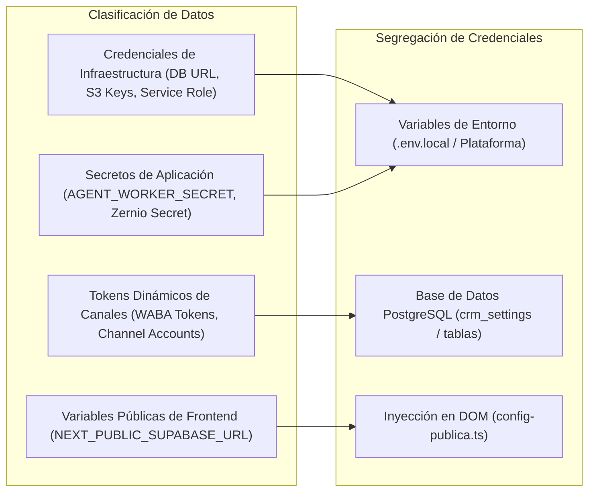

# Nest CRM — Arquitectura de Configuración y Precedencia

**Versión del documento**: 2.1.0\
**Fecha de actualización**: 2026-11-09\
**Estado**: Documento rector del sistema de configuración\
**Ubicación de referencia**: `config/` y `src/lib/config/`\

---

## 1. Convenciones de Clasificación del Documento

- **[ACTUAL COMPROBADA]**: Funcionalidad implementada y verificada en el código.
- **[OBJETIVO APROBADO]**: Decisión arquitectónica aprobada, en especificación o planificación formal.
- **[PENDIENTE DE DECISIÓN]**: Propuesta técnica sujeta a análisis.
- **[NO IMPLEMENTADA]**: Diseñada conceptualmente pero sin código en el repositorio.

---

## 2. Los Cuatro Niveles de Configuración

Para compatibilizar la inmutabilidad del código fuente con la personalización profunda de cada cliente, la arquitectura define conceptualmente cuatro niveles de configuración con precedencia jerárquica estricta:

```
┌─────────────────────────────────────────────────────────────────┐
│ Nivel 4 — Personalizaciones Particulares de la Empresa          │
│ (Ajustes manuales: nombre comercial, campos extra, prompt fino) │ ◀── Máxima Prioridad
├─────────────────────────────────────────────────────────────────┤
│ Nivel 3 — Configuración de la Instalación                       │
│ (Moneda operativa, zona horaria IANA, módulos activos)          │
├─────────────────────────────────────────────────────────────────┤
│ Nivel 2 — Valores Predeterminados de la Plantilla Sectorial     │
│ (Defaults de industria: etapas de venta, campos sectoriales)    │
├─────────────────────────────────────────────────────────────────┤
│ Nivel 1 — Valores Base del Núcleo (Core Defaults)               │
│ (Idioma 'es', moneda 'USD', etapas mínimas, prompts seguros)   │ ◀── Mínima Prioridad
└─────────────────────────────────────────────────────────────────┘
```

### 2.1 Definición y Responsabilidades de Cada Nivel:

| Nivel | Denominación | Responsabilidad y Alcance | Fuente Conceptual |
|---|---|---|---|
| **1** | **Base del Núcleo** | Provee fallbacks mínimos e invariantes del sistema para que el CRM arranque de forma segura si no existen otros valores. | Esquemas en `src/lib/config/schema.ts` y constantes del núcleo. |
| **2** | **Predeterminados de Plantilla** | Aporta la estructura comercial y los flujos recomendados para un sector industrial concreto. | Definición declarativa `TemplateDefinition`. |
| **3** | **Instalación** | Establece los parámetros operativos propios de la instancia de la empresa (zona horaria IANA, moneda, módulos habilitados). | Parámetros del entorno y registro de instalación. |
| **4** | **Personalización Particular** | Almacena los ajustes específicos que la empresa modificó libremente desde su panel de gestión (etiquetas renombradas, campos añadidos). | Procedencia identificada como personalización de cliente. |

---

## 3. Estado Real de la Configuración en el Código

Es fundamental contrastar el modelo conceptual con la implementación existente:

### 3.1 Implementación Actual Comprobada [ACTUAL COMPROBADA]
- La configuración se resuelve de forma estática en tiempo de ejecución de Node.js mediante `src/lib/config/index.ts`.
- `config/cliente.ts` importa manualmente una plantilla (ej. `import { plantillaInmobiliaria } from "./plantillas/inmobiliaria"`) y exporta un objeto TypeScript unificado con `definirConfig({...})`.
- `src/lib/config/index.ts` ejecuta `validar()` contra el esquema Zod `esquemaConfig` (`src/lib/config/schema.ts`) una vez por proceso.
- Se concatenan los campos declarados en `config/cliente.ts` con los aportados por los módulos en `manifiesto.campos`.
- **No existe hoy un algoritmo de merge dinámico de cuatro niveles en tiempo de ejecución.**

### 3.2 Arquitectura Objetivo de Reconciliación [OBJETIVO APROBADO / NO IMPLEMENTADA]
- En la arquitectura objetivo, la configuración efectiva se resolverá mediante un reconciliador jerárquico que combinará los cuatro niveles:
  1. Base del núcleo (valores por defecto).
  2. Plantilla seleccionada.
  3. Parámetros de instalación en base de datos (`crm_settings`).
  4. Personalizaciones de cliente identificadas por su procedencia en base de datos.
- Las personalizaciones no requieren residir obligatoriamente en tablas separadas; pueden persistirse dentro de `crm_settings` organizadas conceptualmente con etiquetas de procedencia (`source: "client"` vs `source: "template"`).

---

## 4. Gestión Segura de Credenciales y Secretos

Las credenciales técnicas de conexión e integraciones externas **no constituyen configuración funcional del negocio** y deben mantenerse completamente segregadas:



### 4.1 Reglas de Seguridad Obligatorias:
1. **Credenciales de Infraestructura [ACTUAL COMPROBADA]:** `DATABASE_URL`, `DIRECT_URL`, `SUPABASE_SERVICE_ROLE_KEY` y accesos S3 residen exclusivamente en variables de entorno del servidor. Jamás se exponen al cliente web ni se versionan en Git.
2. **Secretos de Procesos Internos [ACTUAL COMPROBADA]:** `AGENT_WORKER_SECRET` protege endpoints de background mediante comparación en tiempo constante (`timingSafeEqual`).
3. **Variables Públicas [ACTUAL COMPROBADA]:** Las variables requeridas por el navegador se inyectan en el DOM en tiempo de ejecución (`src/lib/config-publica.ts`).
4. **Tokens Dinámicos en Base de Datos [PENDIENTE DE DECISIÓN / NO IMPLEMENTADA]:**
   - Actualmente los tokens de Meta Graph API en `whatsapp_accounts.accessToken` residen en texto plano en la base de datos [ACTUAL COMPROBADA].
   - La propuesta técnica de implementar cifrado simétrico en reposo (AES-256-GCM) utilizando una llave maestra de aplicación está **pendiente de aprobación técnica e implementación**.

---

## 5. Delimitación de Fuentes de Verdad

Para evitar inconsistencias en el ciclo de vida del producto:

| Responsabilidad | Dónde Reside Actualmente [ACTUAL COMPROBADA] | Dónde Residirá en la Arquitectura Objetivo [OBJETIVO APROBADO] |
|---|---|---|
| **Disponibilidad de Módulos** | Archivos físicos en `modules/` incluidos en el build de Next.js. | Idéntico: el build de Next.js determina qué código puede ejecutarse. |
| **Activación de Módulos** | Archivo estático `config/modulos.json` (`"activos": [...]`). | Base de datos de la instalación (`crm_settings.modules_active_list`). |
| **Valores de Plantilla** | Archivo TypeScript `config/plantillas/inmobiliaria.ts`. | Catálogo de definiciones declarativas `TemplateDefinition`. |
| **Personalización de Empresa** | Archivo TypeScript `config/cliente.ts` y assets en `public/marca/`. | Base de datos de la instalación (`crm_settings`) con procedencia de cliente. |
| **Historial de Migraciones** | Tabla `public._migraciones` en PostgreSQL. | Idéntico: tabla `public._migraciones` como registro inmutable de esquema. |
