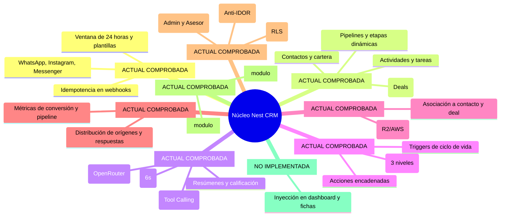

# Nest CRM — Núcleo Funcional Genérico (Core)

**Versión del documento**: 2.1.0\
**Fecha de actualización**: 2026-11-09\
**Estado**: Documento de referencia del núcleo funcional\
**Ubicación en el repositorio**: `src/`\

---

## 1. Convenciones de Clasificación del Documento

- **[ACTUAL COMPROBADA]**: Funcionalidad implementada y verificada en el código.
- **[OBJETIVO APROBADO]**: Decisión aprobada para el núcleo, planificada o en especificación.
- **[PENDIENTE DE DECISIÓN]**: Propuesta sujeta a evaluación técnica.
- **[NO IMPLEMENTADA]**: Diseñada conceptualmente pero sin código en el repositorio.

---

## 2. Misión y Principios del Núcleo

El **Núcleo Funcional (*Core*)** constituye la base inmutable de Nest CRM. Su responsabilidad es suministrar un conjunto genérico de capacidades comerciales, de mensajería, inteligencia artificial y automatización, siendo agnóstico a cualquier sector industrial.

### Distinción Fundamental de Principios:
1. **Inmutabilidad del Núcleo [ACTUAL COMPROBADA / Constitución I]:** El código bajo `src/`, `docker/` y `supabase/migrations/` no se modifica para atender requerimientos de un cliente particular. Todas las adaptaciones deben resolverse a través de configuración o módulos.
2. **Neutralidad de los Módulos [ACTUAL COMPROBADA en diseño]:** Los módulos en `modules/` aportan especializaciones verticales (ej. catálogo de inmuebles), pero no alteran el código fuente del núcleo ni contienen lógica acoplada a una empresa específica.

---

## 3. Inventario de Capacidades del Núcleo

---

## 4. Estado Real de los Mecanismos de Extensión

Es crítico distinguir lo que el núcleo implementa hoy de lo que forma parte de la arquitectura objetivo:

| Mecanismo de Extensión | Clasificación | Estado Real Comprobado en Código |
|---|---|---|
| **Despacho Dinámico de Páginas** | **[ACTUAL COMPROBADA]** | Implementado en `src/app/m/[modulo]/[[...ruta]]/page.tsx`. Resuelve páginas de `servidor.tsx` de módulos activos con `requireMember()`. |
| **Despacho Dinámico de APIs** | **[ACTUAL COMPROBADA]** | Implementado en `src/app/api/m/[modulo]/[[...ruta]]/route.ts`. Enruta peticiones REST hacia controladores del módulo. |
| **Fusión de Campos de Contacto** | **[ACTUAL COMPROBADA]** | Implementado en `src/lib/config/campos.ts`. Combina campos de `config/cliente.ts` con `manifiesto.campos` de módulos activos. |
| **Fusión de Herramientas de IA** | **[ACTUAL COMPROBADA]** | Implementado en `src/lib/agent/tools.ts`. Las herramientas exportadas en `servidor.tsx` se añaden al set del agente IA. |
| **Navegación Modular en Sidebar** | **[ACTUAL COMPROBADA con limitaciones]** | Implementado en `src/components/layout/Sidebar.tsx`. Concatena ítems de navegación exclusivamente en tres secciones fijas hardcodeadas (`Operaciones`, `Productividad`, `Inteligencia`). |
| **Sistema Completo de UI Slots** | **[OBJETIVO APROBADO / NO IMPLEMENTADA]** | Inyección de widgets en dashboard (`dashboard.widgets`), bloques en contactos (`contact.detail`, `contact.tabs`), negocios (`deal.detail`, `deal.tabs`) o chat (`conversation.sidebar`). **No existe en el código actual.** |
| **Componente `SlotRenderer`** | **[NO IMPLEMENTADA]** | Componente contenedor con `Suspense` y `ErrorBoundary` para aislar fallos de módulos. **No existe en el código actual.** |

---

## 5. Modelo de Persistencia Relacional [ACTUAL COMPROBADA]

El esquema relacional del núcleo reside en `src/db/schema.ts` y se gestiona mediante Drizzle ORM sobre PostgreSQL 15+:

| Tabla | Propósito y Restricciones | Llaves Foráneas |
|---|---|---|
| `contacts` | Registro maestro de personas. Posee la columna semiestructurada `custom_fields` (JSONB) para datos dinámicos. | `owner_id` → `team_members.id` (set null) |
| `conversations` | Hilos de chat unificados por canal. UNIQUE `(provider, external_id)`. | `contact_id` → `contacts.id` (cascade), `account_id` → `channel_accounts.id` |
| `messages` | Historial de mensajes in/out. Soporta origen (`agent`, `human`, `template`). | `conversation_id` → `conversations.id` (cascade), `contact_id` → `contacts.id` |
| `pipelines` | Embudos comerciales. | Ninguna |
| `pipeline_stages` | Etapas ordenadas del pipeline. Clave técnica inmutable `key`. UNIQUE `(pipeline_id, key)`. | `pipeline_id` → `pipelines.id` (cascade) |
| `deals` | Oportunidades comerciales. Valor monetario en centavos (`value`). | `stage_id` → `pipeline_stages.id`, `contact_id` → `contacts.id` (cascade) |
| `activities` | Registro cronológico de tareas, notas, reuniones y llamadas. | `contact_id` → `contacts.id` (cascade), `deal_id` → `deals.id` (set null) |
| `team_members` | Extensión de usuarios de Supabase Auth para roles (`admin`, `asesor`) y estado de actividad. | `id` → `auth.users.id` |
| `automations` | Definición de automatizaciones (disparador, filtros, acciones). | Ninguna |
| `automation_runs` | Registro de ejecuciones para auditoría y recuperación. | `automation_key` → `automations.key`, `contact_id` → `contacts.id` |
| `agent_jobs` | Cola de procesamiento asíncrono para el agente LLM con debounce de 6s. | `contact_id` → `contacts.id` (cascade), `conversation_id` → `conversations.id` (cascade) |
| `documents` | Metadatos de archivos adjuntos subidos a buckets S3/R2 presignados. | `contact_id` → `contacts.id`, `deal_id` → `deals.id`, `uploaded_by` → `team_members.id` |
| `crm_settings` | Almacén clave-valor de configuraciones del CRM. | Ninguna |
| `webhook_events` | Control de idempotencia de mensajes entrantes de proveedores externos. | Ninguna |

---

## 6. Sistema Agéntico de Inteligencia Artificial [ACTUAL COMPROBADA]

El agente del núcleo (`src/lib/agent/index.ts`) opera como un asistente conversacional autónomo:
- **Límite de Historial:** Procesa hasta 30 mensajes recientes del hilo.
- **Límite de Iteraciones:** Hasta 6 rondas iterativas de tool calling por invocación (`MAX_TOOL_ROUNDS = 6`).
- **Debounce de Mensajes en Ráfaga:** 6 segundos (`DEBOUNCE_MS = 6000`). Los mensajes consecutivos en el mismo hilo reinician el temporizador para responder a la idea completa.
- **Herramientas Estándar del Núcleo:**
  - `mover_etapa`: Transiciona la oportunidad a una etapa identificada por su `clave`.
  - `actualizar_contacto`: Almacena campos estándar y propiedades validadas en `custom_fields`.
  - `registrar_actividad`: Inserta tareas o notas de seguimiento con prefijo `[IA]`.
  - `resumen_lead`: Condensa la situación del prospecto en `contacts.ai_summary`.
  - `derivar_asesor`: Pausa al agente exclusivamente en ese hilo (`ai_enabled = false`) y marca `needs_human = true`.
  - `asignar_asesor`: Asigna el contacto a un miembro del equipo comercial por nombre.

---

## 7. Motor de Automatizaciones [ACTUAL COMPROBADA]

El motor de reglas opera de forma desacoplada en `src/lib/automations/`:
- **Disparadores (*Triggers*):** `contact.created`, `contact.assigned`, `deal.stage_changed`.
- **Acciones Disponibles:** `push` (notificación VAPID), `add_tag` / `remove_tag`, `assign_owner`, `create_activity`.
- **Prevención de Recursión:** Payload con contador `__depth`. Se aborta si excede `MAX_EVENT_DEPTH = 3`.

---

## 8. Seguridad y Aislamiento de Cartera [ACTUAL COMPROBADA]

- **Aislamiento de Asesores (Anti-IDOR):** Todas las consultas en servidor inyectan la condición `ownerFilter(member)`. Los asesores solo ven contactos donde `contacts.owner_id = member.id`. Rutas por ID ajeno retornan **404 Not Found**.
- **Protección de Rutas Internas:** `/api/agent/process` y sweepers exigen `Authorization: Bearer <AGENT_WORKER_SECRET>`, validado en tiempo constante con `crypto.timingSafeEqual`.
- **Row Level Security (RLS):** Activado en todas las tablas; el rol `anon` carece de permisos.
