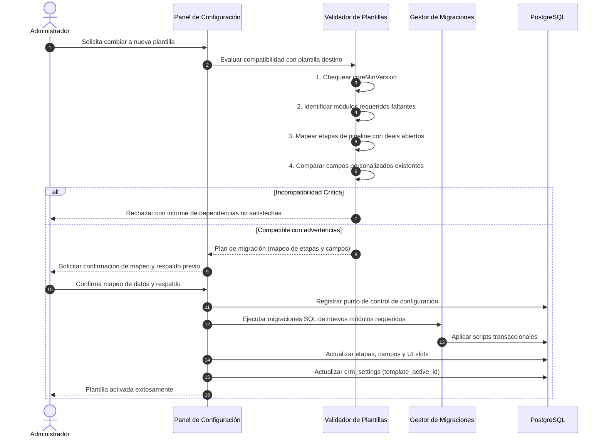

# Nest CRM — Sistema de Plantillas Sectoriales (Templates)

**Versión del documento**: 2.1.0\
**Fecha de actualización**: 2026-11-09\
**Estado**: Documento rector del sistema de plantillas\
**Ubicación de referencia**: `config/plantillas/`\

---

## 1. Convenciones de Clasificación del Documento

- **[ACTUAL COMPROBADA]**: Funcionalidad implementada y verificada en el código.
- **[OBJETIVO APROBADO]**: Decisión arquitectónica aprobada, en especificación o planificación formal.
- **[PENDIENTE DE DECISIÓN]**: Propuesta técnica sujeta a análisis.
- **[NO IMPLEMENTADA]**: Diseñada conceptualmente pero sin código en el repositorio.

---

## 2. Concepto y Rol de las Plantillas

Una **Plantilla Sectorial (*Template*)** en Nest CRM es una especificación declarativa que define la configuración comercial, procesos, campos y recomendaciones de módulos para una vertical de negocio concreta (inmobiliaria, salud, concesionarios, servicios).

### Principio Fundamental [OBJETIVO APROBADO]:
> Las plantillas son estrictamente **declarativas**. No ejecutan código imperativo, no interactúan directamente con la base de datos ni contienen componentes duplicados de módulos.

Una plantilla define:
- Qué módulos son obligatorios (`required`) y cuáles son complementarios (`optional`).
- Valores predeterminados de marca, localización y etiquetas de rol.
- Estructura de etapas del embudo comercial (pipeline kanban).
- Campos personalizados de captura y directivas de calificación para el agente IA.
- Disposición de secciones del menú de navegación (`sidebar.sections`).
- Composición de widgets en la pantalla principal (`dashboard.widgets`).
- Extensiones visuales en pantallas contextuales de contactos, deals y chat (`extensions`).
- Automatizaciones y reportes sugeridos para el sector.

---

## 3. Contrato Formal Unificado `TemplateDefinition` [OBJETIVO APROBADO]

Este contrato representa la especificación unificada que regirá a todas las plantillas:

```typescript
export interface TemplateDefinition {
  /** Identificador técnico único en formato kebab-case (ej. "inmobiliaria", "clinica-dental") */
  id: string;

  /** Nombre comercial descriptivo de la plantilla */
  name: string;

  /** Resumen de la vertical de negocio y propósito comercial */
  description: string;

  /** Versión semántica de la plantilla (ej. "1.0.0") */
  version: string;

  /** Reglas de compatibilidad de versión con el núcleo de Nest CRM */
  compatibility: {
    coreMinVersion: string; // ej. ">=2.1.0"
    coreMaxVersion?: string;
  };

  /** Módulos funcionales asociados a este nicho */
  modules: {
    /** Módulos obligatorios que deben activarse mandatoriamente */
    required: string[]; // ej. ["propiedades", "visitas"]
    /** Módulos complementarios sugeridos para activación opcional */
    optional: string[]; // ej. ["contratos", "comisiones"]
  };

  /** Valores predeterminados del negocio para la instalación */
  defaults: {
    marca: {
      nombreSugerido: string;
      colorPrimario: string; // Formato hex #rrggbb
      colorSidebar: string;  // Formato hex #rrggbb
    };
    moneda: string;          // Código ISO 4217 (ej. "USD", "CLP", "MXN")
    idioma: "es" | "en";
    roles: {
      etiquetaAsesor: string; // ej. "Corredor", "Agente", "Doctor"
    };
    pipeline: {
      nombre: string;
      etapas: Array<{
        clave: string;
        nombre: string;
        color: string;
        ganada?: boolean;
        perdida?: boolean;
      }>;
    };
    contacto: {
      campos: Array<{
        clave: string;
        etiqueta: string;
        tipo: "texto" | "numero" | "seleccion" | "booleano" | "fecha";
        opciones?: string[];
        enTabla?: boolean;
        requerido?: boolean;
        agente?: {
          calificar: boolean;
          descripcion: string;
        };
      }>;
    };
    agente: {
      nombre: string;
      promptBase: string;
      mensajeDerivacion: string;
    };
  };

  /**
   * Navegación y organización del menú lateral.
   * Modela el slot oficial 'sidebar.sections'.
   */
  navigation: {
    secciones: Array<{
      titulo: string;
      items: Array<{
        tipo: "core" | "modulo";
        referencia: string; // ruta del core o id de módulo
        etiqueta?: string;
      }>;
    }>;
  };

  /**
   * Configuración de widgets en la pantalla principal.
   * Modela el slot oficial 'dashboard.widgets'.
   */
  dashboard: {
    widgets: Array<{
      widgetId: string;
      moduloId?: string;
      orden: number;
      tamano: "sm" | "md" | "lg" | "full";
      config?: Record<string, unknown>;
    }>;
  };

  /**
   * Inyección declarativa de extensiones en pantallas contextuales del núcleo.
   * Cubre los 5 slots oficiales restantes sin solaparse con navigation ni dashboard.
   */
  extensions?: Array<{
    slot: "contact.detail" | "contact.tabs" | "deal.detail" | "deal.tabs" | "conversation.sidebar";
    componentId: string;
    moduloId: string;
    orden: number;
  }>;

  /** Automatizaciones predefinidas del sector */
  automations?: Array<{
    key: string;
    name: string;
    trigger: string;
    filters?: Record<string, unknown>;
    actions: Array<Record<string, unknown>>;
  }>;

  /** Reportes e indicadores clave sugeridos para este nicho */
  reports?: Array<{
    key: string;
    titulo: string;
    tipo: "kpi" | "grafico_barras" | "tabla";
    origen: string;
  }>;
}
```

---

## 4. Resolución de la Contradicción Detectada

### 4.1 Situación Real Comprobada en el Código [ACTUAL COMPROBADA]
En el repositorio actual coexisten dos mecanismos con propósitos superpuestos:
1. `config/plantillas/inmobiliaria.ts` incluye la propiedad:
   ```typescript
   modulos: {
     nucleo: { ... },
     activos: ["propiedades", "visitas"], // Lista sugerida
   }
   ```
2. `config/modulos.json` define:
   ```json
   {
     "activos": [] // Lista que realmente lee el sistema
   }
   ```
3. `config/cliente.ts` consume directamente `modulos.json`:
   ```typescript
   import modulos from "./modulos.json";
   ...
   modulos: { activos: modulos.activos }
   ```
4. `scripts/generar-registro-modulos.mjs` y `scripts/migrar.mjs` leen **exclusivamente `config/modulos.json`** para generar el registro de TypeScript y aplicar migraciones SQL.

**Efecto:** La lista de módulos dentro de `inmobiliaria.ts` no tiene efecto operativo directo; si un implementador copia la plantilla a `cliente.ts` pero no actualiza `config/modulos.json`, los módulos inmobiliarios no se compilan ni se migran.

### 4.2 Arquitectura Inequívoca Formalizada [OBJETIVO APROBADO]

Para resolver esta contradicción sin ambigüedades, se establece la siguiente jerarquía de responsabilidades:

1. **La Plantilla DECLARA DEPENDENCIAS Y RECOMENDACIONES:**
   - Define `modules.required` (módulos sin los cuales la plantilla no opera) y `modules.optional` (módulos recomendados).
2. **El Registro de Código DETERMINA LA DISPONIBILIDAD:**
   - Los módulos físicamente presentes en `modules/` e incluidos en el build determinan qué código puede ejecutarse.
3. **La Base de Datos de la Instalación DETERMINA LA ACTIVACIÓN EFECTIVA [NO IMPLEMENTADA]:**
   - En la arquitectura objetivo, la activación residirá en PostgreSQL (`crm_settings.modules_active_list`).
   - Al seleccionar una plantilla, el sistema activará automáticamente sus `modules.required` y ofrecerá activar sus `modules.optional`.
4. **Papel Futuro de `config/modulos.json`:**
   - Durante la transición, permanece como archivo de configuración de build para desarrollo local.
   - En la fase de persistencia dinámica, pasa a ser exclusivamente un archivo de inicialización (*seed*) para el primer arranque de la instancia.

---

## 5. Procedimiento Controlado para Cambio de Plantilla [OBJETIVO APROBADO / NO IMPLEMENTADA]

Una empresa podrá cambiar de plantilla comercial tras haber entrado en operación mediante un procedimiento guiado y seguro:



### Reglas Inviolables del Cambio de Plantilla:
1. **Preservación Total de Datos:** Ningún contacto, deal, mensaje ni actividad previa es eliminada. Las etapas antiguas con operaciones abiertas no se borran; se conservan o se mapean a etapas de la nueva plantilla.
2. **Módulos No Utilizados:** Si la plantilla anterior utilizaba módulos que la nueva no requiere, **sus tablas y datos se preservan íntegros en PostgreSQL**. El módulo simplemente se desactiva de las vistas principales.
3. **Respaldo Previo Obligatorio:** Se debe exigir confirmación explícita del administrador y recomendar un respaldo completo de la base de datos antes de aplicar el cambio.
