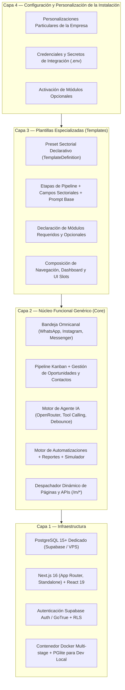
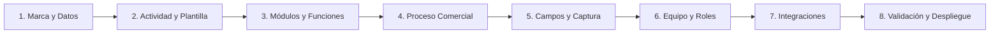

# Nest CRM — Documento de Visión y Arquitectura de Producto

**Versión del documento**: 2.1.0\
**Fecha de actualización**: 2026-11-09\
**Estado**: Documento rector de producto y referencia técnica\
**Repositorio base**: `E:\Codigo\nest-crm` (rama `develop`, v2.1.0)\

---

## 1. Convenciones de Clasificación del Documento

Para garantizar coherencia y precisión técnica, toda afirmación en este documento se clasifica bajo una de las siguientes cuatro categorías normativas:

- **[ACTUAL COMPROBADA]**: Funcionalidad, arquitectura o archivo existente en el repositorio y verificado operativamente en el código.
- **[OBJETIVO APROBADO]**: Decisión de producto o arquitectura formalmente aprobada, cuya especificación está cerrada pero su implementación puede estar en curso o planificada.
- **[PENDIENTE DE DECISIÓN]**: Propuesta técnica o de negocio sujeta a análisis, validación de diseño o definición de gobernanza.
- **[NO IMPLEMENTADA]**: Capacidad o componente diseñado en la arquitectura objetivo pero que aún no cuenta con código ejecutable en el repositorio.

---

## 2. Visión y Propósito del Producto

Nest CRM es una plataforma comercial de gestión de relaciones con clientes (*Customer Relationship Management*) con enfoque prioritario en inteligencia artificial conversacional (*Agent-First*) y omnicanalidad (WhatsApp, Instagram DM, Facebook Messenger).

Su propuesta de valor radica en permitir que agencias de software, integradores de IA y empresas comerciales desplieguen soluciones verticales de alta calidad técnica combinando:
1. **Un núcleo CRM genérico inmutable [OBJETIVO APROBADO / COMPROBADO EN POLÍTICA Y ESTRUCTURA]**: Política constitucional de no modificación de `src/`, con bandeja unificada, embudos de venta, actividades, documentos, reportes y automatizaciones.
2. **Plantillas especializadas por industria [OBJETIVO APROBADO]**: Que preconfiguran el negocio de forma declarativa (ej. inmobiliaria, salud, automoción).
3. **Módulos funcionales desacoplados y reutilizables [ACTUAL COMPROBADA en estructura / OBJETIVO APROBADO en ciclo de vida dinámico]**: Como el catálogo de propiedades o la agenda de visitas.
4. **Personalización sin alteración del código fuente [ACTUAL COMPROBADA en configuración estática / OBJETIVO APROBADO en base de datos]**: Preservando la capacidad de actualizar el núcleo y las plantillas sin conflictos.
5. **Aislamiento de datos e infraestructura [OBJETIVO APROBADO / COMPROBADO ESTRUCTURALMENTE EN CÓDIGO]**: Mediante capacidades de despliegue contenerizado y conexión a una base de datos PostgreSQL dedicada por instalación.

---

## 3. Modelo de Instalación y Despliegue

### 3.1 Decisiones de Producto Aprobadas

| Dimensión | Decisión de Producto | Clasificación | Justificación Estratégica y Regla Técnica |
|---|---|---|---|
| **Modelo de Tenancy** | **Instalación dedicada e independiente por empresa (*Dedicated Single-Tenant Instance*)** | **[OBJETIVO APROBADO]** | Modelo comercial y arquitectónico rector. El repositorio cuenta con capacidades estructurales para ello (`Dockerfile` standalone, scripts de migración autónomos). Facilita el aislamiento operativo y la soberanía de datos. *(Nota de cumplimiento: La instalación dedicada no garantiza por sí sola la conformidad con normativas como GDPR; el cumplimiento legal requiere controles organizativos, gestión de consentimientos, políticas de retención y evaluación jurídica específica).* |
| **Persistencia** | **Una base de datos PostgreSQL dedicada por instalación** | **[OBJETIVO APROBADO / COMPROBADO ESTRUCTURALMENTE]** | Cada instalación apunta a su propia base de datos (`DATABASE_URL`); permite respaldos y restauraciones atómicas sin riesgo de contaminación cruzada entre organizaciones. |
| **SaaS Compartido** | **Descartado como arquitectura principal** | **[OBJETIVO APROBADO]** | Se rechaza el modelo SaaS multi-tenant tradicional donde múltiples organizaciones comparten las mismas tablas de base de datos. |
| **Control de Versiones** | **Núcleo y módulos versionados centralmente en el repositorio** | **[ACTUAL COMPROBADA]** | El código fuente y los módulos estándar residen en el repositorio Git central, asegurando trazabilidad y compilaciones reproducibles. |
| **Inmutabilidad del Núcleo** | **Política de no modificación de `src/` para clientes** | **[ACTUAL COMPROBADA en política / OBJETIVO APROBADO]** | Principio de gobernanza establecido por `specs/CONSTITUCION.md`. La inmutabilidad es una disciplina de desarrollo y arquitectura, no una restricción física del sistema operativo. |
| **Personalización del Cliente** | **Cero modificaciones al código fuente de la aplicación** | **[OBJETIVO APROBADO]** | Todas las particularidades de marca, campos, etapas y flujos deben resolverse mediante capas declarativas y base de datos, sin tocar `src/`. |

> [!NOTE]
> **Aclaración sobre la tabla `tenants` existente [ACTUAL COMPROBADA]:**
> En el esquema actual (`src/db/schema.ts`) existe una tabla `tenants` y columnas `tenant_id` en varias tablas del núcleo (`contacts`, `channel_accounts`, etc.), heredadas de bases previas del proyecto (`auto-crm` / `vocero-crm`). En Nest CRM, dichas columnas **no se utilizan para multi-tenancy entre empresas distintas**. La regla fundamental de producto es: **una empresa = una instalación = una base de datos**.

---

## 4. Arquitectura en Cuatro Capas

El producto se estructura conceptualmente en cuatro capas lógicas estrictamente jerárquicas:

### 4.1 Estado Real de Implementación por Capa

| Capa | Estado Comprobado en Código | Estado Objetivo Aprobado | Brecha Técnica Pendiente |
|---|---|---|---|
| **1. Infraestructura** | **[ACTUAL COMPROBADA]:** Docker multi-stage operativo, script de migraciones transaccionales en arranque, soporte Supabase y PGlite local. | **[OBJETIVO APROBADO]:** Incorporar mecanismos automatizados de respaldo previo a migraciones críticas y healthchecks de infraestructura. | Automatizar scripts de respaldo/restauración previa a operaciones de riesgo. |
| **2. Núcleo Funcional** | **[ACTUAL COMPROBADA]:** Bandeja omnicanal, pipeline, contactos, agente IA con tools, reportes, despacho de rutas `/m/[modulo]` y `/api/m/[modulo]`. | **[OBJETIVO APROBADO]:** Incorporar sistema formal de *UI Slots* para inyección controlada de widgets y vistas en puntos fijos del CRM. | Diseñar e implementar el despachador de UI Slots en el núcleo (`docs/UI_SYSTEM.md`). |
| **3. Plantillas** | **[ACTUAL COMPROBADA]:** Preset estático en TypeScript (`config/plantillas/inmobiliaria.ts`) extendido por `config/cliente.ts`. | **[OBJETIVO APROBADO]:** Contrato declarativo formal [`TemplateDefinition`](file:///e:/Codigo/nest-crm/docs/PLANTILLAS.md#2-contrato-formal-templatedefinition) desacoplado de código ejecutable, con versionado y dependencias. | Migrar de presets en TypeScript a especificaciones declarativas validadas con Zod. |
| **4. Personalización** | **[ACTUAL COMPROBADA]:** Edición manual de archivos locales (`config/cliente.ts`, `config/modulos.json`). | **[OBJETIVO APROBADO]:** Sistema de 4 niveles de configuración con persistencia en base de datos para ajustes administrativos y protección ante actualizaciones. | Implementar capa de persistencia en tabla `crm_settings` con resolución de precedencia en runtime. |

---

## 5. Distinción Rigurosa de Conceptos Arquitectónicos

Para evitar malentendidos en la evolución del software, se definen taxativamente los siguientes conceptos:

1. **Inmutabilidad del Núcleo [ACTUAL COMPROBADA]:** El código bajo `src/`, `docker/` y `supabase/migrations/` es idéntico para todas las empresas. No se admiten condicionales hardcodeados por cliente ni parches particulares en estas carpetas.
2. **Neutralidad de los Módulos [ACTUAL COMPROBADA en diseño / OBJETIVO APROBADO en aislamiento]:** Los módulos (`modules/<nombre>/`) aportan funcionalidad especializada (ej. inmobiliaria), pero no conocen la identidad de la empresa que los ejecuta ni modifican el núcleo.
3. **Existencia en el Repositorio vs. Activación en una Instalación:**
   - *Existencia en Repositorio [ACTUAL COMPROBADA]:* Módulos como `propiedades`, `visitas` o `ejemplo` residen en el repositorio y están disponibles en el artefacto compilado.
   - *Activación en una Instalación [ACTUAL COMPROBADA vía archivo / OBJETIVO APROBADO vía BD]:* Que un módulo exista no implica que esté activo en una instalación específica. Hoy la activación se define en `config/modulos.json` durante el build; en la arquitectura objetivo se gestionará en la base de datos de la instalación.

---

## 6. Experiencia de Configuración del Cliente

### 6.1 Situación Actual vs. Experiencia Objetivo

- **Situación Actual [ACTUAL COMPROBADA]:** La configuración de una nueva empresa requiere conocimientos técnicos: clonar el repositorio, editar `config/cliente.ts` y `config/modulos.json`, añadir imágenes en `public/marca/`, ejecutar comandos CLI (`npm run pwa:icons`, `npm run db:migrar`) y compilar el proyecto.
- **Experiencia Objetivo [OBJETIVO APROBADO / NO IMPLEMENTADA]:** Permitir que un administrador configure y opere su CRM mediante un **Asistente Inicial de Configuración (*Onboarding Wizard*)** guiado en 8 pasos sin tocar archivos ni código.

### 6.2 Flujo del Asistente de Configuración Inicial (8 Pasos) [NO IMPLEMENTADA]

| Paso | Denominación | Acciones Previstas en el Diseño | Clasificación |
|---|---|---|---|
| **1** | **Datos y Marca** | Razón social, nombre comercial, moneda (ISO 4217), zona horaria IANA, subida de logotipo/icono, paleta de colores. | **[NO IMPLEMENTADA]** |
| **2** | **Actividad y Plantilla** | Selección del sector comercial (Inmobiliaria, Salud, etc.) o plantilla base genérica. | **[NO IMPLEMENTADA]** |
| **3** | **Selección de Módulos** | Revisión de módulos obligatorios según plantilla y selección de opcionales compatibles. | **[NO IMPLEMENTADA]** |
| **4** | **Proceso Comercial** | Ajuste fino de etapas del pipeline kanban (nombres, colores, etapas de éxito/pérdida). | **[NO IMPLEMENTADA]** |
| **5** | **Campos y Formularios** | Habilitación de campos personalizados de contactos y negocios, indicando cuáles indaga la IA. | **[NO IMPLEMENTADA]** |
| **6** | **Equipo y Permisos** | Alta de administradores y asesores comerciales, asignación de etiquetas de rol. | **[NO IMPLEMENTADA como paso del wizard / ACTUAL COMPROBADA parcialmente en /settings]** |
| **7** | **Integraciones** | Conexión de canales de mensajería (Zernio / Meta), OpenRouter API key y almacenamiento S3. | **[NO IMPLEMENTADA como paso del wizard / ACTUAL COMPROBADA en .env y /settings]** |
| **8** | **Validación y Activación** | Ejecución de verificaciones automáticas de integridad y aplicación de migraciones pendientes. | **[NO IMPLEMENTADA]** |

---

## 7. Principios Constitucionales Innegociables [ACTUAL COMPROBADA]

El desarrollo de Nest CRM se rige estrictamente por la Constitución del Software (`specs/CONSTITUCION.md`, v1.0.0):

1. **Principio I — Inmutabilidad del Núcleo:** Todo lo específico de un cliente vive en configuración o módulos. `src/` no se edita para adaptar una empresa.
2. **Principio II — Especificación Previa Obligatoria:** Toda funcionalidad o módulo nuevo parte de un `spec.md` antes de escribir código.
3. **Principio III — Autoverificación Automatizada:** Ninguna instancia se entrega sin pasar `scripts/verificar-instancia.mjs` en verde.
4. **Principio IV — Cero Secretos en el Código:** Credenciales y llaves privadas residen exclusivamente en variables de entorno o almacén seguro.

---

## 8. Índice de Referencia Documental

| Documento | Alcance y Contenido Técnico |
|---|---|
| [`docs/ARQUITECTURA.md`](file:///e:/Codigo/nest-crm/docs/ARQUITECTURA.md) | Arquitectura técnica global, contratos conceptuales, flujo de datos y seguridad. |
| [`docs/CORE.md`](file:///e:/Codigo/nest-crm/docs/CORE.md) | Núcleo funcional genérico, entidades de persistencia, APIs y sistema agéntico. |
| [`docs/PLANTILLAS.md`](file:///e:/Codigo/nest-crm/docs/PLANTILLAS.md) | Contrato `TemplateDefinition`, ciclo de vida y resolución de fuentes de verdad. |
| [`docs/MODULOS.md`](file:///e:/Codigo/nest-crm/docs/MODULOS.md) | Contrato `ModuleDefinition`, aislamiento, dependencias y migraciones. |
| [`docs/CONFIGURACION.md`](file:///e:/Codigo/nest-crm/docs/CONFIGURACION.md) | Niveles de configuración, precedencia y gestión segura de secretos. |
| [`docs/PERSONALIZACION.md`](file:///e:/Codigo/nest-crm/docs/PERSONALIZACION.md) | Protección de personalizaciones ante actualizaciones del núcleo. |
| [`docs/UI_SYSTEM.md`](file:///e:/Codigo/nest-crm/docs/UI_SYSTEM.md) | Sistema formal de UI Slots y seguridad de componentes. |
| [`docs/ROADMAP.md`](file:///e:/Codigo/nest-crm/docs/ROADMAP.md) | Hoja de ruta técnica por fases, análisis de riesgos y dependencias. |
| [`specs/CONSTITUCION.md`](file:///e:/Codigo/nest-crm/specs/CONSTITUCION.md) | Principios innegociables del proyecto. |
