# DOCUMENTO: PRODUCTO.md

# Nest CRM — Documento de Visión y Arquitectura de Producto

**Versión del documento**: 2.1.0\
**Fecha de actualización**: 2026-11-09\
**Estado**: Documento rector de producto y referencia técnica\
**Repositorio base**: `E:\Codigo\nest-crm` (rama `develop`, v2.1.0)\

---

## 1. Convenciones de Clasificación del Documento

Para garantizar coherencia y precisión técnica, toda afirmación en este documento se clasifica bajo una de las siguientes cuatro categorías normativas:

- **[ACTUAL COMPROBADA]**: Funcionalidad, arquitectura o archivo existente en el repositorio y verificado operativamente en el código.
- **[OBJETIVO APROBADO]**: Decisión de producto o arquitectura formalmente aprobada, cuya especificación está cerrada pero su implementación puede estar en curso o planificada.
- **[PENDIENTE DE DECISIÓN]**: Propuesta técnica o de negocio sujeta a análisis, validación de diseño o definición de gobernanza.
- **[NO IMPLEMENTADA]**: Capacidad o componente diseñado en la arquitectura objetivo pero que aún no cuenta con código ejecutable en el repositorio.

---

## 2. Visión y Propósito del Producto

Nest CRM es una plataforma comercial de gestión de relaciones con clientes (*Customer Relationship Management*) con enfoque prioritario en inteligencia artificial conversacional (*Agent-First*) y omnicanalidad (WhatsApp, Instagram DM, Facebook Messenger).

Su propuesta de valor radica en permitir que agencias de software, integradores de IA y empresas comerciales desplieguen soluciones verticales de alta calidad técnica combinando:
1. **Un núcleo CRM genérico inmutable [OBJETIVO APROBADO / COMPROBADO EN POLÍTICA Y ESTRUCTURA]**: Política constitucional de no modificación de `src/`, con bandeja unificada, embudos de venta, actividades, documentos, reportes y automatizaciones.
2. **Plantillas especializadas por industria [OBJETIVO APROBADO]**: Que preconfiguran el negocio de forma declarativa (ej. inmobiliaria, salud, automoción).
3. **Módulos funcionales desacoplados y reutilizables [ACTUAL COMPROBADA en estructura / OBJETIVO APROBADO en ciclo de vida dinámico]**: Como el catálogo de propiedades o la agenda de visitas.
4. **Personalización sin alteración del código fuente [ACTUAL COMPROBADA en configuración estática / OBJETIVO APROBADO en base de datos]**: Preservando la capacidad de actualizar el núcleo y las plantillas sin conflictos.
5. **Aislamiento de datos e infraestructura [OBJETIVO APROBADO / COMPROBADO ESTRUCTURALMENTE EN CÓDIGO]**: Mediante capacidades de despliegue contenerizado y conexión a una base de datos PostgreSQL dedicada por instalación.

---

## 3. Modelo de Instalación y Despliegue

### 3.1 Decisiones de Producto Aprobadas

| Dimensión | Decisión de Producto | Clasificación | Justificación Estratégica y Regla Técnica |
|---|---|---|---|
| **Modelo de Tenancy** | **Instalación dedicada e independiente por empresa (*Dedicated Single-Tenant Instance*)** | **[OBJETIVO APROBADO]** | Modelo comercial y arquitectónico rector. El repositorio cuenta con capacidades estructurales para ello (`Dockerfile` standalone, scripts de migración autónomos). Facilita el aislamiento operativo y la soberanía de datos. *(Nota de cumplimiento: La instalación dedicada no garantiza por sí sola la conformidad con normativas como GDPR; el cumplimiento legal requiere controles organizativos, gestión de consentimientos, políticas de retención y evaluación jurídica específica).* |
| **Persistencia** | **Una base de datos PostgreSQL dedicada por instalación** | **[OBJETIVO APROBADO / COMPROBADO ESTRUCTURALMENTE]** | Cada instalación apunta a su propia base de datos (`DATABASE_URL`); permite respaldos y restauraciones atómicas sin riesgo de contaminación cruzada entre organizaciones. |
| **SaaS Compartido** | **Descartado como arquitectura principal** | **[OBJETIVO APROBADO]** | Se rechaza el modelo SaaS multi-tenant tradicional donde múltiples organizaciones comparten las mismas tablas de base de datos. |
| **Control de Versiones** | **Núcleo y módulos versionados centralmente en el repositorio** | **[ACTUAL COMPROBADA]** | El código fuente y los módulos estándar residen en el repositorio Git central, asegurando trazabilidad y compilaciones reproducibles. |
| **Inmutabilidad del Núcleo** | **Política de no modificación de `src/` para clientes** | **[ACTUAL COMPROBADA en política / OBJETIVO APROBADO]** | Principio de gobernanza establecido por `specs/CONSTITUCION.md`. La inmutabilidad es una disciplina de desarrollo y arquitectura, no una restricción física del sistema operativo. |
| **Personalización del Cliente** | **Cero modificaciones al código fuente de la aplicación** | **[OBJETIVO APROBADO]** | Todas las particularidades de marca, campos, etapas y flujos deben resolverse mediante capas declarativas y base de datos, sin tocar `src/`. |

> [!NOTE]
> **Aclaración sobre la tabla `tenants` existente [ACTUAL COMPROBADA]:**
> En el esquema actual (`src/db/schema.ts`) existe una tabla `tenants` y columnas `tenant_id` en varias tablas del núcleo (`contacts`, `channel_accounts`, etc.), heredadas de bases previas del proyecto (`auto-crm` / `vocero-crm`). En Nest CRM, dichas columnas **no se utilizan para multi-tenancy entre empresas distintas**. La regla fundamental de producto es: **una empresa = una instalación = una base de datos**.

---

## 4. Arquitectura en Cuatro Capas

El producto se estructura conceptualmente en cuatro capas lógicas estrictamente jerárquicas:

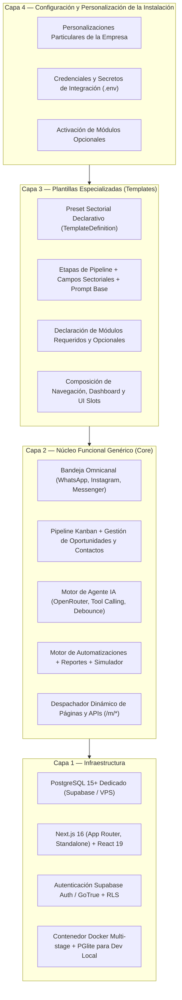

### 4.1 Estado Real de Implementación por Capa

| Capa | Estado Comprobado en Código | Estado Objetivo Aprobado | Brecha Técnica Pendiente |
|---|---|---|---|
| **1. Infraestructura** | **[ACTUAL COMPROBADA]:** Docker multi-stage operativo, script de migraciones transaccionales en arranque, soporte Supabase y PGlite local. | **[OBJETIVO APROBADO]:** Incorporar mecanismos automatizados de respaldo previo a migraciones críticas y healthchecks de infraestructura. | Automatizar scripts de respaldo/restauración previa a operaciones de riesgo. |
| **2. Núcleo Funcional** | **[ACTUAL COMPROBADA]:** Bandeja omnicanal, pipeline, contactos, agente IA con tools, reportes, despacho de rutas `/m/[modulo]` y `/api/m/[modulo]`. | **[OBJETIVO APROBADO]:** Incorporar sistema formal de *UI Slots* para inyección controlada de widgets y vistas en puntos fijos del CRM. | Diseñar e implementar el despachador de UI Slots en el núcleo (`docs/UI_SYSTEM.md`). |
| **3. Plantillas** | **[ACTUAL COMPROBADA]:** Preset estático en TypeScript (`config/plantillas/inmobiliaria.ts`) extendido por `config/cliente.ts`. | **[OBJETIVO APROBADO]:** Contrato declarativo formal [`TemplateDefinition`](file:///e:/Codigo/nest-crm/docs/PLANTILLAS.md#2-contrato-formal-templatedefinition) desacoplado de código ejecutable, con versionado y dependencias. | Migrar de presets en TypeScript a especificaciones declarativas validadas con Zod. |
| **4. Personalización** | **[ACTUAL COMPROBADA]:** Edición manual de archivos locales (`config/cliente.ts`, `config/modulos.json`). | **[OBJETIVO APROBADO]:** Sistema de 4 niveles de configuración con persistencia en base de datos para ajustes administrativos y protección ante actualizaciones. | Implementar capa de persistencia en tabla `crm_settings` con resolución de precedencia en runtime. |

---

## 5. Distinción Rigurosa de Conceptos Arquitectónicos

Para evitar malentendidos en la evolución del software, se definen taxativamente los siguientes conceptos:

1. **Inmutabilidad del Núcleo [ACTUAL COMPROBADA]:** El código bajo `src/`, `docker/` y `supabase/migrations/` es idéntico para todas las empresas. No se admiten condicionales hardcodeados por cliente ni parches particulares en estas carpetas.
2. **Neutralidad de los Módulos [ACTUAL COMPROBADA en diseño / OBJETIVO APROBADO en aislamiento]:** Los módulos (`modules/<nombre>/`) aportan funcionalidad especializada (ej. inmobiliaria), pero no conocen la identidad de la empresa que los ejecuta ni modifican el núcleo.
3. **Existencia en el Repositorio vs. Activación en una Instalación:**
   - *Existencia en Repositorio [ACTUAL COMPROBADA]:* Módulos como `propiedades`, `visitas` o `ejemplo` residen en el repositorio y están disponibles en el artefacto compilado.
   - *Activación en una Instalación [ACTUAL COMPROBADA vía archivo / OBJETIVO APROBADO vía BD]:* Que un módulo exista no implica que esté activo en una instalación específica. Hoy la activación se define en `config/modulos.json` durante el build; en la arquitectura objetivo se gestionará en la base de datos de la instalación.

---

## 6. Experiencia de Configuración del Cliente

### 6.1 Situación Actual vs. Experiencia Objetivo

- **Situación Actual [ACTUAL COMPROBADA]:** La configuración de una nueva empresa requiere conocimientos técnicos: clonar el repositorio, editar `config/cliente.ts` y `config/modulos.json`, añadir imágenes en `public/marca/`, ejecutar comandos CLI (`npm run pwa:icons`, `npm run db:migrar`) y compilar el proyecto.
- **Experiencia Objetivo [OBJETIVO APROBADO / NO IMPLEMENTADA]:** Permitir que un administrador configure y opere su CRM mediante un **Asistente Inicial de Configuración (*Onboarding Wizard*)** guiado en 8 pasos sin tocar archivos ni código.

### 6.2 Flujo del Asistente de Configuración Inicial (8 Pasos) [NO IMPLEMENTADA]

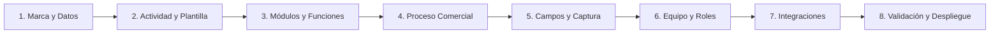

| Paso | Denominación | Acciones Previstas en el Diseño | Clasificación |
|---|---|---|---|
| **1** | **Datos y Marca** | Razón social, nombre comercial, moneda (ISO 4217), zona horaria IANA, subida de logotipo/icono, paleta de colores. | **[NO IMPLEMENTADA]** |
| **2** | **Actividad y Plantilla** | Selección del sector comercial (Inmobiliaria, Salud, etc.) o plantilla base genérica. | **[NO IMPLEMENTADA]** |
| **3** | **Selección de Módulos** | Revisión de módulos obligatorios según plantilla y selección de opcionales compatibles. | **[NO IMPLEMENTADA]** |
| **4** | **Proceso Comercial** | Ajuste fino de etapas del pipeline kanban (nombres, colores, etapas de éxito/pérdida). | **[NO IMPLEMENTADA]** |
| **5** | **Campos y Formularios** | Habilitación de campos personalizados de contactos y negocios, indicando cuáles indaga la IA. | **[NO IMPLEMENTADA]** |
| **6** | **Equipo y Permisos** | Alta de administradores y asesores comerciales, asignación de etiquetas de rol. | **[NO IMPLEMENTADA como paso del wizard / ACTUAL COMPROBADA parcialmente en /settings]** |
| **7** | **Integraciones** | Conexión de canales de mensajería (Zernio / Meta), OpenRouter API key y almacenamiento S3. | **[NO IMPLEMENTADA como paso del wizard / ACTUAL COMPROBADA en .env y /settings]** |
| **8** | **Validación y Activación** | Ejecución de verificaciones automáticas de integridad y aplicación de migraciones pendientes. | **[NO IMPLEMENTADA]** |

---

## 7. Principios Constitucionales Innegociables [ACTUAL COMPROBADA]

El desarrollo de Nest CRM se rige estrictamente por la Constitución del Software (`specs/CONSTITUCION.md`, v1.0.0):

1. **Principio I — Inmutabilidad del Núcleo:** Todo lo específico de un cliente vive en configuración o módulos. `src/` no se edita para adaptar una empresa.
2. **Principio II — Especificación Previa Obligatoria:** Toda funcionalidad o módulo nuevo parte de un `spec.md` antes de escribir código.
3. **Principio III — Autoverificación Automatizada:** Ninguna instancia se entrega sin pasar `scripts/verificar-instancia.mjs` en verde.
4. **Principio IV — Cero Secretos en el Código:** Credenciales y llaves privadas residen exclusivamente en variables de entorno o almacén seguro.

---

## 8. Índice de Referencia Documental

| Documento | Alcance y Contenido Técnico |
|---|---|
| [`docs/ARQUITECTURA.md`](file:///e:/Codigo/nest-crm/docs/ARQUITECTURA.md) | Arquitectura técnica global, contratos conceptuales, flujo de datos y seguridad. |
| [`docs/CORE.md`](file:///e:/Codigo/nest-crm/docs/CORE.md) | Núcleo funcional genérico, entidades de persistencia, APIs y sistema agéntico. |
| [`docs/PLANTILLAS.md`](file:///e:/Codigo/nest-crm/docs/PLANTILLAS.md) | Contrato `TemplateDefinition`, ciclo de vida y resolución de fuentes de verdad. |
| [`docs/MODULOS.md`](file:///e:/Codigo/nest-crm/docs/MODULOS.md) | Contrato `ModuleDefinition`, aislamiento, dependencias y migraciones. |
| [`docs/CONFIGURACION.md`](file:///e:/Codigo/nest-crm/docs/CONFIGURACION.md) | Niveles de configuración, precedencia y gestión segura de secretos. |
| [`docs/PERSONALIZACION.md`](file:///e:/Codigo/nest-crm/docs/PERSONALIZACION.md) | Protección de personalizaciones ante actualizaciones del núcleo. |
| [`docs/UI_SYSTEM.md`](file:///e:/Codigo/nest-crm/docs/UI_SYSTEM.md) | Sistema formal de UI Slots y seguridad de componentes. |
| [`docs/ROADMAP.md`](file:///e:/Codigo/nest-crm/docs/ROADMAP.md) | Hoja de ruta técnica por fases, análisis de riesgos y dependencias. |
| [`specs/CONSTITUCION.md`](file:///e:/Codigo/nest-crm/specs/CONSTITUCION.md) | Principios innegociables del proyecto. |


# DOCUMENTO: ARQUITECTURA.md

# Nest CRM — Arquitectura Técnica y Contratos del Sistema

**Versión del documento**: 2.1.0\
**Fecha de actualización**: 2026-11-09\
**Estado**: Documento rector de arquitectura técnica\
**Repositorio base**: `E:\Codigo\nest-crm` (rama `develop`, v2.1.0)\

---

## 1. Convenciones de Clasificación del Documento

- **[ACTUAL COMPROBADA]**: Funcionalidad o arquitectura implementada y comprobada en el código.
- **[OBJETIVO APROBADO]**: Decisión arquitectónica aprobada, en especificación o planificación formal.
- **[PENDIENTE DE DECISIÓN]**: Propuesta sujeta a análisis técnico o definición de producto.
- **[NO IMPLEMENTADA]**: Diseñada conceptualmente pero sin código ejecutable en el repositorio.

---

## 2. Visión General del Sistema [ACTUAL COMPROBADA]

Nest CRM es una aplicación web full-stack basada en **Next.js 16 (App Router)**, **React 19**, **Drizzle ORM** y **PostgreSQL 15+**, concebida para operar bajo el modelo de **una instalación dedicada y una base de datos aislada por empresa**.

El sistema separa la lógica genérica de negocio de las especializaciones verticales y de las personalizaciones particulares.

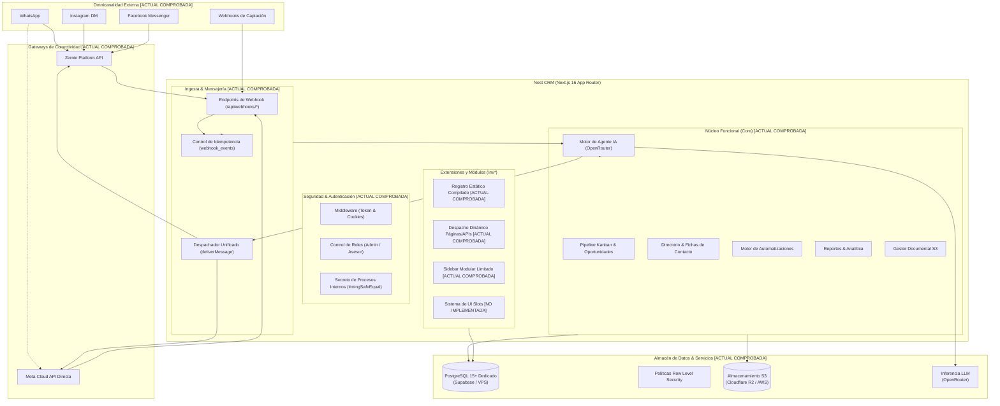

---

## 3. Decisiones Arquitectónicas Registradas (ADR)

| ID | Decisión Arquitectónica | Clasificación | Justificación y Regla Técnica |
|---|---|---|---|
| **ADR-001** | **Instancia y base de datos dedicada por cliente** | **[OBJETIVO APROBADO / COMPROBADA ESTRUCTURALMENTE]** | Modelo rector de despliegue. El repositorio provee las capacidades estructurales para ello (`Dockerfile` standalone, conexión a BD dedicada vía `DATABASE_URL`). Se descarta el SaaS multi-tenant compartido. *(Nota: El aislamiento de infraestructura no confiere por sí solo conformidad GDPR automática; esta exige evaluaciones jurídicas y controles operativos específicos).* |
| **ADR-002** | **Inmutabilidad del núcleo (`src/`)** | **[ACTUAL COMPROBADA en política / OBJETIVO APROBADO]** | Principio de gobernanza constitucional (`specs/CONSTITUCION.md`). La inmutabilidad es una disciplina de ingeniería y control de versiones que prohíbe introducir código particular de clientes en `src/`. |
| **ADR-003** | **Next.js Standalone Build con módulos estáticos** | **[ACTUAL COMPROBADA]** | Next.js compila únicamente código presente en el árbol de build. No existe inyección dinámica de código en caliente que no esté compilado en el artefacto. |
| **ADR-004** | **Configuración en cuatro niveles jerárquicos** | **[OBJETIVO APROBADO]** | Orden conceptual de precedencia: 1) Núcleo, 2) Plantilla, 3) Instalación, 4) Personalización cliente. |
| **ADR-005** | **Migraciones transaccionales idempotentes** | **[ACTUAL COMPROBADA]** | Todo script SQL corre dentro de una transacción registrada en `public._migraciones`. Fallo revierte completamente. |
| **ADR-006** | **Desacoplamiento de UI mediante Slots controlados** | **[OBJETIVO APROBADO / NO IMPLEMENTADA]** | Vistas del núcleo exponen slots de extensión. Módulos inyectan componentes tipados; la plantilla define la distribución. |
| **ADR-007** | **Preservación estricta de datos al desactivar módulos** | **[OBJETIVO APROBADO]** | Desactivar un módulo solo oculta rutas y desactiva tools. **Bajo ninguna circunstancia se eliminan tablas o columnas.** |

---

## 4. Estado Real del Sistema de Módulos y Extensiones de UI

Para evitar ambigüedades, se delimita con precisión el estado técnico de cada componente de extensión:

### 4.1 Lo que Existe Actualmente [ACTUAL COMPROBADA]:
1. **Despacho Dinámico de Páginas:** En `src/app/m/[modulo]/[[...ruta]]/page.tsx`, Next.js resuelve en tiempo de ejecución las páginas declaradas en `servidor.tsx` del módulo según coincidencia de patrones.
2. **Despacho Dinámico de APIs:** En `src/app/api/m/[modulo]/[[...ruta]]/route.ts`, se enrutan peticiones HTTP hacia los controladores REST del módulo, aplicando `requireMember()`.
3. **Navegación Modular Limitada:** `src/components/layout/Sidebar.tsx` concatena elementos de `manifiesto.nav` exclusivamente al final de tres secciones fijas hardcodeadas (`Operaciones`, `Productividad`, `Inteligencia`).
4. **Fusión de Campos y Tools:** Los campos de contacto y las tools de IA de los módulos activos se suman a los del núcleo al compilar o arrancar el servidor.

### 4.2 Lo que Aún NO Existe [NO IMPLEMENTADA]:
- **UI Slots Completos:** No existen puntos de anclaje para inyectar widgets en el dashboard (`dashboard.widgets`), bloques en la ficha de contacto (`contact.detail`, `contact.tabs`), vistas en oportunidades (`deal.detail`, `deal.tabs`), ni paneles laterales en el chat (`conversation.sidebar`).
- **Componente `SlotRenderer`:** No existe en el repositorio ningún despachador de slots con `Suspense` o `ErrorBoundary` para componentes modulares.
- **Contratos de Extensión de UI:** Los módulos actuales no exportan componentes para slots porque el mecanismo no ha sido implementado en el código fuente.

---

## 5. Contratos Conceptuales Unificados

Los contratos conceptuales formalizan las interfaces objetivo que regirán las plantillas y los módulos.

### 5.1 Contrato Conceptual `TemplateDefinition` [OBJETIVO APROBADO]

Este contrato define formalmente una plantilla sectorial. Es idéntico en todas las referencias documentales:

```typescript
export interface TemplateDefinition {
  /** Identificador técnico único en kebab-case (ej. "inmobiliaria", "clinica-dental") */
  id: string;

  /** Nombre comercial descriptivo de la plantilla */
  name: string;

  /** Resumen del sector de negocio y alcance funcional */
  description: string;

  /** Versión semántica de la plantilla (ej. "1.0.0") */
  version: string;

  /** Reglas de compatibilidad de versión con el núcleo de Nest CRM */
  compatibility: {
    coreMinVersion: string; // ej. ">=2.1.0"
    coreMaxVersion?: string;
  };

  /** Módulos funcionales del sistema asociados a este nicho */
  modules: {
    /** Módulos estrictamente necesarios que se activan obligatoriamente */
    required: string[]; // ej. ["propiedades", "visitas"]
    /** Módulos sugeridos o complementarios disponibles para activación opcional */
    optional: string[]; // ej. ["contratos", "comisiones"]
  };

  /** Valores predeterminados del negocio para la instalación */
  defaults: {
    marca: {
      nombreSugerido: string;
      colorPrimario: string; // Formato hex #rrggbb
      colorSidebar: string;  // Formato hex #rrggbb
    };
    moneda: string;          // Código ISO 4217 (ej. "USD", "CLP", "MXN")
    idioma: "es" | "en";
    roles: {
      etiquetaAsesor: string; // ej. "Corredor", "Agente", "Doctor"
    };
    pipeline: {
      nombre: string;
      etapas: Array<{
        clave: string;
        nombre: string;
        color: string;
        ganada?: boolean;
        perdida?: boolean;
      }>;
    };
    contacto: {
      campos: Array<{
        clave: string;
        etiqueta: string;
        tipo: "texto" | "numero" | "seleccion" | "booleano" | "fecha";
        opciones?: string[];
        enTabla?: boolean;
        requerido?: boolean;
        agente?: {
          calificar: boolean;
          descripcion: string;
        };
      }>;
    };
    agente: {
      nombre: string;
      promptBase: string;
      mensajeDerivacion: string;
    };
  };

  /**
   * Navegación y organización del menú lateral.
   * Modela el slot oficial 'sidebar.sections'.
   */
  navigation: {
    secciones: Array<{
      titulo: string;
      items: Array<{
        tipo: "core" | "modulo";
        referencia: string; // ruta del core o id de módulo
        etiqueta?: string;
      }>;
    }>;
  };

  /**
   * Configuración de widgets en la pantalla principal.
   * Modela el slot oficial 'dashboard.widgets'.
   */
  dashboard: {
    widgets: Array<{
      widgetId: string;
      moduloId?: string;
      orden: number;
      tamano: "sm" | "md" | "lg" | "full";
      config?: Record<string, unknown>;
    }>;
  };

  /**
   * Inyección de extensiones en pantallas contextuales del núcleo.
   * Modela exclusivamente los slots de detalle y conversación.
   */
  extensions?: Array<{
    slot: "contact.detail" | "contact.tabs" | "deal.detail" | "deal.tabs" | "conversation.sidebar";
    componentId: string;
    moduloId: string;
    orden: number;
  }>;

  /** Automatizaciones predefinidas del sector */
  automations?: Array<{
    key: string;
    name: string;
    trigger: string;
    filters?: Record<string, unknown>;
    actions: Array<Record<string, unknown>>;
  }>;

  /** Reportes e indicadores clave sugeridos para este nicho */
  reports?: Array<{
    key: string;
    titulo: string;
    tipo: "kpi" | "grafico_barras" | "tabla";
    origen: string;
  }>;
}
```

> [!NOTE]
> **Consistencia de los 7 UI Slots Oficiales:**
> - `sidebar.sections` está modelado en `navigation.secciones`.
> - `dashboard.widgets` está modelado en `dashboard.widgets`.
> - Los 5 slots contextuales restantes (`contact.detail`, `contact.tabs`, `deal.detail`, `deal.tabs`, `conversation.sidebar`) se agrupan en `extensions`. No existe duplicidad de responsabilidades.

---

### 5.2 Contrato Conceptual `ModuleDefinition` [OBJETIVO APROBADO]

Evolución planificada sobre el actual `ManifiestoModulo`:

```typescript
export interface ModuleDefinition {
  /** Identificador técnico único en snake_case (ej. "propiedades", "visitas") */
  id: string;

  /** Nombre comercial legible en la interfaz */
  name: string;

  /** Descripción concisa de la funcionalidad aportada */
  description: string;

  /** Versión semántica del módulo (ej. "1.1.0") */
  version: string;

  /** Compatibilidad semver con el núcleo */
  compatibility: {
    coreMinVersion: string; // ej. ">=2.1.0"
    coreMaxVersion?: string;
  };

  /** Dependencias entre módulos */
  dependencies: {
    /** Módulos que deben estar previamente activos en la instalación */
    required: string[];
    /** Módulos con los que se integra opcionalmente si están presentes */
    optional: string[];
  };

  /** Capacidades declaradas explícitamente */
  capabilities: {
    hasPages: boolean;         // Expone páginas bajo /m/[id]/*
    hasApi: boolean;           // Expone endpoints bajo /api/m/[id]/*
    hasAgentTools: boolean;    // Registra herramientas para el LLM
    hasUiSlots: boolean;       // Exporta componentes para UI slots
    hasAutomations: boolean;   // Registra disparadores o acciones
    hasReports: boolean;       // Aporta métricas a la sección de reportes
  };

  /** Gestión de persistencia y esquema propio */
  database: {
    /** Directorio relativo de scripts SQL */
    migrationsDir: string;
    /** Versión secuencial del esquema del módulo */
    schemaVersion: number;
    /** Tablas pertenecientes al módulo */
    tables: string[];
  };
}
```

---

## 6. Fuente de Verdad del Sistema de Módulos

Para erradicar contradicciones entre archivos y base de datos, se separan formalmente cuatro responsabilidades:

```
┌────────────────────────────────────────────────────────────────────────┐
│ 1. REGISTRO DE CÓDIGO COMPILADO (Build Time) [ACTUAL COMPROBADA]       │
│    - Los archivos físicos en modules/ determinan la DISPONIBILIDAD.    │
│    - Next.js solo puede ejecutar código incluido en el artefacto.      │
├────────────────────────────────────────────────────────────────────────┤
│ 2. DEFINICIÓN DE PLANTILLA (Declarativa) [OBJETIVO APROBADO]           │
│    - Declara qué módulos son obligatorios (required) y opcionales.     │
├────────────────────────────────────────────────────────────────────────┤
│ 3. BASE DE DATOS DE INSTALACIÓN (Runtime) [NO IMPLEMENTADA]           │
│    - Almacenará la ACTIVACIÓN EFECTIVA de la empresa (crm_settings).   │
│    - El administrador podrá activar módulos opcionales compilados.     │
├────────────────────────────────────────────────────────────────────────┤
│ 4. HISTORIAL DE MIGRACIONES (Runtime) [ACTUAL COMPROBADA]             │
│    - La tabla public._migraciones registra qué scripts se aplicaron.   │
└────────────────────────────────────────────────────────────────────────┘
```

> [!IMPORTANT]
> **Papel Real de `config/modulos.json`:**
> - **En el código actual [ACTUAL COMPROBADA]:** Es la fuente real que determina qué módulos se compilan y migran (`scripts/generar-registro-modulos.mjs` y `scripts/migrar.mjs`).
> - **En la arquitectura objetivo [OBJETIVO APROBADO / NO IMPLEMENTADA]:** Pasará a ser únicamente un archivo de inicialización (*seed*) para el primer arranque de la instancia. Una vez inicializada la base de datos, la activación residirá en PostgreSQL (`crm_settings`).

---

## 7. Seguridad y Gestión de Secretos

### 7.1 Segregación de Credenciales [ACTUAL COMPROBADA]
1. **Credenciales de Infraestructura:** `DATABASE_URL`, `DIRECT_URL`, `SUPABASE_SERVICE_ROLE_KEY` y `S3_*` residen exclusivamente en variables de entorno del servidor. Jamás se exponen al navegador.
2. **Secretos de Procesos Internos:** `AGENT_WORKER_SECRET` protege endpoints de background (`/api/agent/process`, sweepers) mediante validación en tiempo constante (`timingSafeEqual`).
3. **Variables Públicas del Navegador:** `NEXT_PUBLIC_*` se inyectan en tiempo de ejecución en el DOM (`src/lib/config-publica.ts`), evitando embeber secretos en el bundle estático.

### 7.2 Decisiones de Seguridad Pendientes [PENDIENTE DE DECISIÓN]
- **Cifrado Simétrico en Reposo (SEC-01):** La propuesta de implementar cifrado AES-256-GCM para tokens de Meta en `whatsapp_accounts.accessToken` está **pendiente de aprobación técnica e implementación**. Actualmente dichos tokens se almacenan en texto plano en la base de datos de la instalación.
- **Rate Limiting en Webhooks (SEC-02):** La implementación de limitadores de tasa en Next.js Middleware para endpoints de webhooks está **pendiente de diseño e implementación**.


# DOCUMENTO: CORE.md

# Nest CRM — Núcleo Funcional Genérico (Core)

**Versión del documento**: 2.1.0\
**Fecha de actualización**: 2026-11-09\
**Estado**: Documento de referencia del núcleo funcional\
**Ubicación en el repositorio**: `src/`\

---

## 1. Convenciones de Clasificación del Documento

- **[ACTUAL COMPROBADA]**: Funcionalidad implementada y verificada en el código.
- **[OBJETIVO APROBADO]**: Decisión aprobada para el núcleo, planificada o en especificación.
- **[PENDIENTE DE DECISIÓN]**: Propuesta sujeta a evaluación técnica.
- **[NO IMPLEMENTADA]**: Diseñada conceptualmente pero sin código en el repositorio.

---

## 2. Misión y Principios del Núcleo

El **Núcleo Funcional (*Core*)** constituye la base inmutable de Nest CRM. Su responsabilidad es suministrar un conjunto genérico de capacidades comerciales, de mensajería, inteligencia artificial y automatización, siendo agnóstico a cualquier sector industrial.

### Distinción Fundamental de Principios:
1. **Inmutabilidad del Núcleo [ACTUAL COMPROBADA / Constitución I]:** El código bajo `src/`, `docker/` y `supabase/migrations/` no se modifica para atender requerimientos de un cliente particular. Todas las adaptaciones deben resolverse a través de configuración o módulos.
2. **Neutralidad de los Módulos [ACTUAL COMPROBADA en diseño]:** Los módulos en `modules/` aportan especializaciones verticales (ej. catálogo de inmuebles), pero no alteran el código fuente del núcleo ni contienen lógica acoplada a una empresa específica.

---

## 3. Inventario de Capacidades del Núcleo

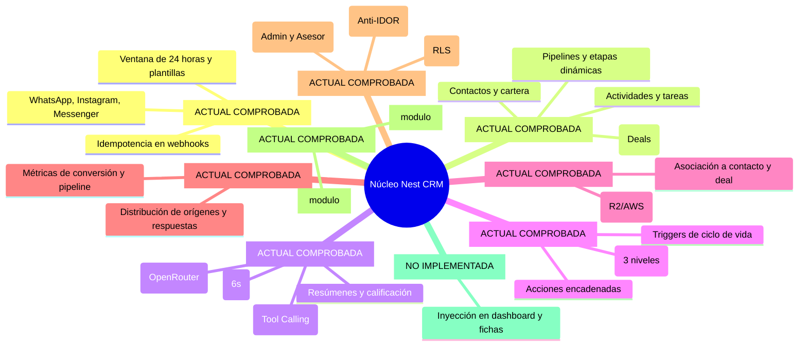

---

## 4. Estado Real de los Mecanismos de Extensión

Es crítico distinguir lo que el núcleo implementa hoy de lo que forma parte de la arquitectura objetivo:

| Mecanismo de Extensión | Clasificación | Estado Real Comprobado en Código |
|---|---|---|
| **Despacho Dinámico de Páginas** | **[ACTUAL COMPROBADA]** | Implementado en `src/app/m/[modulo]/[[...ruta]]/page.tsx`. Resuelve páginas de `servidor.tsx` de módulos activos con `requireMember()`. |
| **Despacho Dinámico de APIs** | **[ACTUAL COMPROBADA]** | Implementado en `src/app/api/m/[modulo]/[[...ruta]]/route.ts`. Enruta peticiones REST hacia controladores del módulo. |
| **Fusión de Campos de Contacto** | **[ACTUAL COMPROBADA]** | Implementado en `src/lib/config/campos.ts`. Combina campos de `config/cliente.ts` con `manifiesto.campos` de módulos activos. |
| **Fusión de Herramientas de IA** | **[ACTUAL COMPROBADA]** | Implementado en `src/lib/agent/tools.ts`. Las herramientas exportadas en `servidor.tsx` se añaden al set del agente IA. |
| **Navegación Modular en Sidebar** | **[ACTUAL COMPROBADA con limitaciones]** | Implementado en `src/components/layout/Sidebar.tsx`. Concatena ítems de navegación exclusivamente en tres secciones fijas hardcodeadas (`Operaciones`, `Productividad`, `Inteligencia`). |
| **Sistema Completo de UI Slots** | **[OBJETIVO APROBADO / NO IMPLEMENTADA]** | Inyección de widgets en dashboard (`dashboard.widgets`), bloques en contactos (`contact.detail`, `contact.tabs`), negocios (`deal.detail`, `deal.tabs`) o chat (`conversation.sidebar`). **No existe en el código actual.** |
| **Componente `SlotRenderer`** | **[NO IMPLEMENTADA]** | Componente contenedor con `Suspense` y `ErrorBoundary` para aislar fallos de módulos. **No existe en el código actual.** |

---

## 5. Modelo de Persistencia Relacional [ACTUAL COMPROBADA]

El esquema relacional del núcleo reside en `src/db/schema.ts` y se gestiona mediante Drizzle ORM sobre PostgreSQL 15+:

| Tabla | Propósito y Restricciones | Llaves Foráneas |
|---|---|---|
| `contacts` | Registro maestro de personas. Posee la columna semiestructurada `custom_fields` (JSONB) para datos dinámicos. | `owner_id` → `team_members.id` (set null) |
| `conversations` | Hilos de chat unificados por canal. UNIQUE `(provider, external_id)`. | `contact_id` → `contacts.id` (cascade), `account_id` → `channel_accounts.id` |
| `messages` | Historial de mensajes in/out. Soporta origen (`agent`, `human`, `template`). | `conversation_id` → `conversations.id` (cascade), `contact_id` → `contacts.id` |
| `pipelines` | Embudos comerciales. | Ninguna |
| `pipeline_stages` | Etapas ordenadas del pipeline. Clave técnica inmutable `key`. UNIQUE `(pipeline_id, key)`. | `pipeline_id` → `pipelines.id` (cascade) |
| `deals` | Oportunidades comerciales. Valor monetario en centavos (`value`). | `stage_id` → `pipeline_stages.id`, `contact_id` → `contacts.id` (cascade) |
| `activities` | Registro cronológico de tareas, notas, reuniones y llamadas. | `contact_id` → `contacts.id` (cascade), `deal_id` → `deals.id` (set null) |
| `team_members` | Extensión de usuarios de Supabase Auth para roles (`admin`, `asesor`) y estado de actividad. | `id` → `auth.users.id` |
| `automations` | Definición de automatizaciones (disparador, filtros, acciones). | Ninguna |
| `automation_runs` | Registro de ejecuciones para auditoría y recuperación. | `automation_key` → `automations.key`, `contact_id` → `contacts.id` |
| `agent_jobs` | Cola de procesamiento asíncrono para el agente LLM con debounce de 6s. | `contact_id` → `contacts.id` (cascade), `conversation_id` → `conversations.id` (cascade) |
| `documents` | Metadatos de archivos adjuntos subidos a buckets S3/R2 presignados. | `contact_id` → `contacts.id`, `deal_id` → `deals.id`, `uploaded_by` → `team_members.id` |
| `crm_settings` | Almacén clave-valor de configuraciones del CRM. | Ninguna |
| `webhook_events` | Control de idempotencia de mensajes entrantes de proveedores externos. | Ninguna |

---

## 6. Sistema Agéntico de Inteligencia Artificial [ACTUAL COMPROBADA]

El agente del núcleo (`src/lib/agent/index.ts`) opera como un asistente conversacional autónomo:
- **Límite de Historial:** Procesa hasta 30 mensajes recientes del hilo.
- **Límite de Iteraciones:** Hasta 6 rondas iterativas de tool calling por invocación (`MAX_TOOL_ROUNDS = 6`).
- **Debounce de Mensajes en Ráfaga:** 6 segundos (`DEBOUNCE_MS = 6000`). Los mensajes consecutivos en el mismo hilo reinician el temporizador para responder a la idea completa.
- **Herramientas Estándar del Núcleo:**
  - `mover_etapa`: Transiciona la oportunidad a una etapa identificada por su `clave`.
  - `actualizar_contacto`: Almacena campos estándar y propiedades validadas en `custom_fields`.
  - `registrar_actividad`: Inserta tareas o notas de seguimiento con prefijo `[IA]`.
  - `resumen_lead`: Condensa la situación del prospecto en `contacts.ai_summary`.
  - `derivar_asesor`: Pausa al agente exclusivamente en ese hilo (`ai_enabled = false`) y marca `needs_human = true`.
  - `asignar_asesor`: Asigna el contacto a un miembro del equipo comercial por nombre.

---

## 7. Motor de Automatizaciones [ACTUAL COMPROBADA]

El motor de reglas opera de forma desacoplada en `src/lib/automations/`:
- **Disparadores (*Triggers*):** `contact.created`, `contact.assigned`, `deal.stage_changed`.
- **Acciones Disponibles:** `push` (notificación VAPID), `add_tag` / `remove_tag`, `assign_owner`, `create_activity`.
- **Prevención de Recursión:** Payload con contador `__depth`. Se aborta si excede `MAX_EVENT_DEPTH = 3`.

---

## 8. Seguridad y Aislamiento de Cartera [ACTUAL COMPROBADA]

- **Aislamiento de Asesores (Anti-IDOR):** Todas las consultas en servidor inyectan la condición `ownerFilter(member)`. Los asesores solo ven contactos donde `contacts.owner_id = member.id`. Rutas por ID ajeno retornan **404 Not Found**.
- **Protección de Rutas Internas:** `/api/agent/process` y sweepers exigen `Authorization: Bearer <AGENT_WORKER_SECRET>`, validado en tiempo constante con `crypto.timingSafeEqual`.
- **Row Level Security (RLS):** Activado en todas las tablas; el rol `anon` carece de permisos.


# DOCUMENTO: PLANTILLAS.md

# Nest CRM — Sistema de Plantillas Sectoriales (Templates)

**Versión del documento**: 2.1.0\
**Fecha de actualización**: 2026-11-09\
**Estado**: Documento rector del sistema de plantillas\
**Ubicación de referencia**: `config/plantillas/`\

---

## 1. Convenciones de Clasificación del Documento

- **[ACTUAL COMPROBADA]**: Funcionalidad implementada y verificada en el código.
- **[OBJETIVO APROBADO]**: Decisión arquitectónica aprobada, en especificación o planificación formal.
- **[PENDIENTE DE DECISIÓN]**: Propuesta técnica sujeta a análisis.
- **[NO IMPLEMENTADA]**: Diseñada conceptualmente pero sin código en el repositorio.

---

## 2. Concepto y Rol de las Plantillas

Una **Plantilla Sectorial (*Template*)** en Nest CRM es una especificación declarativa que define la configuración comercial, procesos, campos y recomendaciones de módulos para una vertical de negocio concreta (inmobiliaria, salud, concesionarios, servicios).

### Principio Fundamental [OBJETIVO APROBADO]:
> Las plantillas son estrictamente **declarativas**. No ejecutan código imperativo, no interactúan directamente con la base de datos ni contienen componentes duplicados de módulos.

Una plantilla define:
- Qué módulos son obligatorios (`required`) y cuáles son complementarios (`optional`).
- Valores predeterminados de marca, localización y etiquetas de rol.
- Estructura de etapas del embudo comercial (pipeline kanban).
- Campos personalizados de captura y directivas de calificación para el agente IA.
- Disposición de secciones del menú de navegación (`sidebar.sections`).
- Composición de widgets en la pantalla principal (`dashboard.widgets`).
- Extensiones visuales en pantallas contextuales de contactos, deals y chat (`extensions`).
- Automatizaciones y reportes sugeridos para el sector.

---

## 3. Contrato Formal Unificado `TemplateDefinition` [OBJETIVO APROBADO]

Este contrato representa la especificación unificada que regirá a todas las plantillas:

```typescript
export interface TemplateDefinition {
  /** Identificador técnico único en formato kebab-case (ej. "inmobiliaria", "clinica-dental") */
  id: string;

  /** Nombre comercial descriptivo de la plantilla */
  name: string;

  /** Resumen de la vertical de negocio y propósito comercial */
  description: string;

  /** Versión semántica de la plantilla (ej. "1.0.0") */
  version: string;

  /** Reglas de compatibilidad de versión con el núcleo de Nest CRM */
  compatibility: {
    coreMinVersion: string; // ej. ">=2.1.0"
    coreMaxVersion?: string;
  };

  /** Módulos funcionales asociados a este nicho */
  modules: {
    /** Módulos obligatorios que deben activarse mandatoriamente */
    required: string[]; // ej. ["propiedades", "visitas"]
    /** Módulos complementarios sugeridos para activación opcional */
    optional: string[]; // ej. ["contratos", "comisiones"]
  };

  /** Valores predeterminados del negocio para la instalación */
  defaults: {
    marca: {
      nombreSugerido: string;
      colorPrimario: string; // Formato hex #rrggbb
      colorSidebar: string;  // Formato hex #rrggbb
    };
    moneda: string;          // Código ISO 4217 (ej. "USD", "CLP", "MXN")
    idioma: "es" | "en";
    roles: {
      etiquetaAsesor: string; // ej. "Corredor", "Agente", "Doctor"
    };
    pipeline: {
      nombre: string;
      etapas: Array<{
        clave: string;
        nombre: string;
        color: string;
        ganada?: boolean;
        perdida?: boolean;
      }>;
    };
    contacto: {
      campos: Array<{
        clave: string;
        etiqueta: string;
        tipo: "texto" | "numero" | "seleccion" | "booleano" | "fecha";
        opciones?: string[];
        enTabla?: boolean;
        requerido?: boolean;
        agente?: {
          calificar: boolean;
          descripcion: string;
        };
      }>;
    };
    agente: {
      nombre: string;
      promptBase: string;
      mensajeDerivacion: string;
    };
  };

  /**
   * Navegación y organización del menú lateral.
   * Modela el slot oficial 'sidebar.sections'.
   */
  navigation: {
    secciones: Array<{
      titulo: string;
      items: Array<{
        tipo: "core" | "modulo";
        referencia: string; // ruta del core o id de módulo
        etiqueta?: string;
      }>;
    }>;
  };

  /**
   * Configuración de widgets en la pantalla principal.
   * Modela el slot oficial 'dashboard.widgets'.
   */
  dashboard: {
    widgets: Array<{
      widgetId: string;
      moduloId?: string;
      orden: number;
      tamano: "sm" | "md" | "lg" | "full";
      config?: Record<string, unknown>;
    }>;
  };

  /**
   * Inyección declarativa de extensiones en pantallas contextuales del núcleo.
   * Cubre los 5 slots oficiales restantes sin solaparse con navigation ni dashboard.
   */
  extensions?: Array<{
    slot: "contact.detail" | "contact.tabs" | "deal.detail" | "deal.tabs" | "conversation.sidebar";
    componentId: string;
    moduloId: string;
    orden: number;
  }>;

  /** Automatizaciones predefinidas del sector */
  automations?: Array<{
    key: string;
    name: string;
    trigger: string;
    filters?: Record<string, unknown>;
    actions: Array<Record<string, unknown>>;
  }>;

  /** Reportes e indicadores clave sugeridos para este nicho */
  reports?: Array<{
    key: string;
    titulo: string;
    tipo: "kpi" | "grafico_barras" | "tabla";
    origen: string;
  }>;
}
```

---

## 4. Resolución de la Contradicción Detectada

### 4.1 Situación Real Comprobada en el Código [ACTUAL COMPROBADA]
En el repositorio actual coexisten dos mecanismos con propósitos superpuestos:
1. `config/plantillas/inmobiliaria.ts` incluye la propiedad:
   ```typescript
   modulos: {
     nucleo: { ... },
     activos: ["propiedades", "visitas"], // Lista sugerida
   }
   ```
2. `config/modulos.json` define:
   ```json
   {
     "activos": [] // Lista que realmente lee el sistema
   }
   ```
3. `config/cliente.ts` consume directamente `modulos.json`:
   ```typescript
   import modulos from "./modulos.json";
   ...
   modulos: { activos: modulos.activos }
   ```
4. `scripts/generar-registro-modulos.mjs` y `scripts/migrar.mjs` leen **exclusivamente `config/modulos.json`** para generar el registro de TypeScript y aplicar migraciones SQL.

**Efecto:** La lista de módulos dentro de `inmobiliaria.ts` no tiene efecto operativo directo; si un implementador copia la plantilla a `cliente.ts` pero no actualiza `config/modulos.json`, los módulos inmobiliarios no se compilan ni se migran.

### 4.2 Arquitectura Inequívoca Formalizada [OBJETIVO APROBADO]

Para resolver esta contradicción sin ambigüedades, se establece la siguiente jerarquía de responsabilidades:

1. **La Plantilla DECLARA DEPENDENCIAS Y RECOMENDACIONES:**
   - Define `modules.required` (módulos sin los cuales la plantilla no opera) y `modules.optional` (módulos recomendados).
2. **El Registro de Código DETERMINA LA DISPONIBILIDAD:**
   - Los módulos físicamente presentes en `modules/` e incluidos en el build determinan qué código puede ejecutarse.
3. **La Base de Datos de la Instalación DETERMINA LA ACTIVACIÓN EFECTIVA [NO IMPLEMENTADA]:**
   - En la arquitectura objetivo, la activación residirá en PostgreSQL (`crm_settings.modules_active_list`).
   - Al seleccionar una plantilla, el sistema activará automáticamente sus `modules.required` y ofrecerá activar sus `modules.optional`.
4. **Papel Futuro de `config/modulos.json`:**
   - Durante la transición, permanece como archivo de configuración de build para desarrollo local.
   - En la fase de persistencia dinámica, pasa a ser exclusivamente un archivo de inicialización (*seed*) para el primer arranque de la instancia.

---

## 5. Procedimiento Controlado para Cambio de Plantilla [OBJETIVO APROBADO / NO IMPLEMENTADA]

Una empresa podrá cambiar de plantilla comercial tras haber entrado en operación mediante un procedimiento guiado y seguro:

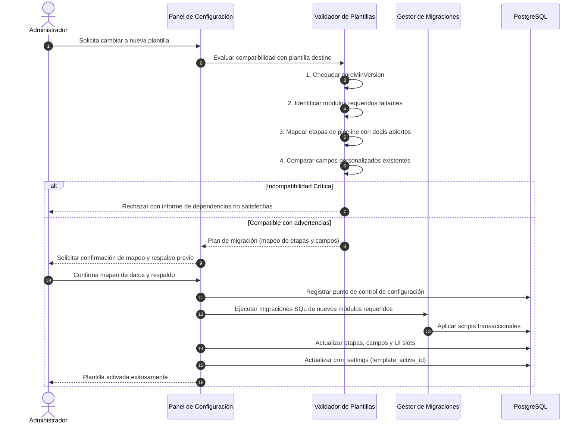

### Reglas Inviolables del Cambio de Plantilla:
1. **Preservación Total de Datos:** Ningún contacto, deal, mensaje ni actividad previa es eliminada. Las etapas antiguas con operaciones abiertas no se borran; se conservan o se mapean a etapas de la nueva plantilla.
2. **Módulos No Utilizados:** Si la plantilla anterior utilizaba módulos que la nueva no requiere, **sus tablas y datos se preservan íntegros en PostgreSQL**. El módulo simplemente se desactiva de las vistas principales.
3. **Respaldo Previo Obligatorio:** Se debe exigir confirmación explícita del administrador y recomendar un respaldo completo de la base de datos antes de aplicar el cambio.


# DOCUMENTO: MODULOS.md

# Nest CRM — Sistema de Módulos Funcionales (Modules)

**Versión del documento**: 2.1.0\
**Fecha de actualización**: 2026-11-09\
**Estado**: Documento rector del sistema de módulos\
**Ubicación de referencia**: `modules/` y `src/lib/modules/`\

---

## 1. Convenciones de Clasificación del Documento

- **[ACTUAL COMPROBADA]**: Funcionalidad o arquitectura implementada y comprobada en el código.
- **[OBJETIVO APROBADO]**: Decisión arquitectónica aprobada, en especificación o planificación formal.
- **[PENDIENTE DE DECISIÓN]**: Propuesta técnica sujeta a análisis.
- **[NO IMPLEMENTADA]**: Diseñada conceptualmente pero sin código en el repositorio.

---

## 2. Concepto y Rol de los Módulos

Un **Módulo Funcional** en Nest CRM es un paquete autocontenido de software que extiende las capacidades del sistema en una vertical específica (ej. catálogo de inmuebles en `modules/propiedades`, agenda de visitas presenciales en `modules/visitas`).

### Principios Fundamentales:
1. **Reutilización Intersectorial [ACTUAL COMPROBADA]:** Diferentes plantillas pueden requerir los mismos módulos (ej. `visitas` puede emplearse en inmobiliarias, talleres o consultorios).
2. **Aislamiento del Núcleo [ACTUAL COMPROBADA]:** Los módulos residen en `modules/<id>/` y no modifican archivos en `src/`.
3. **Preservación Estricta de Datos [ACTUAL COMPROBADA en comportamiento / OBJETIVO APROBADO en política]:** Desactivar un módulo **NUNCA elimina sus tablas, columnas ni registros históricos de la base de datos**.

---

## 3. Estado Real del Contrato de Módulos

Es imprescindible distinguir entre el contrato que existe en el código hoy y el contrato formalizado para la arquitectura objetivo:

### 3.1 Contrato Actual Comprobado en Código [ACTUAL COMPROBADA]
En `src/lib/modules/types.ts`, el sistema define actualmente dos interfaces:
- `ManifiestoModulo`: Metadatos del navegador (`nombre`, `titulo`, `descripcion`, `version`, `nav`, `campos`).
- `ModuloServidor`: Capacidades del servidor (`manifiesto`, `paginas`, `api`, `tools`, `seed`).

### 3.2 Contrato Objetivo Unificado `ModuleDefinition` [OBJETIVO APROBADO]
Evolución formalizada para dotar a los módulos de gestión de dependencias transitivas, grafo acíclico, capacidades explícitas y metadatos de persistencia:

```typescript
export interface ModuleDefinition {
  /** Identificador técnico único en snake_case (ej. "propiedades", "visitas") */
  id: string;

  /** Nombre comercial legible en la interfaz */
  name: string;

  /** Descripción concisa de la funcionalidad aportada */
  description: string;

  /** Versión semántica del módulo (ej. "1.1.0") */
  version: string;

  /** Compatibilidad semver con el núcleo */
  compatibility: {
    coreMinVersion: string; // ej. ">=2.1.0"
    coreMaxVersion?: string;
  };

  /** Dependencias entre módulos */
  dependencies: {
    /** Módulos que deben estar previamente activos en la instalación */
    required: string[];
    /** Módulos con los que se integra opcionalmente si están presentes */
    optional: string[];
  };

  /** Capacidades declaradas explícitamente */
  capabilities: {
    hasPages: boolean;         // Expone páginas bajo /m/[id]/*
    hasApi: boolean;           // Expone endpoints bajo /api/m/[id]/*
    hasAgentTools: boolean;    // Registra herramientas para el LLM
    hasUiSlots: boolean;       // Exporta componentes para UI slots
    hasAutomations: boolean;   // Registra disparadores o acciones
    hasReports: boolean;       // Aporta métricas a la sección de reportes
  };

  /** Gestión de persistencia y esquema propio */
  database: {
    /** Directorio relativo de scripts SQL */
    migrationsDir: string;
    /** Versión secuencial del esquema del módulo */
    schemaVersion: number;
    /** Tablas pertenecientes al módulo */
    tables: string[];
  };
}
```

---

## 4. Gestión de Dependencias entre Módulos [OBJETIVO APROBADO / NO IMPLEMENTADA]

El contrato `ModuleDefinition` introduce la gestión formal de dependencias:

1. **Dependencias Directas:**
   - Si el módulo `visitas` declara `dependencies.required: ["propiedades"]`, el CRM no permitirá activar `visitas` a menos que `propiedades` esté activo en la instalación.
2. **Dependencias Transitivas y Detección de Ciclos (DAG):**
   - El validador de módulos evalúa el grafo de dependencias como un **Grafo Acíclico Dirigido (*Directed Acyclic Graph - DAG*)**.
   - Si se detecta una dependencia circular (ej. Módulo A requiere Módulo B, y Módulo B requiere Módulo A), la activación se rechaza inmediatamente con error descriptivo.
3. **Orden Secuencial de Activación y Migración:**
   - Los módulos se activan y sus migraciones SQL se aplican respetando estrictamente el orden topológico del DAG (primero las dependencias base, luego los módulos dependientes).

---

## 5. Estructura Interna de un Módulo [ACTUAL COMPROBADA]

Todo módulo en `modules/<id>/` respeta la siguiente organización de archivos:

```
modules/<id>/
├── manifiesto.ts       # Metadatos del módulo (seguro para el navegador)
├── servidor.tsx        # Páginas, APIs, tools de IA y seed (exclusivo servidor)
├── tabla.ts            # Esquemas de base de datos en Drizzle ORM
├── tipos.ts            # Definiciones de TypeScript internas del módulo
├── componentes/        # Componentes React propios de las vistas del módulo
├── migrations/         # Scripts de migración SQL secuenciales (0000_*.sql)
└── README.md           # Documentación técnica y variables de entorno
```

### Separación Estricta Navegador / Servidor [ACTUAL COMPROBADA]:
- `manifiesto.ts`: No importa código de base de datos, secretos ni librerías pesadas. Es consumido de forma segura por el cliente.
- `servidor.tsx`: Contiene `import "server-only"`. Resuelve peticiones de base de datos, consultas Drizzle y llamadas LLM.

---

## 6. Ciclo de Vida: Activación, Desactivación y Persistencia

### 6.1 Activación de un Módulo

| Etapa | Estado Actual Comprobado [ACTUAL COMPROBADA] | Estado Objetivo Aprobado [OBJETIVO APROBADO / NO IMPLEMENTADA] |
|---|---|---|
| **Mecanismo / Disparador** | Edición manual de `config/modulos.json` (`"activos": [...]`). Requiere reconstrucción de artefacto (`build`). | Acción interactiva desde el panel de administración del CRM (`POST /api/settings/modules/[id]/toggle`) en tiempo de ejecución. |
| **Generación de Registro** | `scripts/generar-registro-modulos.mjs` genera imports estáticos en tiempo de compilación. | Registro dinámico basado en catálogo compilado con conmutación en runtime. |
| **Validación de Código** | Comprueba la existencia física de `manifiesto.ts` y `servidor.tsx`. | Comprueba que el módulo esté presente en el artefacto de ejecución y compatible con el núcleo. |
| **Validación de Dependencias** | No implementada. | Validación estricta del grafo acíclico dirigido (DAG) de dependencias (`dependencies.required`). |
| **Migraciones SQL** | `scripts/migrar.mjs` aplica `modules/<activo>/migrations/*.sql` durante el arranque. | Ejecución transaccional automática de migraciones pendientes del módulo al activarlo. |
| **Persistencia de Estado** | Archivo estático versionado `config/modulos.json`. | Base de datos de la instalación (`crm_settings.modules_active_list`). |

> [!IMPORTANT]
> **Aclaración sobre la activación en el CRM:**
> La activación y desactivación dinámica en tiempo de ejecución desde la interfaz web es un **[OBJETIVO APROBADO / NO IMPLEMENTADA]**. En la arquitectura actual comprobada, no existe conmutación en caliente; la inclusión de un módulo requiere su presencia en `config/modulos.json`, la ejecución del generador de registro y el build o reinicio del proceso Next.js.

### 6.2 Desactivación de un Módulo y Conservación de Datos

> [!CAUTION]
> **REGLA ARQUITECTÓNICA INNEGOCIABLE:**\
> **La desactivación de un módulo NUNCA elimina sus tablas, columnas ni datos de la base de datos.**

#### A. Comportamiento Actual Comprobado [ACTUAL COMPROBADA]:
1. **Procedimiento de Desactivación:** Se elimina el identificador del módulo de la lista `"activos"` en `config/modulos.json`.
2. **Efecto tras Recompilación / Reinicio:**
   - `scripts/generar-registro-modulos.mjs` excluye el módulo de `registro.generated.ts` y `registro-cliente.generated.ts`.
   - Al no formar parte del registro compilado, sus rutas en `/m/[id]/*` y `/api/m/[id]/*` son interceptadas por el despachador dinámico respondiendo **404 Not Found**.
   - El módulo no se incluye en el menú de navegación (`Sidebar.tsx`).
   - Sus herramientas de IA no son registradas en el agente conversacional.
   - `scripts/migrar.mjs` deja de listar o aplicar migraciones del módulo en arranques posteriores.
3. **Persistencia Garantizada:** Las tablas PostgreSQL asociadas al módulo (ej. `propiedades`, `visitas`) y todos sus registros permanecen **estrictamente intactos** en la base de datos.
4. **Limitación Actual:** Las rutas y componentes **no se desactivan de forma inmediata en caliente sin recompilación o reinicio**, dado que la resolución de módulos activos depende del registro generado estáticamente.

#### B. Comportamiento Objetivo Aprobado [OBJETIVO APROBADO / NO IMPLEMENTADA]:
1. **Desactivación en Runtime:** El administrador conmuta el estado del módulo desde la interfaz del CRM sin requerir reconstrucción de la imagen Docker ni reinicio de la instancia.
2. **Ocultamiento Inmediato:** El despachador dinámico (`/m/*`, `/api/m/*`), el agente de IA y los UI Slots consultan el estado activo en base de datos (`crm_settings`) y ocultan inmediatamente las interfaces y herramientas.
3. **Reactivación Controlada:** Al volver a activar el módulo, el sistema valida que las dependencias continúen cumpliéndose y restablece el acceso a los datos históricos sin pérdida de información ni re-migración innecesaria.


# DOCUMENTO: CONFIGURACION.md

# Nest CRM — Arquitectura de Configuración y Precedencia

**Versión del documento**: 2.1.0\
**Fecha de actualización**: 2026-11-09\
**Estado**: Documento rector del sistema de configuración\
**Ubicación de referencia**: `config/` y `src/lib/config/`\

---

## 1. Convenciones de Clasificación del Documento

- **[ACTUAL COMPROBADA]**: Funcionalidad implementada y verificada en el código.
- **[OBJETIVO APROBADO]**: Decisión arquitectónica aprobada, en especificación o planificación formal.
- **[PENDIENTE DE DECISIÓN]**: Propuesta técnica sujeta a análisis.
- **[NO IMPLEMENTADA]**: Diseñada conceptualmente pero sin código en el repositorio.

---

## 2. Los Cuatro Niveles de Configuración

Para compatibilizar la inmutabilidad del código fuente con la personalización profunda de cada cliente, la arquitectura define conceptualmente cuatro niveles de configuración con precedencia jerárquica estricta:

```
┌─────────────────────────────────────────────────────────────────┐
│ Nivel 4 — Personalizaciones Particulares de la Empresa          │
│ (Ajustes manuales: nombre comercial, campos extra, prompt fino) │ ◀── Máxima Prioridad
├─────────────────────────────────────────────────────────────────┤
│ Nivel 3 — Configuración de la Instalación                       │
│ (Moneda operativa, zona horaria IANA, módulos activos)          │
├─────────────────────────────────────────────────────────────────┤
│ Nivel 2 — Valores Predeterminados de la Plantilla Sectorial     │
│ (Defaults de industria: etapas de venta, campos sectoriales)    │
├─────────────────────────────────────────────────────────────────┤
│ Nivel 1 — Valores Base del Núcleo (Core Defaults)               │
│ (Idioma 'es', moneda 'USD', etapas mínimas, prompts seguros)   │ ◀── Mínima Prioridad
└─────────────────────────────────────────────────────────────────┘
```

### 2.1 Definición y Responsabilidades de Cada Nivel:

| Nivel | Denominación | Responsabilidad y Alcance | Fuente Conceptual |
|---|---|---|---|
| **1** | **Base del Núcleo** | Provee fallbacks mínimos e invariantes del sistema para que el CRM arranque de forma segura si no existen otros valores. | Esquemas en `src/lib/config/schema.ts` y constantes del núcleo. |
| **2** | **Predeterminados de Plantilla** | Aporta la estructura comercial y los flujos recomendados para un sector industrial concreto. | Definición declarativa `TemplateDefinition`. |
| **3** | **Instalación** | Establece los parámetros operativos propios de la instancia de la empresa (zona horaria IANA, moneda, módulos habilitados). | Parámetros del entorno y registro de instalación. |
| **4** | **Personalización Particular** | Almacena los ajustes específicos que la empresa modificó libremente desde su panel de gestión (etiquetas renombradas, campos añadidos). | Procedencia identificada como personalización de cliente. |

---

## 3. Estado Real de la Configuración en el Código

Es fundamental contrastar el modelo conceptual con la implementación existente:

### 3.1 Implementación Actual Comprobada [ACTUAL COMPROBADA]
- La configuración se resuelve de forma estática en tiempo de ejecución de Node.js mediante `src/lib/config/index.ts`.
- `config/cliente.ts` importa manualmente una plantilla (ej. `import { plantillaInmobiliaria } from "./plantillas/inmobiliaria"`) y exporta un objeto TypeScript unificado con `definirConfig({...})`.
- `src/lib/config/index.ts` ejecuta `validar()` contra el esquema Zod `esquemaConfig` (`src/lib/config/schema.ts`) una vez por proceso.
- Se concatenan los campos declarados en `config/cliente.ts` con los aportados por los módulos en `manifiesto.campos`.
- **No existe hoy un algoritmo de merge dinámico de cuatro niveles en tiempo de ejecución.**

### 3.2 Arquitectura Objetivo de Reconciliación [OBJETIVO APROBADO / NO IMPLEMENTADA]
- En la arquitectura objetivo, la configuración efectiva se resolverá mediante un reconciliador jerárquico que combinará los cuatro niveles:
  1. Base del núcleo (valores por defecto).
  2. Plantilla seleccionada.
  3. Parámetros de instalación en base de datos (`crm_settings`).
  4. Personalizaciones de cliente identificadas por su procedencia en base de datos.
- Las personalizaciones no requieren residir obligatoriamente en tablas separadas; pueden persistirse dentro de `crm_settings` organizadas conceptualmente con etiquetas de procedencia (`source: "client"` vs `source: "template"`).

---

## 4. Gestión Segura de Credenciales y Secretos

Las credenciales técnicas de conexión e integraciones externas **no constituyen configuración funcional del negocio** y deben mantenerse completamente segregadas:

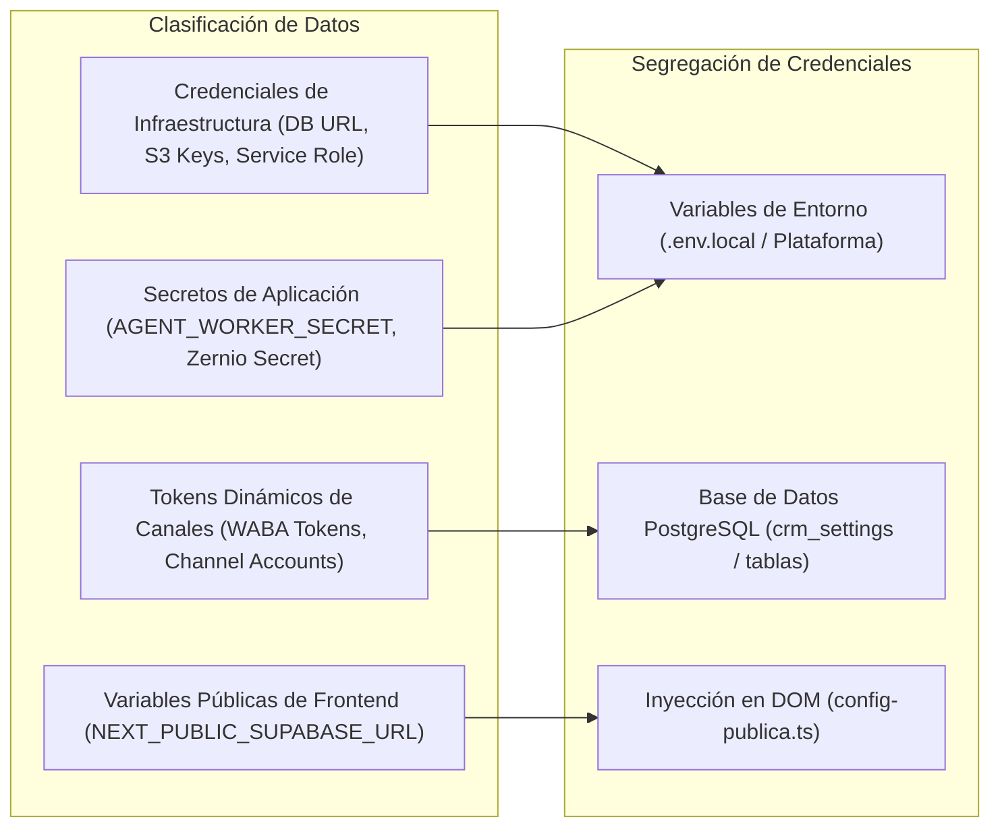

### 4.1 Reglas de Seguridad Obligatorias:
1. **Credenciales de Infraestructura [ACTUAL COMPROBADA]:** `DATABASE_URL`, `DIRECT_URL`, `SUPABASE_SERVICE_ROLE_KEY` y accesos S3 residen exclusivamente en variables de entorno del servidor. Jamás se exponen al cliente web ni se versionan en Git.
2. **Secretos de Procesos Internos [ACTUAL COMPROBADA]:** `AGENT_WORKER_SECRET` protege endpoints de background mediante comparación en tiempo constante (`timingSafeEqual`).
3. **Variables Públicas [ACTUAL COMPROBADA]:** Las variables requeridas por el navegador se inyectan en el DOM en tiempo de ejecución (`src/lib/config-publica.ts`).
4. **Tokens Dinámicos en Base de Datos [PENDIENTE DE DECISIÓN / NO IMPLEMENTADA]:**
   - Actualmente los tokens de Meta Graph API en `whatsapp_accounts.accessToken` residen en texto plano en la base de datos [ACTUAL COMPROBADA].
   - La propuesta técnica de implementar cifrado simétrico en reposo (AES-256-GCM) utilizando una llave maestra de aplicación está **pendiente de aprobación técnica e implementación**.

---

## 5. Delimitación de Fuentes de Verdad

Para evitar inconsistencias en el ciclo de vida del producto:

| Responsabilidad | Dónde Reside Actualmente [ACTUAL COMPROBADA] | Dónde Residirá en la Arquitectura Objetivo [OBJETIVO APROBADO] |
|---|---|---|
| **Disponibilidad de Módulos** | Archivos físicos en `modules/` incluidos en el build de Next.js. | Idéntico: el build de Next.js determina qué código puede ejecutarse. |
| **Activación de Módulos** | Archivo estático `config/modulos.json` (`"activos": [...]`). | Base de datos de la instalación (`crm_settings.modules_active_list`). |
| **Valores de Plantilla** | Archivo TypeScript `config/plantillas/inmobiliaria.ts`. | Catálogo de definiciones declarativas `TemplateDefinition`. |
| **Personalización de Empresa** | Archivo TypeScript `config/cliente.ts` y assets en `public/marca/`. | Base de datos de la instalación (`crm_settings`) con procedencia de cliente. |
| **Historial de Migraciones** | Tabla `public._migraciones` en PostgreSQL. | Idéntico: tabla `public._migraciones` como registro inmutable de esquema. |


# DOCUMENTO: PERSONALIZACION.md

# Nest CRM — Estrategia de Personalización y Protección de Cambios

**Versión del documento**: 2.1.0\
**Fecha de actualización**: 2026-11-09\
**Estado**: Documento rector de la personalización de instalaciones\

---

## 1. Convenciones de Clasificación del Documento

- **[ACTUAL COMPROBADA]**: Funcionalidad implementada y verificada en el código.
- **[OBJETIVO APROBADO]**: Decisión arquitectónica aprobada, en especificación o planificación formal.
- **[PENDIENTE DE DECISIÓN]**: Propuesta técnica sujeta a análisis.
- **[NO IMPLEMENTADA]**: Diseñada conceptualmente pero sin código en el repositorio.

---

## 2. Misión de la Personalización Sostenible

La personalización sostenible en Nest CRM garantiza que una empresa cliente pueda adaptar su identidad, procesos y vocabulario de negocio **sin que dichas modificaciones se pierdan al actualizar el núcleo o la plantilla sectorial**, y sin requerir la modificación del código fuente del producto (`src/`).

```
┌─────────────────────────────────────────────────────────────┐
│                 ACTUALIZACIÓN DEL NÚCLEO                    │
│      (Nuevas funciones, parches de seguridad, optimización) │
└──────────────────────────────┬──────────────────────────────┘
                               │ Fluye sin conflictos
                               ▼
┌─────────────────────────────────────────────────────────────┐
│            PERSONALIZACIÓN DE LA INSTALACIÓN                │
│    ✓ Marca propia (Logo, colores corporativos)              │
│    ✓ Nombres de etapas del pipeline y orden particular      │
│    ✓ Campos adicionales propios del negocio                 │
│    ✓ Instrucciones y tono personalizado del agente IA       │
│    ✓ Módulos específicos habilitados                        │
└─────────────────────────────────────────────────────────────┘
```

---

## 3. Mecanismos Existentes en el Código [ACTUAL COMPROBADA]

El núcleo actual ya incorpora patrones arquitectónicos diseñados para proteger la personalización:

### 3.1 Claves Técnicas Inmutables vs. Nombres Visuales [ACTUAL COMPROBADA]
- En las etapas del pipeline (`pipeline_stages`), existe una separación entre:
  1. `key`: Identificador técnico inmutable (ej. `nuevo`, `calificado`, `visita_agendada`).
  2. `name`: Texto descriptivo visible para el usuario en el tablero Kanban.
- **Regla:** El usuario puede renombrar libremente la etiqueta visual de una etapa. Las automatizaciones y las herramientas del agente de IA (`mover_etapa`) continúan funcionando de forma inalterada porque operan sobre la columna `key`.

### 3.2 Contenedor Semiestructurado para Datos Dinámicos (`custom_fields`) [ACTUAL COMPROBADA]
- En la tabla `contacts`, los campos personalizados definidos por la empresa o por los módulos activos no requieren sentencias `ALTER TABLE` relacionales; se persisten en la columna semiestructurada `custom_fields` de tipo `JSONB`.
- Esto garantiza que nuevas versiones del núcleo nunca colisionen con columnas creadas arbitrariamente por clientes.

### 3.3 Variables CSS Dinámicas en Runtime [ACTUAL COMPROBADA]
- En `src/lib/config/index.ts`, la función `cssVariablesMarca()` calcula los colores primarios y del sidebar en tiempo de ejecución (`SSR`) y los inyecta en el bloque `<head>` del layout raíz, evitando flash visual y sin modificar archivos CSS estáticos.

---

## 4. Protección de Personalizaciones por Procedencia [OBJETIVO APROBADO / NO IMPLEMENTADA]

Para que una instalación pueda actualizar la versión de su plantilla sectorial o del núcleo sin destruir cambios particulares:

### 4.1 Identificación por Procedencia (*Origin Tracking*)
- La configuración de una instalación no requiere dividirse físicamente en múltiples tablas de base de datos; basta con estructurar los registros de `crm_settings` asociando a cada propiedad una etiqueta de procedencia:
  - `origin: "core"`: Valor base inmutable.
  - `origin: "template"`: Valor sugerido por la plantilla sectorial.
  - `origin: "client"`: Valor modificado o creado explícitamente por el administrador de la empresa.

### 4.2 Reglas de Reconciliación y Límites de la Inmunidad [OBJETIVO APROBADO / NO IMPLEMENTADA]

> **Principio Rector:** Cuando se aplica una actualización de plantilla o del núcleo, los registros con `origin: "client"` **no se sobrescriben automáticamente por valores por defecto**.

Sin embargo, **preservar un valor personalizado no garantiza por sí solo que sea compatible con la nueva versión**:
1. **Límites de la Inmunidad Automática:**
   - Si una plantilla actualizada modifica la lógica del flujo comercial, los tipos de datos o las herramientas del agente, mantener un valor antiguo del cliente puede generar incompatibilidades semánticas o fallos de validación.
   - Por tanto, el sistema **no asume compatibilidad ciega**: ante discrepancias estructurales, suspende la aplicación automática y exige **revisión y confirmación administrativa**.
2. **Campos Eliminados o Renombrados por una Nueva Versión:**
   - Si una nueva versión de la plantilla retira un campo que la empresa utilizaba, o lo renombra, el sistema **no elimina los datos existentes** en `contacts.custom_fields`.
   - El campo se mantiene en modo "preservado/legado" accesible en la ficha, pero se notifica al administrador para que decida si lo mapea a un campo nuevo o lo conserva como atributo histórico.
3. **Cambios Incompatibles de Tipo de Datos:**
   - Si un campo personalizado definido previamente como `texto` es redefinido por una nueva plantilla como `numero` o `seleccion` con opciones cerradas, la actualización relacional directa provocaría errores de validación.
   - El sistema detecta la incompatibilidad de tipos, mantiene el valor existente en formato texto y solicita al administrador un procedimiento de **migración de datos asistida** o la asignación de una clave técnica alternativa.
4. **Etapas Utilizadas por Oportunidades Abiertas:**
   - Si una actualización de plantilla retira o reestructura etapas del embudo comercial, pero existen oportunidades (`deals`) activas en ellas, **se bloquea cualquier eliminación de la etapa**.
   - El administrador debe realizar un mapeo guiado transfiriendo los deals abiertos hacia las nuevas etapas antes de consolidar el cambio.
5. **Puntos de Control y Respaldo Previo:**
   - Ante cualquier operación de actualización que involucre reestructuración de esquemas o reconciliación de conflictos, el sistema exige generar un punto de respaldo de la base de datos y confirmación administrativa explícita de los cambios propuestos.

> [!NOTE]
> **Estado de Implementación:** El algoritmo formal de reconciliación por procedencia, detección de incompatibilidades semánticas y resolución guiada de conflictos es un **[OBJETIVO APROBADO / NO IMPLEMENTADA]**. En el código actual comprobado, la configuración es estática y se define en archivos locales (`config/cliente.ts`).

---

## 5. Matriz de Resolución de Cambios y Conflictos

| Escenario de Cambio | Comportamiento Técnico Previsto | Clasificación | Acción Requerida |
|---|---|---|---|
| **Renombrar una etapa comercial** | Se modifica `pipeline_stages.name`. La columna inmutable `key` no cambia. | **[ACTUAL COMPROBADA]** | Ninguna. Automatizaciones y tools de IA siguen operando con la `key`. |
| **Añadir campos de contacto extra** | Se registran en la configuración activa y se guardan dentro de `contacts.custom_fields`. | **[ACTUAL COMPROBADA]** | Ninguna alteración relacional requerida. |
| **Actualizar paleta cromática** | Las variables CSS (`--primary`, `--sidebar`) se inyectan dinámicamente en el layout. | **[ACTUAL COMPROBADA]** | Se inyecta en tiempo de ejecución sin tocar `globals.css`. |
| **Actualización de plantilla con nueva etapa** | El sistema detecta la nueva `key` técnica y la inserta al pipeline sin alterar el orden de las existentes. | **[OBJETIVO APROBADO]** | El administrador revisa y posiciona la nueva etapa en el tablero. |
| **Desactivar etapa con deals abiertos** | El sistema bloquea el borrado físico para evitar pérdida de oportunidades comerciales. | **[ACTUAL COMPROBADA]** | Reasignación previa de las operaciones comerciales a otra etapa. |
| **Cambio de tipo en campo existente (ej. texto a número)** | El validador detecta incompatibilidad de esquema en datos históricos de `custom_fields`. | **[OBJETIVO APROBADO / NO IMPLEMENTADA]** | Revisión administrativa y ejecución de script de migración/normalización de datos. |
| **Campo retirado por nueva versión de plantilla** | Los datos históricos en `custom_fields` se preservan; el campo pasa a estado legado. | **[OBJETIVO APROBADO / NO IMPLEMENTADA]** | Confirmación administrativa para mapeo o archivo del campo. |
| **Colisión de claves entre módulo y campo propio** | El validador de configuración detecta la duplicidad de `clave` y emite error descriptivo. | **[ACTUAL COMPROBADA]** | El implementador renombra la clave técnica conflictiva. |


# DOCUMENTO: UI_SYSTEM.md

# Nest CRM — Sistema de Extensiones de Interfaz (UI Slots)

**Versión del documento**: 2.1.0\
**Fecha de actualización**: 2026-11-09\
**Estado**: Especificación de arquitectura objetivo\
**Clasificación general**: **[OBJETIVO APROBADO / NO IMPLEMENTADA]**\

---

## 1. Convenciones de Clasificación del Documento

- **[ACTUAL COMPROBADA]**: Funcionalidad implementada y verificada en el código.
- **[OBJETIVO APROBADO]**: Decisión arquitectónica aprobada, en especificación o planificación formal.
- **[PENDIENTE DE DECISIÓN]**: Propuesta técnica sujeta a análisis.
- **[NO IMPLEMENTADA]**: Diseñada conceptualmente pero sin código en el repositorio.

---

## 2. Estado Real vs. Arquitectura Objetivo

Para evitar expectativas erróneas sobre el código existente:

### 2.1 Lo que Existe Actualmente en el Código [ACTUAL COMPROBADA]:
1. **Navegación Modular Básica:** En `src/components/layout/Sidebar.tsx`, los elementos declarados en `manifiesto.nav` de los módulos activos se concatenan al final de tres secciones fijas hardcodeadas (`Operaciones`, `Productividad`, `Inteligencia`).
2. **Páginas Aisladas en `/m/[modulo]`:** Los módulos pueden renderizar pantallas completas bajo su propio prefijo de ruta.
3. **No existen puntos de anclaje de UI:** No existe en el código actual ningún mecanismo para inyectar widgets en el dashboard, bloques en fichas de contactos o deals, ni paneles laterales en el chat.

### 2.2 Arquitectura Objetivo de UI Slots [OBJETIVO APROBADO / NO IMPLEMENTADA]:
El **Sistema de UI Slots** es la arquitectura diseñada para permitir que módulos funcionales y plantillas sectoriales extiendan visualmente las pantallas maestras del núcleo **sin modificar el código fuente de los componentes en `src/components/`**.

---

## 3. Inventario de los Siete Slots de Interfaz Oficiales

Se formalizan taxativamente los siguientes siete puntos de anclaje (*UI Slots*) dentro del CRM:

```
┌────────────────────────────────────────────────────────────────────────┐
│                              APP SHELL                                 │
│  ┌────────────────────┬─────────────────────────────────────────────┐  │
│  │  sidebar.sections  │             dashboard.widgets               │  │
│  │                    │                                             │  │
│  │  - Operaciones     │  ┌──────────────┐  ┌─────────────────────┐  │  │
│  │  - Productividad   │  │ Core KPIs    │  │ Módulo Widget (ej.  │  │  │
│  │  - Inteligencia    │  │              │  │ Visitas Pendientes) │  │  │
│  │  - [Slots Módulos] │  └──────────────┘  └─────────────────────┘  │  │
│  │                    ├─────────────────────────────────────────────┤  │
│  │                    │              Vistas de Detalle              │  │
│  │                    │  ┌───────────────────────┬───────────────┐  │  │
│  │                    │  │ contact.detail / tabs │ conversation. │  │  │
│  │                    │  │ deal.detail / tabs    │ sidebar       │  │  │
│  │                    │  │ (Ficha enriquecida)   │ (Panel extra) │  │  │
│  │                    │  └───────────────────────┴───────────────┘  │  │
│  └────────────────────┴─────────────────────────────────────────────┘  │
└────────────────────────────────────────────────────────────────────────┘
```

| Identificador de Slot | Ubicación en la Aplicación | Propósito Funcional | Props Inyectadas por el Núcleo |
|---|---|---|---|
| `dashboard.widgets` | Pantalla principal (`/`, `src/app/page.tsx`). | Tarjetas de métricas, accesos directos o listas resumidas de un módulo. | `{ member, dateRange }` |
| `sidebar.sections` | Menú lateral (`src/components/layout/Sidebar.tsx`). | Secciones y enlaces de navegación hacia las vistas principales de los módulos. | `{ member, pathname }` |
| `contact.detail` | Columna principal de la ficha del contacto (`/contacts/[id]`). | Bloques de información sectorial vinculada al prospecto (ej. requerimiento de inmueble). | `{ contact, member }` |
| `contact.tabs` | Pestañas de la ficha del contacto (`/contacts/[id]`). | Subvistas dedicadas de gestión profunda (ej. historial de visitas del prospecto). | `{ contact, member }` |
| `deal.detail` | Vista de oportunidad comercial (`/pipeline` modal o página de deal). | Atributos comerciales específicos del nicho (ej. propiedad asociada, tasación). | `{ deal, contact, member }` |
| `deal.tabs` | Pestañas de la ficha de oportunidad comercial. | Vistas relacionales del negocio (ej. cotizaciones generadas, contratos). | `{ deal, member }` |
| `conversation.sidebar` | Panel lateral derecho en la bandeja de chat (`/conversations/[id]`). | Herramientas operativas durante la conversación (ej. buscador de catálogo o agenda directa). | `{ conversation, contact, member }` |

---

## 4. Contratos de Componentes para Slots [OBJETIVO APROBADO]

Todo componente exportado por un módulo para ser utilizado en un UI Slot deberá ajustarse a contratos tipados:

```typescript
import type { ComponentType } from "react";
import type { TeamMember } from "@/lib/team";

/** Props base comunes a todos los slots */
export interface BaseSlotProps {
  member: TeamMember;
}

/** Props para widgets del dashboard */
export interface DashboardWidgetProps extends BaseSlotProps {
  config?: Record<string, unknown>;
}

/** Props para slots contextuales a un contacto */
export interface ContactSlotProps extends BaseSlotProps {
  contactId: string;
  contactData: {
    name: string;
    email?: string | null;
    phone?: string | null;
    customFields: Record<string, unknown>;
  };
}

/** Props para slots contextuales a una oportunidad comercial */
export interface DealSlotProps extends BaseSlotProps {
  dealId: string;
  dealData: {
    title: string;
    value: number;
    stageId: string;
    contactId: string;
  };
}

/** Props para el menú lateral (sidebar.sections) */
export interface SidebarSectionProps extends BaseSlotProps {
  pathname: string;
}

/** Props para el panel lateral de conversación */
export interface ConversationSidebarProps extends BaseSlotProps {
  conversationId: string;
  contactId: string;
  channel: "whatsapp" | "instagram" | "facebook";
}

/**
 * Mapa canónico que vincula cada identificador oficial de Slot con su interfaz de props.
 * Garantiza que cada componente declare y reciba exclusivamente las props correspondientes a su anclaje.
 */
export interface SlotPropsMap {
  "dashboard.widgets": DashboardWidgetProps;
  "sidebar.sections": SidebarSectionProps;
  "contact.detail": ContactSlotProps;
  "contact.tabs": ContactSlotProps;
  "deal.detail": DealSlotProps;
  "deal.tabs": DealSlotProps;
  "conversation.sidebar": ConversationSidebarProps;
}

export type SlotId = keyof SlotPropsMap;

/**
 * Representación conceptual fuertemente tipada de una extensión registrada.
 * Parametrizada por el identificador del Slot para evitar 'ComponentType<any>'.
 */
export interface RegisteredSlotExtension<S extends SlotId = SlotId> {
  id: string;                 // ej. "propiedades.buscador_rapido"
  slot: S;                    // Identificador exacto del slot
  title: string;              // Título para pestañas, encabezados o accesibilidad
  component: ComponentType<SlotPropsMap[S]>; // Componente tipado con las props exactas del slot
  rolesPermitidos?: ("admin" | "asesor")[];
  tamanoDefault?: "sm" | "md" | "lg" | "full";
}

/** Unión discriminada para colecciones heterogéneas de extensiones */
export type AnyRegisteredSlotExtension = {
  [K in SlotId]: RegisteredSlotExtension<K>;
}[SlotId];
```

> [!NOTE]
> **Decisión Técnica Pendiente sobre Inferencia de Colecciones Heterogéneas [PENDIENTE DE DECISIÓN]:**\
> Si bien `RegisteredSlotExtension<S>` y `AnyRegisteredSlotExtension` resuelven formalmente la asociación estricta entre slot y props a nivel conceptual, la implementación de un despachador genérico sin pérdida de inferencia requerirá una evaluación técnica específica durante la Fase 3 del Roadmap para validar la compatibilidad con Server Components de Next.js y empaquetado dinámico sin recurrir a tipos inseguros.

---

## 5. Principios de Seguridad y Aislamiento en UI Slots [OBJETIVO APROBADO]

La implementación de UI Slots deberá respetar estrictamente las siguientes garantías técnicas:

1. **La Autorización en Servidor es Innegociable:**
   - El filtrado visual por rol en el frontend (`rolesPermitidos`) es una optimización de experiencia de usuario, **no una barrera de seguridad**.
   - Todo endpoint de API (`/api/m/[modulo]/*`) o Server Action que alimente un componente de slot **debe verificar obligatoriamente la sesión y los permisos en el servidor** (`requireMember()`, `requireAdmin()`, `ownerFilter()`).
2. **`Suspense` no Reemplaza a `ErrorBoundary`:**
   - `Suspense` gestiona exclusivamente estados de carga asíncrona (*fallbacks* y *skeletons*).
   - Cada slot debe estar obligatoriamente encapsulado en un **`ErrorBoundary` dedicado** para que, si un componente de módulo arroja una excepción no controlada en tiempo de ejecución, el fallo quede confinado a ese widget y **no derribe la pantalla principal del CRM**.
3. **Soberanía del Núcleo en el Renderizado:**
   - El núcleo decide cuándo, cómo y dónde se renderiza cada slot.
   - Los módulos no pueden manipular el DOM fuera del contenedor de su slot ni interferir con la navegación global.
4. **Prohibición de Código Arbitrario:**
   - Los módulos no pueden inyectar scripts, cadenas ejecutables (`eval`) ni componentes dinámicos no validados desde la base de datos o archivos de configuración. Todo componente debe estar fuertemente tipado e importado desde el código compilado del repositorio.


# DOCUMENTO: ROADMAP.md

# Nest CRM — Hoja de Ruta Técnica (Roadmap)

**Versión del documento**: 2.1.0\
**Fecha de actualización**: 2026-11-09\
**Estado**: Plan de evolución técnica formalizado y aprobado\

---

## 1. Convenciones de Clasificación del Documento

- **[ACTUAL COMPROBADA]**: Funcionalidad implementada y verificada en el código.
- **[OBJETIVO APROBADO]**: Decisión arquitectónica aprobada, en especificación o planificación formal.
- **[PENDIENTE DE DECISIÓN]**: Propuesta técnica sujeta a análisis.
- **[NO IMPLEMENTADA]**: Diseñada conceptualmente pero sin código en el repositorio.

---

## 2. Estrategia de Evolución y Orden de Fases

Para preservar la estabilidad operativa comprobada en la auditoría técnica (v2.1.0), la evolución se estructura en cinco fases estrictamente secuenciales.

> [!IMPORTANT]
> **Regla de Precedencia Técnica:**
> No se avanzará a la implementación del Sistema de UI Slots (Fase 3) ni del Asistente Inicial (Fase 4) antes de haber formalizado y validado en tests los contratos de tipos y la fuente de verdad en base de datos (Fases 1 y 2).

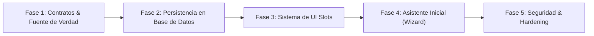

---

## 3. Detalle de Fases Técnicas y Criterios de Aceptación

### Fase 1: Formalización de Contratos y Fuente Única de Verdad

**Objetivo:** Introducir los tipos formales [`TemplateDefinition`](file:///e:/Codigo/nest-crm/docs/PLANTILLAS.md#3-contrato-formal-unificado-templatedefinition-objetivo-aprobado) y [`ModuleDefinition`](file:///e:/Codigo/nest-crm/docs/MODULOS.md#32-contrato-objetivo-unificado-moduledefinition-objetivo-aprobado) en el código sin romper los módulos existentes, y resolver la contradicción entre `plantillas/inmobiliaria.ts` y `config/modulos.json`.

| Hito Técnico | Descripción | Clasificación | Análisis de Riesgos y Complejidad |
|---|---|---|---|
| **H1.1** Tipado de `TemplateDefinition` | Crear `src/lib/templates/types.ts` con el contrato unificado. | **[OBJETIVO APROBADO]** | **Riesgo Medio:** Requiere desacoplar el preset inmobiliario actual sin romper la validación con `esquemaConfig`. |
| **H1.2** Evolución de `ModuleDefinition` | Incorporar dependencias y capacidades en `src/lib/modules/types.ts` manteniendo retrocompatibilidad con `ManifiestoModulo`. | **[OBJETIVO APROBADO]** | **Riesgo Medio:** Debe preservar compatibilidad con los módulos existentes (`propiedades`, `visitas`, `ejemplo`). |
| **H1.3** Adaptación de plantilla inmobiliaria | Refactorizar `config/plantillas/inmobiliaria.ts` para que declare `modules.required: ["propiedades", "visitas"]`. | **[OBJETIVO APROBADO]** | **Riesgo Bajo:** Modificación declarativa en la carpeta `config/plantillas/`. |
| **H1.4** Validación en script de generación | Actualizar `scripts/generar-registro-modulos.mjs` para validar la coherencia entre módulos requeridos por la plantilla y módulos presentes. | **[OBJETIVO APROBADO]** | **Riesgo Medio:** Puede impactar el ciclo de build de Next.js si se introducen chequeos que fallen en frío. |

**Criterios de Aceptación Verificables de la Fase 1:**
1. `npm run typecheck` ejecuta en verde sin errores de tipos en `src/`, `config/` ni `modules/`.
2. `npm run build` genera el artefacto standalone sin advertencias de módulos no encontrados.
3. La suite de pruebas unitarias (`npm run test`) pasa al 100%.
4. `scripts/verificar-instancia.mjs` pasa en verde contra una base de datos de prueba.

---

### Fase 2: Persistencia de Configuración y Gestión de Módulos en Base de Datos

**Objetivo:** Trasladar la verdad operativa de la activación de módulos y personalizaciones hacia PostgreSQL (`crm_settings`), permitiendo la activación de módulos opcionales en tiempo de ejecución.

| Hito Técnico | Descripción | Clasificación | Análisis de Riesgos |
|---|---|---|---|
| **H2.1** Estructura en `crm_settings` | Definir el esquema JSON para `template_active_id`, `modules_active_list` y `customizations` con procedencia. | **[NO IMPLEMENTADA]** | **Riesgo Bajo:** Utiliza la tabla clave-valor existente en `schema.ts`. |
| **H2.2** Reconciliador de cuatro niveles | Implementar la cascada jerárquica con fusión no destructiva documentada en [`docs/CONFIGURACION.md`](file:///e:/Codigo/nest-crm/docs/CONFIGURACION.md). | **[NO IMPLEMENTADA]** | **Riesgo Alto:** Riesgo de sobreescritura accidental si el algoritmo de merge no discrimina correctamente la procedencia (`origin`). |
| **H2.3** Endpoint de activación de módulos | Crear `/api/settings/modules/[id]/toggle` que valide el DAG de dependencias y aplique migraciones SQL. | **[NO IMPLEMENTADA]** | **Riesgo Alto:** Requiere ejecutar DDL transaccional desde el runtime de la aplicación. |
| **H2.4** Mecanismo de respaldo previo | Implementar script CLI de volcado (*dump*) antes de cambios estructurales o de plantilla. | **[NO IMPLEMENTADA]** | **Riesgo Medio:** Dependencia de utilidades `pg_dump` disponibles en el entorno. |

**Criterios de Aceptación Verificables de la Fase 2:**
1. Desactivar un módulo desde el endpoint apaga sus rutas (`404 Not Found`) sin eliminar sus tablas relacionales en PostgreSQL.
2. Activar un módulo opcional aplica sus migraciones pendientes registradas en `public._migraciones`.
3. Un intento de activación con dependencias insatisfechas o dependencias circulares es rechazado con error `400 Bad Request`.
4. Los valores personalizados de la empresa prevalecen ante reinicios del contenedor.

---

### Fase 3: Sistema Controlado de Extensiones de Interfaz (UI Slots)

**Objetivo:** Habilitar los siete slots oficiales para que los módulos inyecten componentes visuales en vistas maestras del núcleo.

| Hito Técnico | Descripción | Clasificación | Análisis de Riesgos |
|---|---|---|---|
| **H3.1** Componente `SlotRenderer` | Desarrollar el despachador defensivo con `Suspense` y `ErrorBoundary` en `src/components/shared/SlotRenderer.tsx`. | **[NO IMPLEMENTADA]** | **Riesgo Bajo:** Aislamiento estricto de componentes React. |
| **H3.2** Puntos de inserción en el núcleo | Incorporar los anclajes para `dashboard.widgets`, `contact.detail/tabs`, `deal.detail/tabs` y `conversation.sidebar`. | **[NO IMPLEMENTADA]** | **Riesgo Medio:** Modificación de vistas maestras del núcleo (`src/app/`, `src/components/`). |
| **H3.3** Migración de widgets modulares | Exportar el buscador rápido de `propiedades` para `conversation.sidebar` y el calendario de `visitas` para `dashboard.widgets`. | **[NO IMPLEMENTADA]** | **Riesgo Bajo:** Refactorización interna de componentes de módulos. |

**Criterios de Aceptación Verificables de la Fase 3:**
1. Si un componente inyectado en un slot arroja un error en tiempo de renderizado, el error queda confinado a su contenedor y la pantalla principal del CRM continúa 100% operativa.
2. Los slots no renderizan componentes si el módulo asociado está inactivo en la base de datos.
3. El filtrado visual de roles oculta el slot a usuarios no autorizados, y los endpoints subyacentes validan permisos en servidor.

---

### Fase 4: Asistente Inicial de Configuración (Onboarding Wizard)

**Objetivo:** Permitir que una empresa configure su instalación en 8 pasos guiados sin edición de código fuente.

| Hito Técnico | Descripción | Clasificación | Análisis de Riesgos |
|---|---|---|---|
| **H4.1** Flujo de 8 pasos en `/onboarding` | Interfaz asistida para marca, plantilla, módulos, pipeline, campos, equipo e integraciones. | **[NO IMPLEMENTADA]** | **Riesgo Medio:** Interfaz amplia con múltiples estados intermedios. |
| **H4.2** Gate de activación | Transicionar el estado de la instalación a `ACTIVE` solo tras pasar la verificación de integridad. | **[NO IMPLEMENTADA]** | **Riesgo Bajo:** Control de estado en `crm_settings`. |

**Criterios de Aceptación Verificables de la Fase 4:**
1. Una instalación recién desplegada redirige automáticamente a `/onboarding` hasta que se completa el proceso.
2. El asistente permite configurar la marca, elegir la plantilla y validar las credenciales de canales sin requerir un commit en Git.

---

### Fase 5: Seguridad Avanzada, Hardening y Madurez Operativa

**Objetivo:** Abordar las recomendaciones pendientes de la auditoría integral de seguridad.

| Hito Técnico | Descripción | Clasificación | Análisis de Riesgos |
|---|---|---|---|
| **H5.1** Cifrado simétrico de credenciales | Implementar AES-256-GCM para tokens de Meta en `whatsapp_accounts`. | **[PENDIENTE DE DECISIÓN / NO IMPLEMENTADA]** | **Riesgo Medio:** Gestión de llave maestra y migración de tokens existentes. |
| **H5.2** Limitador de tasa (*Rate Limiting*) | Rate limiting por IP/token en Next.js Middleware para endpoints de webhooks públicos. | **[PENDIENTE DE DECISIÓN / NO IMPLEMENTADA]** | **Riesgo Bajo:** Mitigación de abusos DoS en rutas de captación. |
| **H5.3** Suite de pruebas E2E con Playwright | Pruebas automáticas en CI para flujos críticos (login, kanban, chat). | **[OBJETIVO APROBADO / NO IMPLEMENTADA]** | **Riesgo Bajo:** Automatización de calidad continua. |
| **H5.4** Unificación de conector Meta | Consolidar la ingesta de Meta Cloud API bajo la interfaz `WebhookConector`. | **[OBJETIVO APROBADO / NO IMPLEMENTADA]** | **Riesgo Medio:** Refactorización de endpoints legados de WhatsApp. |

---

## 4. Próxima Fase Técnica Inmediata: Fase 1

La próxima fase a ejecutar por el equipo de desarrollo debe ser **exclusivamente la Fase 1**:
- Permite formalizar los contratos [`TemplateDefinition`](file:///e:/Codigo/nest-crm/docs/PLANTILLAS.md#3-contrato-formal-unificado-templatedefinition-objetivo-aprobado) y [`ModuleDefinition`](file:///e:/Codigo/nest-crm/docs/MODULOS.md#32-contrato-objetivo-unificado-moduledefinition-objetivo-aprobado) en TypeScript.
- Resuelve la contradicción técnica entre `config/plantillas/inmobiliaria.ts` y `config/modulos.json`.
- Establece la base tipada inmutable para las fases posteriores de persistencia y UI Slots sin alterar la base de datos de producción.


# DOCUMENTO: AUDITORIA.md

# AUDITORÍA INTEGRAL DE SOFTWARE — BUILDER CRM

---

## 1. RESUMEN EJECUTIVO

**Builder CRM** es una solución web multicanal de gestión de relaciones con clientes (CRM) concebida bajo el paradigma **"Single-Tenant per Client / Agent-First"**, diseñada para agencias de desarrollo e implementación de inteligencia artificial (nacida dentro de la comunidad *IA Builder Lab*). Su propósito central es permitir el despliegue de **una instancia aislada y dedicada por cada cliente**, dotada de una bandeja de entrada unificada (WhatsApp, Instagram DM y Facebook Messenger mediante Zernio o Meta Cloud API), un pipeline comercial drag-and-drop con etapas dinámicas, y un **agente conversacional autónomo** capaz de interactuar con clientes, calificar leads, actualizar campos personalizados, registrar actividades, transicionar etapas del pipeline, agendar citas o derivar la conversación a asesores humanos ante situaciones complejas.

El sistema se apoya en un principio de **inmutabilidad del núcleo** (*Core Immutability* regulado por `specs/CONSTITUCION.md`), donde todo el comportamiento estándar (`src/`, `supabase/migrations/`, `docker/`) permanece idéntico en todas las instalaciones, mientras que las adaptaciones de marca, flujos comerciales, campos de captura y módulos verticales (tales como catálogos inmobiliarios o agendas de visitas) se configuran de forma estrictamente declarativa en la "zona del cliente" (`config/cliente.ts`, `config/modulos.json` y `modules/<nombre>/`).

### Estado General de Madurez Técnica
- **Arquitectura:** **Excelente**. Diseño desacoplado, modularidad limpia con despacho dinámico de páginas y APIs en `/m/[modulo]` y `/api/m/[modulo]`, inyección en tiempo de ejecución de configuración pública (`src/lib/config-publica.ts`) que erradica la dependencia de compilación para variables de entorno de frontend.
- **Seguridad:** **Alta**. Modelo *fail-closed* estricto para rutas internas (`AGENT_WORKER_SECRET` validado con `timingSafeEqual`), autenticación desacoplada de Supabase Auth con rolización en base de datos (`team_members`), mitigación de auto-registro abusivo mediante trigger SQL que restringe el alta desatendida exclusivamente al primer administrador, y políticas de Row Level Security (RLS) en todas las tablas de PostgreSQL.
- **Operatividad:** **Funcional y Comprobada**. Cuenta con un modo de ejecución local de cero configuración (`npm run local`) basado en PGlite (PostgreSQL embebido en WebAssembly) con datos de demostración, y soporte de despliegue contenerizado en Docker y Coolify con ejecución automática de migraciones transaccionales en el arranque del contenedor.
- **Riesgos Principales:** Dependencia crítica de servicios externos para la operación completa (Zernio para mensajería omnicanal; OpenRouter para el agente de IA; bucket S3 para almacenamiento de documentos); falta de cola de mensajería distribuida persistente (el debounce y el procesamiento asíncrono descansan en la función `after()` de Next.js y barridos periódicos en base de datos); ausencia de pruebas automáticas de extremo a extremo (E2E) con emulación de navegador en el repositorio central.

---

## 2. IDENTIFICACIÓN DEL PROYECTO

| Atributo | Detalle Técnico |
|---|---|
| **Nombre Real del Producto** | Builder CRM (identificador de paquete: `builder-crm`) |
| **Versión Auditada** | `2.1.0` (según `package.json`) |
| **Repositorio / Rama** | `origin/develop` |
| **Licencia** | MIT (Copyright (c) 2026 Diego Vásquez; aviso de atribución en `NOTICE` a favor de `auto-crm` y `vocero-crm`) |
| **Tipo de Aplicación** | Aplicación Web Monolítica Full Stack (SSR/RSC/API Routes) y Progressive Web App (PWA) instalable |
| **Modelo Operativo** | Instancia única por cliente (*Dedicated Single-Tenant Instance*) |
| **Audiencia Objetivo** | Agencias de software/IA y sus clientes finales (equipos de venta, asesores comerciales, administradores de pymes, agentes inmobiliarios) |
| **Lenguaje Primario** | TypeScript 5 (Modo estricto activado) |

---

## 3. DESCRIPCIÓN GENERAL DEL PRODUCTO

### 3.1 Problema que Resuelve
Las pymes y negocios comerciales pierden leads por tiempos de respuesta tardíos en canales conversacionales masivos (WhatsApp, Instagram, Facebook), desorden en la gestión manual de múltiples números o bandejas, y falta de actualización oportuna de fichas de contacto y pipelines de venta por parte de asesores humanos. Los CRMs tradicionales suelen ser costosos, multi-inquilino rígidos o difíciles de adaptar a las particularidades de un nicho comercial sin incurrir en modificaciones invasivas de código.

### 3.2 Solución Implementada
Builder CRM suministra una plataforma autónoma donde:
1. **Unifica la atención:** Centraliza chats de WhatsApp, Instagram DM y Messenger en una bandeja en tiempo real con soporte de ventana de 24 horas y plantillas Meta pre-aprobadas.
2. **Automatiza la atención con IA:** Un agente impulsado por LLMs (vía OpenRouter) atiende inmediatamente, extrae datos clave, actualiza la ficha del contacto y progresa la oportunidad en el embudo comercial.
3. **Asegura la propiedad de los datos:** Cada cliente dispone de su propia base de datos Postgres (en Supabase cloud o autoalojada en VPS) y su contenedor independiente en Coolify o Docker.
4. **Desacopla la personalización:** La adaptación de marca, colores, etapas, preguntas del agente y módulos verticales (ej. propiedades, visitas) se efectúa mediante archivos de configuración estáticos y módulos aislados sin tocar el código fuente central.

---

## 4. STACK TECNOLÓGICO

```
[Cliente Web / PWA (React 19)]
           │
           ▼
[Next.js 16 (App Router / SSR / API Routes / Node.js 22)]
  ├── Autenticación: Supabase Auth / GoTrue + Cookies Seguras
  ├── ORM: Drizzle ORM (PostgreSQL Driver postgres-js)
  ├── Proveedor de IA: OpenAI SDK -> OpenRouter API
  ├── Conectividad Canales: Zernio SDK / Meta Graph API
  ├── Notificaciones: web-push (VAPID) + PWA Service Worker
  └── Almacenamiento: AWS SDK v3 S3 (Cloudflare R2 / MinIO)
           │
           ▼
[Base de Datos: PostgreSQL 15+ con Row Level Security]
  (Modo Local: PGlite Wasm Postgres en .local/db)
```

### Componentes de Software y Librerías

#### Frontend y UI
- **Framework React:** React `19.2.4` / React DOM `19.2.4`.
- **Framework Aplicación:** Next.js `16.4.3` (App Router, Server Components, Server Actions y Route Handlers).
- **Estilos y Diseño:** Tailwind CSS `4` (vía `@tailwindcss/postcss`), Radix UI / `@base-ui/react`, componentes `shadcn/ui`, `lucide-react` para iconografía, `tw-animate-css`.
- **Formularios y Validación:** `react-hook-form` `7.72.1` con `@hookform/resolvers` y `zod` `4.6.7`.
- **Gestión Drag and Drop:** `@dnd-kit/core` `6.3.1`, `@dnd-kit/sortable` `10.0.0`, `@dnd-kit/utilities` `3.2.2`.
- **Visualización y Gráficos:** `recharts` `3.8.1`.
- **Notificaciones UI:** `sonner` `2.0.7`.
- **Manejo de Fechas:** `date-fns` `4.1.0`.

#### Backend y Persistencia
- **Entorno de Ejecución:** Node.js 22 LTS en contenedores `node:22-alpine`.
- **Acceso a Datos / ORM:** `drizzle-orm` `0.45.2` y herramienta de generación `drizzle-kit` `0.31.10`.
- **Driver SQL:** `postgres` (postgres-js `3.4.9`) con soporte TLS forzado (`ssl: "require"`).
- **Base de Datos Local (Offline Dev):** `@electric-sql/pglite` `0.5.8` (PostgreSQL compilado a WebAssembly para ejecución local en `.local/db`).
- **Autenticación:** `@supabase/ssr` `0.10.2` y `@supabase/supabase-js` `2.105.3` (compatibles con Supabase Cloud o GoTrue autoalojado).

#### IA, Mensajería y Almacenamiento
- **Inteligencia Artificial:** `openai` `6.36.0` configurado con base URL dirigida a OpenRouter (`https://openrouter.ai/api/v1`).
- **Web Push:** `web-push` `3.6.7` (notificaciones nativas VAPID).
- **Almacenamiento S3:** `@aws-sdk/client-s3` `3.1134.0` y `@aws-sdk/s3-request-presigner` `3.1134.0`.
- **Google Auth Client:** `google-auth-library` `10.6.2`.

---

## 5. ARQUITECTURA Y DISEÑO DEL SOFTWARE

### 5.1 Diagrama de Arquitectura Global

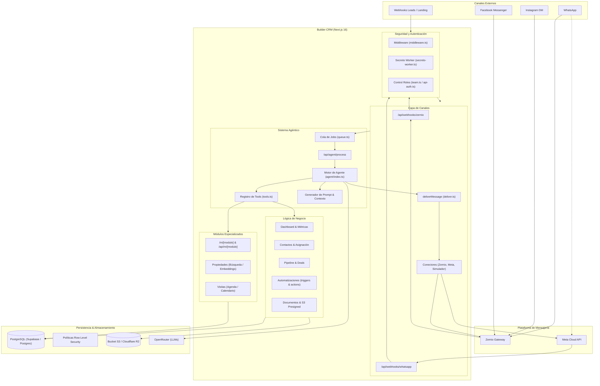

### 5.2 Separación entre Núcleo, Configuración y Módulos
La arquitectura obedece al principio de separación estricta:
1. **Núcleo (`src/`):** Completamente agnóstico al nicho de negocio. No contiene nombres de clientes, modelos inmobiliarios hardcodeados ni reglas de calificación fijas.
2. **Zona del Cliente (`config/`):**
   - `config/cliente.ts`: Define la marca, colores, idioma, moneda, zona horaria IANA, etapas del pipeline, campos personalizados y prompt base del agente.
   - `config/modulos.json`: Lista los módulos de nicho habilitados (`"activos": [...]`).
3. **Módulos Verticales (`modules/`):**
   - Cada carpeta en `modules/` representa una extensión autocontenida con:
     - `manifiesto.ts`: Configuración para el navegador, elementos de menú y campos personalizados aportados.
     - `servidor.tsx`: Rutas de API, componentes de páginas, definición de herramientas (*tools*) para el agente y sembrado (*seed*).
     - `migrations/*.sql`: Esquema propio en base de datos.
     - `tabla.ts`: Esquemas tipados Drizzle.

### 5.3 Despacho Dinámico de Módulos
El App Router de Next.js delega a los módulos mediante rutas catch-all:
- **Páginas:** `src/app/m/[modulo]/[[...ruta]]/page.tsx` resuelve el módulo activo mediante `obtenerModulo(nombre)` y `resolverPagina(modulo, ruta)`.
- **Rutas de API:** `src/app/api/m/[modulo]/[[...ruta]]/route.ts` despacha peticiones `GET`, `POST`, `PUT`, `PATCH`, `DELETE` hacia los controladores declarados en el módulo, ejecutando previamente `requireMember()`.

---

## 6. ESTRUCTURA COMPLETA DE DIRECTORIOS

```
nest-crm/
├── .claude/                   # Configuración del arnés de asistencia y memoria local
├── .github/workflows/         # Pipelines de CI (typecheck, lint, test, build) y sweepers
├── .local/                    # Base de datos embebida PGlite (WebAssembly) para modo local
├── config/                    # ZONA DEL CLIENTE: Configuración de instancia y plantillas
│   ├── plantillas/            # Plantillas predefinidas (ej. inmobiliaria.ts)
│   ├── cliente.ts             # Configuración activa de la instancia
│   └── modulos.json           # Lista de módulos externos habilitados
├── docker/                    # Scripts de infraestructura y entrypoint de contenedor
├── docs/                      # Guías operativas (AGENTE, CORREO, GOOGLE-AUTH, VPS, MCP, AUDITORIA)
├── drizzle/                   # Metadatos generados por drizzle-kit
├── modules/                   # Módulos verticales especializados
│   ├── _plantilla/            # Esqueleto para la creación de nuevos módulos
│   ├── ejemplo/               # Módulo de tareas personales de demostración
│   ├── propiedades/           # Módulo inmobiliario: catálogo, búsqueda y embeddings
│   └── visitas/               # Módulo inmobiliario: agendamiento y calendario de visitas
├── public/                    # Archivos estáticos públicos, assets de marca y Service Worker
│   ├── marca/                 # Logotipo e icono de la instancia
│   └── sw.js                  # Service Worker para Push Notifications (sin intercepción fetch)
├── scripts/                   # Herramientas operativas CLI (migraciones, seed, admin, zernio)
│   └── lib/                   # Librerías de soporte para migraciones
├── specs/                     # Especificaciones funcionales y CONSTITUCION.md
│   ├── inmobiliaria/          # Especificaciones del nicho inmobiliario
│   └── nucleo/                # Especificaciones de arquitectura del sistema base
├── src/                       # NÚCLEO DEL SISTEMA (No modificable por cliente)
│   ├── app/                   # Páginas y API Routes (App Router)
│   │   ├── (vistas)/          # Dashboard, contactos, conversaciones, pipeline, etc.
│   │   ├── api/               # Endpoints REST (agent, channels, webhooks, auth, etc.)
│   │   ├── auth/              # Flujos de sesión, login, recuperación y establecimiento de clave
│   │   └── m/ & api/m/        # Despachadores dinámicos hacia módulos activos
│   ├── components/            # Componentes React (dashboard, chat, contactos, pipeline, etc.)
│   ├── db/                    # Instanciación de Drizzle ORM y esquemas relacionales
│   ├── lib/                   # Lógica de negocio (agente, canales, automaciones, seguridad)
│   └── types/                 # Definiciones globales de TypeScript
└── supabase/                  # Migraciones SQL del núcleo y políticas RLS
    └── migrations/            # Archivos de migración de esquema, RLS y triggers de administración
```

---

## 7. INVENTARIO COMPLETO DE FUNCIONALIDADES

### Matriz de Funcionalidades por Módulo

| Módulo / Función | Ubicación / Ruta | Modelos / Tablas | Estado | Limitaciones / Dependencias |
|---|---|---|---|---|
| **Dashboard Principal** | `/` (`src/app/page.tsx`) | `contacts`, `deals`, `pipeline_stages`, `activities` | **IMPLEMENTADA Y VALIDADA** | Consulta directa en servidor; filtra por `owner_id` para asesores. Muestra KPIs agregados en tiempo real. |
| **Carga de Datos Demo** | `/` (`components/dashboard/CargarDemo.tsx`) | `POST /api/seed/demo` | **IMPLEMENTADA** | Requiere rol `admin` o cabecera `AGENT_WORKER_SECRET`. Utiliza conector simulado. |
| **Directorio de Contactos** | `/contacts` (`src/app/contacts/page.tsx`) | `contacts`, `team_members` | **IMPLEMENTADA Y VALIDADA** | Búsqueda por texto (nombre, email, empresa), filtros por fuente. Vista paginada/tabla. |
| **Ficha de Contacto** | `/contacts/[id]` | `contacts`, `activities`, `deals`, `conversations`, `documents` | **IMPLEMENTADA Y VALIDADA** | Muestra datos generales, campos personalizados validados, historial de actividades y resumen de IA. Retorna 404 a asesores no propietarios. |
| **Gestor Documental** | `/contacts/[id]` (`components/contacts/DocumentSection.tsx`) | `documents` | **DEPENDIENTE** | Requiere S3 configurado (`S3_ENDPOINT`, `S3_BUCKET`, etc.). Usa presigned URLs (PUT/GET). Límite 20MB. |
| **Bandeja Multicanal** | `/conversations` | `conversations`, `messages`, `contacts`, `channel_accounts` | **IMPLEMENTADA Y VALIDADA** | Unifica WhatsApp, Instagram y Messenger. Polling en vivo en cliente (`ConversationsListLive`). Retorna 404 a hilos ajenos. |
| **Chat y Panel de Mensajes** | `/conversations/[id]` | `conversations`, `messages`, `contacts` | **IMPLEMENTADA Y VALIDADA** | Envío optimista vía `deliverMessage`. Cumple ventana 24h: para WhatsApp restringe a plantillas; para IG/Messenger exige tag `HUMAN_AGENT`. |
| **Pausa / Reactivación Agente** | `/conversations/[id]` (`PATCH /api/conversations/[id]/agente`) | `conversations` | **IMPLEMENTADA** | Permite pausar el agente por hilo específico sin deshabilitar al contacto en otros canales. |
| **Pipeline Kanban** | `/pipeline` (`src/app/pipeline/page.tsx`) | `pipelines`, `pipeline_stages`, `deals`, `contacts` | **IMPLEMENTADA Y VALIDADA** | Soporte Drag & Drop con `@dnd-kit`. Mueve etapas recalculando orden y disparando eventos de automatización (`deal.stage_changed`). |
| **Agente Autónomo de IA** | `src/lib/agent/index.ts` | `agent_jobs`, `contacts`, `conversations`, `messages`, `agent_configs` | **DEPENDIENTE** | Requiere `OPENROUTER_API_KEY`. Hasta 6 rondas de tools por turno. Control de debounce de 6s en cola de jobs. |
| **Motor de Automatizaciones** | `/automatizaciones` (`src/app/automatizaciones/page.tsx`) | `automations`, `automation_runs`, `contacts` | **IMPLEMENTADA** | Disparadores: `contact.created`, `contact.assigned`, `deal.stage_changed`. Acciones: `push`, `add_tag`, `remove_tag`, `assign_owner`, `create_activity`. |
| **Simulador de IA** | `/simulador` (`src/app/simulador/page.tsx`) | `contacts`, `conversations`, `messages`, `deals` | **IMPLEMENTADA** | Acceso exclusivo para administradores (`admin`). Ejecuta el agente de forma síncrona usando el conector en memoria `simulador`. |
| **Plantillas Meta WhatsApp** | `/plantillas` (`src/app/plantillas/page.tsx`) | `whatsapp_templates` | **DEPENDIENTE** | Sincroniza y crea plantillas contra Meta Graph API / Zernio. Requiere credenciales de WABA activas. |
| **Reportes y Analítica** | `/reportes` (`src/app/reportes/page.tsx`) | `contacts`, `conversations`, `messages`, `deals`, `pipeline_stages` | **IMPLEMENTADA Y VALIDADA** | Filtros por 7, 30 y 90 días. Métricas de conversión, tasa de cierre, tiempo de primera respuesta y distribución de orígenes salientes. |
| **Configuración Canales** | `/settings` (`components/settings/ChannelsSettings.tsx`) | `channel_accounts`, `whatsapp_accounts` | **CONFIGURABLE** | Visualiza estado de credenciales, sincronización de cuentas Zernio y cuentas de Meta Cloud API. |
| **Gestión de Equipo (RBAC)** | `/settings` (`components/settings/TeamSettings.tsx`) | `team_members`, `auth.users` | **IMPLEMENTADA** | Solo administradores. Invita asesores (vía GoTrue SMTP si `AUTH_ENVIA_CORREOS=true` o mediante contraseña manual), activa o desactiva usuarios. |
| **Notificaciones Web Push** | `/settings` (`components/settings/PushSettings.tsx`) | `push_subscriptions`, `notifications` | **DEPENDIENTE** | Requiere llaves VAPID configuradas. Registro de suscripciones por dispositivo mediante Service Worker (`public/sw.js`). |
| **Catálogo Inmobiliario (Módulo)** | `/m/propiedades` (`modules/propiedades/servidor.tsx`) | `propiedades` | **CONFIGURABLE** | Búsqueda por filtros SQL o búsqueda semántica vectorial (si `OPENAI_API_KEY` y pgvector están disponibles). Sincronización Tokko opcional. |
| **Agenda de Visitas (Módulo)** | `/m/visitas` (`modules/visitas/servidor.tsx`) | `visitas`, `contacts`, `deals` | **CONFIGURABLE** | Estados: coordinando, agendada, realizada, cancelada. Vistas de lista y calendario mensual. El agente puede agendar visitas preliminares. |

---

## 8. EXPLICACIÓN DETALLADA DE MÓDULOS DEL SISTEMA

### 8.1 Bandeja Multicanal e Ingesta de Mensajes
La bandeja multicanal procesa mensajes entrantes y salientes a través de una abstracción unificada:
- **Flujo de Entrada:**
  1. El proveedor externo invoca `POST /api/webhooks/zernio` o `/api/webhooks/whatsapp`.
  2. La petición valida criptográficamente la firma (`verifyZernioSignature` con HMAC SHA-256 o `X-Hub-Signature-256`).
  3. El webhook registra el evento en `webhook_events` para garantizar idempotencia. Si el evento ya existía, responde inmediatamente con código `200 OK`.
  4. La ingesta pesada corre dentro de `after()` de Next.js mediante `processZernioEvent`, resolviendo o creando el `contact` y la `conversation`, guardando el mensaje en `messages` y encolando un trabajo en `agent_jobs` con un debounce de 6.000 ms.
- **Flujo de Salida:**
  - Toda emisión (manual, automática o generada por el agente) invoca exclusivamente a `deliverMessage`.
  - Se genera un registro optimista en `messages` con estado `pending`.
  - El conector asociado (`zernio`, `meta` o `simulador`) ejecuta la llamada al proveedor. Si Meta o Zernio rechazan la entrega, el estado se actualiza a `failed` con su respectivo código de error (`errorMessage`).

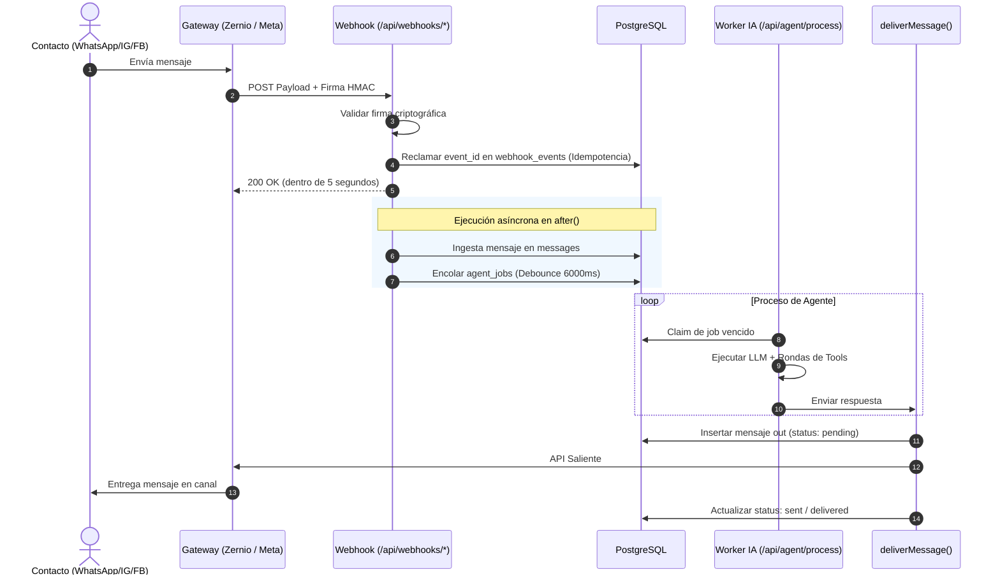

### 8.2 Pipeline Comercial y Gestión de Oportunidades
- **Estructura:** Soporta múltiples pipelines (con uno marcado como predeterminado en `is_default=true`). Cada pipeline cuenta con etapas ordenadas secuencialmente (`pipeline_stages.order`).
- **Sincronización Declarativa:** Al arrancar o ejecutar `sincronizarPipeline()`, el sistema reconcilia las etapas definidas en `config/cliente.ts` con la base de datos utilizando la columna `key`. Si el usuario renombró visualmente una etapa, su identificador clave permanece estable.
- **Transición de Etapas:** Implementada en `src/lib/deals/stage.ts`. La función `setDealStage()` actualiza la etapa del negocio, crea registros en `activities` y emite el evento `deal.stage_changed` para disparar reglas de automatización.

### 8.3 Automatizaciones
El módulo de automatizaciones (`src/lib/automations/`) opera como un motor de reglas desacoplado:
- **Disparadores (*Triggers*):**
  - `contact.created`: Emitido al registrarse un nuevo contacto (manual, CSV o webhook).
  - `contact.assigned`: Emitido cuando cambia el `owner_id` de un contacto.
  - `deal.stage_changed`: Emitido cuando una oportunidad comercial cambia de etapa.
- **Filtros:** Evaluación en memoria de operadores lógicos (`eq`, `neq`, `in`) sobre los metadatos del evento (ej. canal, fuente, etapa origen, asesor asignado).
- **Acciones:**
  - `push`: Envía notificación push VAPID a los administradores, a un asesor puntual o al propietario asignado.
  - `add_tag` / `remove_tag`: Agrega o elimina etiquetas en el arreglo `contacts.tags`.
  - `assign_owner`: Asigna el contacto a un miembro del equipo mediante `assignContact()`.
  - `create_activity`: Inserta una tarea o nota con fecha relativa en `activities`.
- **Control de Ciclos:** El payload de los eventos incluye un contador `__depth`. Si una acción encadenada supera una profundidad máxima de 3 (`MAX_EVENT_DEPTH = 3`), el motor aborta el procesamiento para prevenir bucles infinitos.

---

## 9. MODELOS Y ENTIDADES (PERSISTENCIA DE DATOS)

El esquema de datos está gestionado mediante Drizzle ORM sobre PostgreSQL con extensiones relacionales y soporte para tipos avanzados (`jsonb`, arrays de texto y `vector` para embeddings).

### 9.1 Inventario de Tablas del Núcleo

#### `contacts` (Contactos)
- **Propósito:** Registro maestro de personas y leads comerciales.
- **Campos Principales:**
  - `id` (text, PK, UUID v4).
  - `name` (text, not null).
  - `email` (text), `phone` (text), `company` (text).
  - `source` (text, default "otro").
  - `score` (integer, default 0).
  - `tags` (text[], default empty array).
  - `custom_fields` (jsonb, default `{}`): Almacena pares clave-valor según la configuración declarativa en `config/cliente.ts`.
  - `ai_summary` (text), `ai_summary_at` (timestamptz): Resumen ejecutivo redactado por el agente de IA.
  - `ai_enabled` (boolean, default true): Kill-switch global del agente para el contacto.
  - `needs_human` (boolean, default false), `needs_human_reason` (text), `needs_human_at` (timestamptz).
  - `owner_id` (uuid, FK `team_members.id`, `onDelete: set null`): Asesor responsable. Clave de aislamiento de visibilidad.
  - `tenant_id` (uuid, FK `tenants.id`).
  - `created_at`, `updated_at` (timestamptz).

#### `conversations` (Conversaciones / Hilos)
- **Propósito:** Agrupa los mensajes de un canal específico para un contacto. Un contacto puede poseer múltiples hilos (uno para WhatsApp y otro para Instagram).
- **Campos:** `id` (text, PK), `contact_id` (text, FK `contacts.id`, cascade), `account_id` (uuid, FK `channel_accounts.id`), `channel` (text: whatsapp, instagram, facebook), `provider` (text: zernio, meta, simulador), `external_id` (text, not null), `participant_id` (text), `participant_name` (text), `last_inbound_at` (timestamptz), `ai_enabled` (boolean, default true), `needs_human` (boolean), `metadata` (jsonb para atribución publicitaria CTWA).
- **Restricción Única:** `(provider, external_id)`.

#### `messages` (Mensajes)
- **Propósito:** Historial unificado de mensajes entrantes y salientes de todos los canales.
- **Campos:** `id` (text, PK), `contact_id` (text, FK `contacts.id`), `conversation_id` (text, FK `conversations.id`, cascade), `channel` (text), `provider` (text), `direction` (text: "in" o "out"), `origin` (text: "agent", "human", "template", "webhook"), `type` (text: "text", "template"), `body` (text), `external_id` (text), `status` (text: "received", "pending", "sent", "failed"), `error_message` (text), `sent_at`, `delivered_at`, `read_at` (timestamptz).

#### `pipelines` y `pipeline_stages` (Pipelines y Etapas)
- **Propósito:** Estructuración del embudo comercial kanban.
- **Campos `pipelines`:** `id` (text, PK), `name` (text), `is_default` (boolean), `order` (integer).
- **Campos `pipeline_stages`:** `id` (text, PK), `pipeline_id` (text, FK `pipelines.id`, cascade), `key` (text: clave técnica de configuración), `name` (text), `order` (integer), `color` (text), `is_won` (boolean), `is_lost` (boolean).
- **Restricción Única:** `(pipeline_id, key)`.

#### `deals` (Operaciones / Negocios)
- **Propósito:** Oportunidad económica asociada a un contacto dentro de una etapa del pipeline.
- **Campos:** `id` (text, PK), `title` (text), `value` (integer: montos monetarios en **centavos**), `stage_id` (text, FK `pipeline_stages.id`), `contact_id` (text, FK `contacts.id`, cascade), `expected_close` (timestamptz), `probability` (integer 0-100), `notes` (text).

#### `activities` (Actividades y Tareas)
- **Propósito:** Registro cronológico de notas, llamadas, reuniones y seguimientos.
- **Campos:** `id` (text, PK), `type` (text: "note", "follow_up", "call", "meeting", "email"), `description` (text), `contact_id` (text, FK `contacts.id`, cascade), `deal_id` (text, FK `deals.id`), `scheduled_at`, `completed_at` (timestamptz).

#### `team_members` (Miembros del Equipo)
- **Propósito:** Extensión de `auth.users` de Supabase para gestión de roles internos y estado activo.
- **Campos:** `id` (uuid, PK coincidente con `auth.users.id`), `email` (text, unique), `name` (text), `role` (text: "admin" | "asesor"), `active` (boolean, default true).

#### `agent_jobs` (Cola de Ejecución del Agente)
- **Propósito:** Tareas encoladas con debounce para procesamiento diferido del LLM.
- **Campos:** `id` (text, PK), `contact_id` (text, FK `contacts.id`, cascade), `conversation_id` (text, FK `conversations.id`, cascade), `status` (text: "pending", "processing", "done", "failed"), `process_after` (timestamptz), `attempts` (integer), `error` (text).

#### `automations` y `automation_runs` (Automatizaciones)
- **Propósito:** Definición de reglas y registro de ejecuciones/cola de automatizaciones.
- **Campos `automations`:** `key` (text, PK), `name` (text), `trigger` (text), `enabled` (boolean), `filters` (jsonb), `actions` (jsonb), `source` (text: "user" | "seed").
- **Campos `automation_runs`:** `id` (uuid, PK), `automation_key` (text, FK `automations.key`), `trigger` (text), `contact_id` (text, FK `contacts.id`), `status` (text: "pending", "processing", "done", "skipped", "failed"), `payload` (jsonb), `result` (jsonb), `error` (text).

#### `webhook_events` (Idempotencia de Mensajería)
- **Propósito:** Registro estricto de eventos entrantes de proveedores externos para absorción de reintentos at-least-once.
- **Campos:** `event_id` (text, PK), `provider` (text), `event` (text), `status` (text: "received", "processed", "ignored", "failed"), `payload` (jsonb), `error` (text), `attempts` (integer).

#### `push_subscriptions` y `notifications` (Notificaciones)
- **Propósito:** Suscripciones VAPID del navegador y notificaciones internas de campanita.
- **Campos `push_subscriptions`:** `id` (uuid, PK), `member_id` (uuid, FK `team_members.id`), `endpoint` (text), `p256dh` (text), `auth` (text), `user_agent` (text).
- **Campos `notifications`:** `id` (uuid, PK), `member_id` (uuid, FK `team_members.id`), `kind` (text), `title` (text), `body` (text), `url` (text), `read_at` (timestamptz).

#### `documents` (Fichas de Documentos)
- **Propósito:** Metadatos de archivos adjuntos subidos al bucket S3.
- **Campos:** `id` (uuid, PK), `contact_id` (text, FK `contacts.id`), `deal_id` (text, FK `deals.id`), `name` (text), `mime` (text), `size` (integer), `storage_key` (text, unique), `status` (text: "pending" | "ready"), `uploaded_by` (uuid, FK `team_members.id`).

---

## 10. DIAGRAMA ENTIDAD-RELACIÓN (MERMAID)

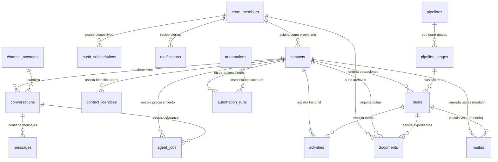

---

## 11. FLUJOS PRINCIPALES DEL SISTEMA

### 11.1 Flujo de Autenticación, Roles y Aislamiento de Cartera

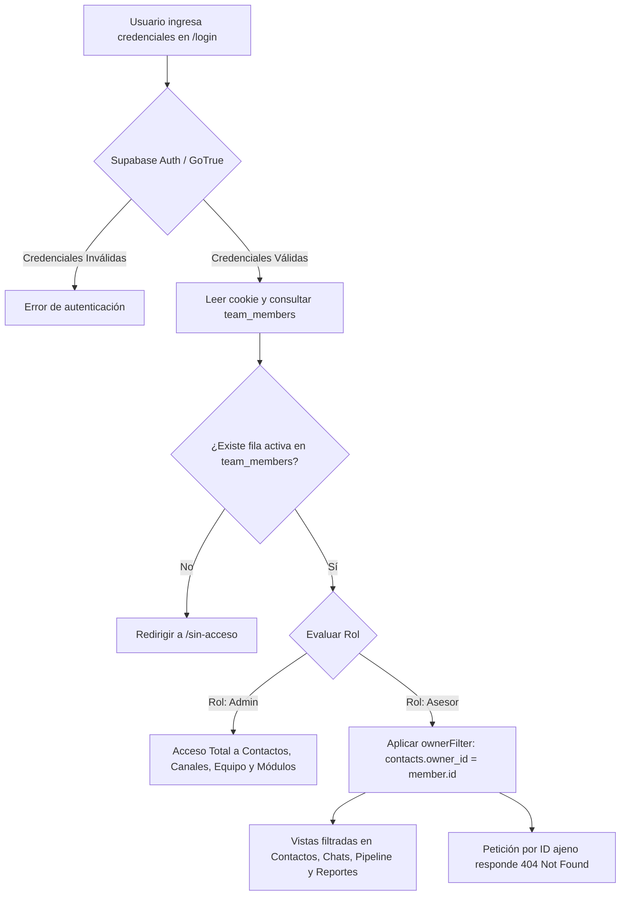

---

## 12. FUNCIONAMIENTO DEL AGENTE DE INTELIGENCIA ARTIFICIAL

El agente conversacional está implementado en `src/lib/agent/index.ts` y utiliza el cliente oficial de OpenAI adaptado para la API de **OpenRouter**.

### 12.1 Parámetros de Operación
- **Límite de Historial:** Carga hasta los últimos 30 mensajes del hilo específico (`HISTORY_LIMIT = 30`). Los mensajes consecutivos en una misma dirección se colapsan para optimizar la ventana de contexto.
- **Rondas de Herramientas:** Máximo 6 rondas iterativas de tool calling por invocación (`MAX_TOOL_ROUNDS = 6`).
- **Debounce de Mensajes en Ráfaga:** 6 segundos (`DEBOUNCE_MS = 6000`). Si el usuario envía múltiples mensajes seguidos en el mismo canal, el job extiende su temporizador `process_after` para procesar todo el bloque junto.
- **Modelo LLM Predeterminado:** Configurable por variable de entorno `AGENT_MODEL` (por defecto `google/gemini-2.5-flash`), con soporte para modelos alternativos como `anthropic/claude-sonnet-4.5` o `openai/gpt-5-mini`.

### 12.2 Construcción del Prompt y Contexto Dinámico
El prompt del sistema se compone en cascada:
1. **Plantilla Base:** Definida en `agent_configs[canal]` -> `crm_settings` -> `config.agente.prompt` -> prompt por defecto en código.
2. **Reemplazo de Variables:** Sustituye `{{agente}}`, `{{negocio}}`, `{{canal}}` y `{{fecha}}` (calculada según la `zonaHoraria` IANA configurada, evitando confusiones temporales nocturnas).
3. **Guía de Canal (*Channel Hints*):** Adapta la longitud y estilo (ej. respuestas ultra cortas sin URLs largas para Instagram DM vs. párrafos fluidos para WhatsApp).
4. **Bloque `# CONTEXTO`:**
   - Nombre, email y teléfono del cliente.
   - Datos personalizados conocidos y lista de campos que faltan averiguar según `config/cliente.ts`.
   - Resumen previo del lead (`ai_summary`).
   - Etapa comercial actual y catálogo de etapas del pipeline.
5. **Bloque `# EQUIPO`:** Lista de asesores disponibles para la herramienta `asignar_asesor`.

### 12.3 Inventario Individual de Herramientas del Agente

| Herramienta (*Tool Name*) | Descripción y Alcance | Datos que Modifica / Genera |
|---|---|---|
| `mover_etapa` | Transiciona la oportunidad del contacto a una nueva etapa del pipeline. Si el contacto no tiene una oportunidad abierta, la crea automáticamente. | Actualiza o inserta en `deals`, registra nota explicativa en `activities`. |
| `actualizar_contacto` | Almacena datos descubiertos durante la conversación (nombre, correo, teléfono, notas y campos personalizados validados). | Modifica columnas de `contacts` y el objeto `custom_fields`. |
| `registrar_actividad` | Genera una tarea, llamada, reunión o nota con fecha estimada para seguimiento del equipo. | Inserta fila en `activities` con prefijo `[IA]`. |
| `resumen_lead` | Condensa en 2 a 4 frases los requerimientos, presupuesto y situación del lead al concluir una fase útil. | Actualiza `contacts.ai_summary`, `ai_summary_at` y genera nota en `activities`. |
| `derivar_asesor` | Marca la conversación para atención humana y **pausa al agente exclusivamente en ese hilo**. | Modifica `conversations.ai_enabled = false`, `conversations.needs_human = true`, despacha mensaje de despedida/espera y detiene el loop de IA. |
| `asignar_asesor` | Asigna el contacto a un asesor por nombre (con tolerancia a acentos y coincidencias ambiguas). | Ejecuta `assignContact()`, actualiza `contacts.owner_id` y emite evento `contact.assigned`. |
| `buscar_info_propiedades` *(Módulo propiedades)* | Consulta información pública de una propiedad puntual por dirección, código o link externo. | Consulta catálogo `propiedades`; etiqueta al contacto con la propiedad en `contacts.tags`. |
| `buscar_propiedades` *(Módulo propiedades)* | Búsqueda multicriterio (tipo, operación, precio mín/máx, dormitorios, barrio). | Ejecuta búsqueda vectorial por embeddings (OpenAI) o filtros relacionales SQL. |
| `agendar_visita` *(Módulo visitas)* | Registra la intención confirmada de visitar un inmueble en estado preliminar `coordinating`. | Inserta registro en tabla `visitas` y crea nota en `activities`. |

---

## 13. INTEGRACIONES EXTERNAS Y ECOSISTEMA

| Servicio / Integración | Propósito | Archivos Clave | Dirección | Autenticación / Requisitos | Estado |
|---|---|---|---|---|---|
| **Supabase Postgres** | Base de datos relacional y ejecución RLS | `src/db/index.ts`, `supabase/` | Bidireccional | `DATABASE_URL`, `DIRECT_URL`, TLS obligatorio | **OPERATIVO** |
| **Supabase Auth / GoTrue** | Autenticación de usuarios, login, reseteo de claves | `src/lib/supabase/*`, `src/lib/auth-correo.ts` | Servidor -> Supabase | `NEXT_PUBLIC_SUPABASE_URL`, `NEXT_PUBLIC_SUPABASE_ANON_KEY`, `SUPABASE_SERVICE_ROLE_KEY` | **OPERATIVO** |
| **OpenRouter** | Gateway de inferencia para LLMs del agente | `src/lib/agent/openrouter.ts` | Saliente (HTTPS) | `OPENROUTER_API_KEY`, variable `AGENT_MODEL` | **OPERATIVO** |
| **Zernio** | Gateway omnicanal (WhatsApp, Instagram DM, Messenger) | `src/lib/channels/conectores/zernio.ts`, `src/lib/zernio/*` | Bidireccional (Webhook + API REST) | `ZERNIO_API_KEY`, `ZERNIO_WEBHOOK_SECRET` (HMAC SHA-256) | **OPERATIVO** |
| **Meta Cloud API** | Conexión directa alternativa con WhatsApp Business API | `src/lib/channels/conectores/meta-cloud.ts`, `src/lib/meta-whatsapp.ts` | Bidireccional | `WHATSAPP_ACCESS_TOKEN`, `WHATSAPP_PHONE_NUMBER_ID`, `WHATSAPP_APP_SECRET` | **PARCIAL** (Ingesta en endpoint legacy) |
| **Cloudflare R2 / AWS S3** | Almacenamiento presignado de documentos de contacto | `src/lib/storage.ts`, `src/app/api/documents/` | Browser -> S3 (Presigned PUT/GET) | `S3_ENDPOINT`, `S3_BUCKET`, `S3_ACCESS_KEY_ID`, `S3_SECRET_ACCESS_KEY` | **OPERATIVO** |
| **Web Push (VAPID)** | Notificaciones push móviles y desktop a través de navegadores | `src/lib/push.ts`, `public/sw.js` | Servidor -> Push Service (Google/Apple) | `NEXT_PUBLIC_VAPID_PUBLIC_KEY`, `VAPID_PRIVATE_KEY`, `VAPID_SUBJECT` | **OPERATIVO** |
| **OpenAI (Embeddings)** | Generación de vectores para búsqueda semántica inmobiliaria | `modules/propiedades/lib/embeddings.ts` | Saliente (HTTPS) | `OPENAI_API_KEY` (modelo `text-embedding-3-small`) | **OPCIONAL** (Fallback a filtros SQL) |
| **Tokko Broker** | Sincronización de catálogo inmobiliario externo | `modules/propiedades/lib/tokko.ts`, `scripts/sync-tokko.ts` | Entrante (API REST) | `TOKKO_API_KEY` | **OPCIONAL** |
| **Firecrawl** | Extracción web estructurada de publicaciones inmobiliarias | `modules/propiedades/lib/firecrawl.ts` | Saliente (HTTPS) | `FIRECRAWL_API_KEY` | **OPCIONAL** |

---

## 14. AUDITORÍA DE SEGURIDAD ESTÁTICA

### 14.1 Análisis de Puntos Críticos y Hallazgos

#### 1. Aislamiento de Cartera entre Asesores (IDOR)
- **Estado:** **SÓLIDO**.
- **Evidencia:** Las consultas en route handlers y Server Components no confían en parámetros de URL. Se aplica sistemáticamente `ownerFilter(member)` que inyecta `eq(contacts.ownerId, member.id)` a nivel SQL. En rutas por identificador puntual (`/contacts/[id]`, `/conversations/[id]`, `/api/deals/[id]`), se valida `canAccessContactId()`. Si el registro pertenece a otro asesor, el sistema responde **404 Not Found** en lugar de 403, evitando ataques de enumeración.

#### 2. Protección de Rutas Internas de Procesamiento
- **Estado:** **SÓLIDO (Fail-Closed)**.
- **Evidencia:** `src/lib/secreto-worker.ts`. Las rutas `/api/agent/process`, los sweepers de automatizaciones y el seeder están excluidas del middleware de login pero exigen obligatoriamente la cabecera `Authorization: Bearer <AGENT_WORKER_SECRET>` o `x-agent-secret`. La comparación se realiza en tiempo constante mediante `crypto.timingSafeEqual` previo chequeo de longitud. Si `AGENT_WORKER_SECRET` no está configurada, la función retorna `false` inmediatamente y `/api/health` emite un estado de error 503.

#### 3. Autenticación y Mitigación de Registros No Autorizados
- **Estado:** **CORRECTO**.
- **Evidencia:** En la migración `20261003010000_alta_solo_del_primer_admin.sql`, el trigger sobre `auth.users` (`alta_miembro_desde_auth`) verifica si ya existe al menos un miembro en `team_members`. Una vez creado el primer administrador, cualquier usuario adicional que invoque directamente el endpoint público de registro de Supabase Auth es ignorado por el trigger, carece de fila en `team_members` y queda bloqueado en la vista `/sin-acceso`.

#### 4. Validación Criptográfica de Webhooks
- **Estado:** **SÓLIDO**.
- **Evidencia:** `src/lib/zernio/webhooks.ts` valida HMAC SHA-256 sobre el cuerpo bruto (*raw body*). Si no se define `ZERNIO_WEBHOOK_SECRET`, el conector opera en modo *fail-closed* rechazando cualquier petición.

#### 5. Exposición de Secretos y Variables al Navegador
- **Estado:** **SÓLIDO**.
- **Evidencia:** El cliente frontend no lee directamente `process.env`. Las variables públicas (`NEXT_PUBLIC_SUPABASE_URL`, `NEXT_PUBLIC_SUPABASE_ANON_KEY`) se inyectan en tiempo de ejecución en el DOM mediante un bloque JSON seguro (`src/lib/config-publica.ts`) en el layout raíz. `SUPABASE_SERVICE_ROLE_KEY`, `OPENROUTER_API_KEY`, credenciales S3 y secretos de webhooks nunca se empaquetan en el bundle cliente.

#### 6. Seguridad en Políticas Row Level Security (RLS)
- **Estado:** **CORRECTO**.
- **Evidencia:** `supabase/migrations/20261001000100_rls.sql`. El rol `anon` tiene revocado todo privilegio sobre tablas, secuencias y funciones del esquema `public`. El rol `authenticated` solo posee permisos de lectura (`SELECT`) estrictamente regulados por funciones `security definer` (`contacto_visible`, `es_admin`, `es_miembro`). Las mutaciones de datos del CRM se realizan vía Drizzle utilizando el rol de conexión directa `postgres` (bypassing RLS), de modo que la API pública REST de Supabase no puede ser utilizada para alterar registros.

### 14.2 Matriz de Hallazgos y Riesgos de Seguridad

| ID | Hallazgo | Severidad | Ubicación | Impacto Potencial | Recomendación |
|---|---|---|---|---|---|
| **SEC-01** | Tokens de acceso de WhatsApp Meta guardados en texto plano | **Media** | `src/db/schema.ts` (`whatsapp_accounts.accessToken`) | Si un atacante compromete la base de datos con permisos de superusuario, obtendría el token de la cuenta WABA. | Implementar cifrado simétrico en reposo (AES-256-GCM) a nivel aplicación antes de persistir tokens de terceros. |
| **SEC-02** | Ausencia de Rate Limiting en endpoints públicos de webhooks | **Media** | `src/app/api/webhooks/leads/route.ts` | Posibilidad de denegación de servicio (DoS) o consumo excesivo de base de datos por bombardeo de peticiones. | Implementar rate limiting por IP o token (ej. Upstash / Redis o bucket en memoria) en middleware para `/api/webhooks/*`. |
| **SEC-03** | Falta de aislamiento multi-tenant estricto en tablas compartidas | **Informativa** | `src/db/schema.ts` (`tenants.id` opcional) | Preparado para arquitectura de instancia única por cliente; si se intenta utilizar una sola base de datos para múltiples clientes sin RLS multi-tenant, existiría riesgo de filtrado. | Mantener la regla arquitectónica fundamental de **una instancia y una base de datos por cliente**. |

---

## 15. CALIDAD DEL CÓDIGO Y DEUDA TÉCNICA

### 15.1 Evaluación de Estructura y Mantenibilidad
- **Cohesión y Acoplamiento:** Muy bien estructurado. Las utilidades de canales (`conector.ts`, `deliver.ts`, `ingest.ts`) están limpiamente desacopladas de las vistas.
- **Tipado TypeScript:** Riguroso. Modo estricto habilitado en `tsconfig.json`. Muy bajo uso de `any` no tipado (restringido principalmente a deserialización inicial de JSON de webhooks antes de validación).
- **Control de Incompatibilidades de Driver:** Implementación defensiva en `src/db/index.ts` para normalizar las diferencias entre el driver de producción `postgres-js` (que devuelve un array directo de filas) y el driver embebido de desarrollo `@electric-sql/pglite` (que devuelve `{ rows: [...] }`), evitando errores silenciosos en consultas agregadas.
- **Manejo de Fechas en Consultas SQL:** Cumple con la convención de no inyectar objetos `Date` nativos en `db.execute(sql\`...\`)`, serializando a cadenas ISO con cast explícito (`${fecha.toISOString()}::timestamptz`) para evitar excepciones del driver.

### 15.2 Deuda Técnica Identificada
1. **Conector Meta Cloud API Parcial:** `src/lib/channels/conectores/meta-cloud.ts` implementa el envío pero no el webhook del nuevo contrato; la ingesta de Meta continúa residiendo en la ruta heredada `src/app/api/webhooks/whatsapp/route.ts`.
2. **Dependencias del Proyecto Original:** Existen scripts heredados (`scripts/connect-whatsapp-account.ts`) y tablas (`whatsappAccounts`) originarias del proyecto base `auto-crm` que coexisten con la nueva arquitectura multicanal de Zernio.

---

## 16. TESTING Y CONTROL DE CALIDAD (QA)

### 16.1 Suite de Pruebas Unitarias
El proyecto utiliza **Vitest** (`vitest.config.mts`) para pruebas rápidas de invariantes críticos que fallan en silencio:
- `tests/acceso-por-rol.test.ts`: Valida que `ownerFilter()` devuelva `undefined` exclusivamente para el administrador y siempre filtre por `owner_id = member.id` para asesores.
- `tests/firma-webhook.test.ts`: Valida verificación de firmas HMAC SHA-256 de Zernio, comportamiento *fail-closed* ante falta de secreto y resistencia a firmas malformadas.
- `tests/ventana-24h.test.ts`: Comprueba la regla de ventana de 24 horas y etiquetado `HUMAN_AGENT` en base a `last_inbound_at`.
- `tests/secreto-worker.test.ts`: Valida autorización de procesos internos y comparación segura de cadenas.
- `tests/config-cliente.test.ts`: Valida el esquema de configuración del cliente con Zod.
- `tests/config-publica.test.ts`: Verifica serialización segura para el navegador.
- `tests/plantillas-correo.test.ts`: Valida integridad de plantillas de acceso GoTrue.
- `tests/zona-horaria.test.ts`: Valida formateo de fechas con IANA timezones.

### 16.2 Script de Autoverificación de Instancia
`scripts/verificar-instancia.mjs` funciona como el gate de aceptación en despliegue (Principio III de la Constitución), validando de punta a punta:
1. Healthcheck (`/api/health`).
2. Login real contra Supabase Auth y validación de membresía en `/api/team/me`.
3. Verificación de marca corporativa en manifest y metadata.
4. Consulta de estado y consistencia de pipeline.
5. Inyección de conversación de prueba mediante el simulador, comprobando respuesta del agente LLM y avance automático de etapa en el pipeline.
6. Comprobación de estado operativo de módulos activos.

---

## 17. INFRAESTRUCTURA, DESPLIEGUE Y OPERACIÓN

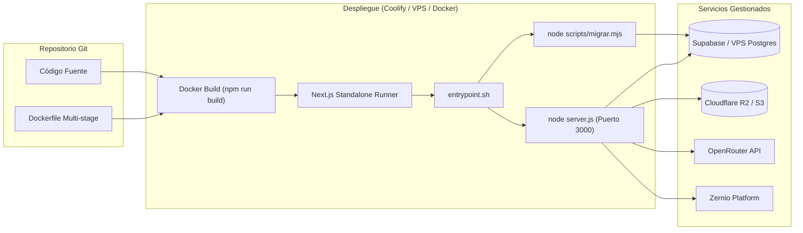

### 17.1 Dockerfile y Optimización de Construcción
- **Estructura Multi-Etapa:** 3 fases (`deps` -> `builder` -> `runner`).
- **Caché Eficiente:** Emplea `--mount=type=cache,target=/root/.npm` y `--mount=type=cache,target=/app/.next/cache` para acelerar reconstrucciones recurrentes en VPS.
- **Imagen Mínima de Ejecución:** La fase `runner` utiliza Alpine Linux con usuario no privilegiado (`app:app`), copiando solo los artefactos standalone generados por Next.js (`output: "standalone"` en `next.config.ts`), los scripts de migración y los módulos.
- **Entrypoint Robusto:** `docker/entrypoint.sh` ejecuta `node scripts/migrar.mjs` antes de arrancar `node server.js`. Si la base de datos tarda en iniciar, el script de migración reintenta hasta 15 veces (30 s).

### 17.2 Ambientes Operativos

| Característica | Modo Local (`npm run local`) | Desarrollo con Supabase | Producción (Coolify / Docker) |
|---|---|---|---|
| **Base de Datos** | PGlite (Wasm Postgres en `.local/db`) | Supabase Cloud / Postgres Remoto | Supabase Cloud o Postgres VPS |
| **Autenticación** | Sin login (Simula admin automático) | Supabase Auth (Email + Pass) | Supabase Auth / GoTrue |
| **Agente IA** | Requiere `OPENROUTER_API_KEY` | Requiere `OPENROUTER_API_KEY` | Requiere `OPENROUTER_API_KEY` |
| **Canales Reales** | No disponibles (Usa simulador) | Zernio / Webhooks vía Ngrok | Zernio / Meta Cloud directo con HTTPS |
| **Búsqueda Vectorial**| Deshabilitada (No soporta pgvector) | Disponible con extensión `vector` | Disponible con extensión `vector` |
| **Migraciones** | Automáticas al iniciar script | `npm run db:migrar` manual | Automáticas en `entrypoint.sh` |

---

## 18. RENDIMIENTO Y ESCALABILIDAD

### 18.1 Base de Datos y Consultas
- **Indexación:** Existen índices primarios y únicos sobre columnas críticas (`external_id`, claves compuestas de idempotencia).
- **Prevención de N+1:** Las consultas de listas en contactos, conversaciones y reportes emplean agregaciones SQL directas y sentencias `JOIN` en lugar de llamadas individuales iterativas.
- **Agregaciones de Reportes:** `src/lib/reportes.ts` consolida los cálculos estadísticos en una única batería concurrente de consultas SQL vía `Promise.all()`.

### 18.2 Concurrencia y Procesamiento Asíncrono
- **Next.js `after()`:** El webhook de Zernio responde en menos de 1 segundo liberando al proveedor y difiere la ingesta y encolado de jobs dentro del ciclo de vida asíncrono del servidor.
- **Barridos de Recuperación (*Sweepers*):** `src/lib/barridos.ts` ejecuta temporizadores internos en producción cada 30 minutos (configurable con `SWEEP_INTERVAL_MIN`) para reclamar jobs de agente y ejecuciones de automatización que hayan quedado en estado pendiente por interrupciones abruptas del proceso.

---

## 19. LIMITACIONES IDENTIFICADAS

1. **Ausencia de Cola Distribuida (Redis/BullMQ):** La gestión de tareas del agente y automatizaciones reside en tablas de PostgreSQL (`agent_jobs`, `automation_runs`) y temporizadores en memoria. Si bien es adecuado para el modelo de una instancia por cliente, no escala a cientos de mensajes simultáneos por segundo en una misma instancia.
2. **Modo Local Limitado:** El motor PGlite no soporta la extensión `pgvector`, impidiendo probar localmente la búsqueda semántica del módulo de propiedades sin una base de datos PostgreSQL real.
3. **Dependencia de Zernio para Instagram y Messenger:** El canal de Meta Cloud API directo solo soporta WhatsApp; Instagram DM y Messenger requieren obligatoriamente la suscripción y servicio de Zernio.
4. **Almacenamiento de Documentos Condicionado:** La subida de documentos exige la provisión de un bucket S3 compatible con políticas CORS configuradas; no existe almacenamiento de archivos local como respaldo.

---

## 20. PROBLEMAS Y RIESGOS PRIORIZADOS

### P0 — Críticos (Bloqueantes)
*No se detectaron problemas P0 en el código actual.* El sistema cuenta con salvaguardas *fail-closed* operativas.

### P1 — Altos (Atención Necesaria antes de Producción)
- **Riesgo P1-01:** Falta de cifrado en reposo para el token de acceso en `whatsapp_accounts` (`accessToken`). Si se utiliza la conexión Meta Cloud API directa, el token reside en texto plano en la base de datos.

### P2 — Medios (Estabilidad y Mantenibilidad)
- **Riesgo P2-01:** Ausencia de rate limiting en `/api/webhooks/leads`. Cualquier tercero que descubra o adivine la URL de leads podría enviar peticiones masivas si no se define `LEADS_WEBHOOK_SECRET`.
- **Riesgo P2-02:** Desincronización potencial en `config/modulos.json` vs. código generado. Si un desarrollador edita `config/modulos.json` a mano sin ejecutar `npm run modulos:registro`, los archivos generados de TypeScript pueden quedar desfasados hasta la siguiente compilación.

### P3 — Bajos (Mejoras Recomendadas)
- **Riesgo P3-01:** El conector Meta Cloud API se encuentra en estado parcial, manteniendo la ingesta en un endpoint separado (`/api/webhooks/whatsapp`) en lugar de consolidarse en la interfaz `WebhookConector`.

---

## 21. CAPACIDADES ACTUALES DEL PRODUCTO

1. **Operación Comercial Omnicanal:** Bandeja en tiempo real que permite alternar entre atención autónoma por IA y atención humana asistida por asesores en WhatsApp, Instagram y Facebook Messenger.
2. **Calificación y Enrutamiento Inteligente:** El agente interactúa en lenguaje natural, identifica el perfil del cliente, recopila campos específicos del negocio y mueve al cliente a través del embudo de ventas.
3. **Asignación Automática de Cartera:** Capacidad del agente o de reglas automáticas para derivar contactos a asesores comerciales específicos con notificación push inmediata al teléfono móvil.
4. **Seguridad y Privacidad de Datos:** Cada empresa cuenta con su base de datos aislada, control de acceso basado en roles (el asesor no ve contactos ajenos) y RLS estricto en la base de datos.
5. **Simulador Integrado:** Permite a los administradores probar en tiempo real las respuestas y herramientas del agente con guiones de prueba sin consumir mensajes de canales reales.
6. **Especialización Vertical Inmobiliaria:** Módulos listos para uso con catálogo de propiedades, búsqueda por filtros/embeddings y agenda de visitas presenciales.

---

## 22. POTENCIAL DE AMPLIACIÓN

Gracias a la arquitectura de módulos en `modules/` y la configuración desacoplada en `config/`:
- **Nuevas Plantillas de Nicho:** Posibilidad de crear plantillas declarativas para clínicas dentales (agenda de turnos de salud), concesionarias de vehículos (catálogo de autos y cotizaciones) o despachos legales (solicitud de antecedentes y expedientes).
- **Nuevos Conectores de Comunicación:** Se puede añadir soporte para Telegram, correo electrónico entrante o webchat en vivo creando un nuevo archivo en `src/lib/channels/conectores/` bajo la interfaz `Conector`.
- **Nuevas Acciones de Automatización:** Posibilidad de extender `src/lib/automations/actions.ts` para enviar webhooks salientes a Make/Zapier, disparar mensajes de WhatsApp salientes con plantillas o sincronizar con hojas de cálculo.

---

## 23. RECOMENDACIONES TÉCNICAS

1. **Unificar el Conector Meta:** Completar la interfaz `webhook` en `src/lib/channels/conectores/meta-cloud.ts` y transformar `/api/webhooks/whatsapp` en una llamada estandarizada a `manejarWebhook(metaCloud, req)`.
2. **Cifrado de Credenciales Externas:** Añadir una capa de cifrado simétrico (usando un secreto de aplicación) para columnas que almacenen tokens o llaves de terceros en la base de datos.
3. **Incorporar Pruebas E2E:** Agregar pruebas con Playwright en el CI para validar los flujos críticos de la interfaz (login, cambio de etapa en el kanban y envío de mensajes en el chat).
4. **Protección de Rate Limit:** Configurar un limitador de frecuencia de peticiones en Next.js Middleware para los endpoints públicos de webhooks.

---

## 24. EVALUACIÓN FINAL DEL ESTADO DEL PROYECTO

### 24.1 Matriz de Evaluación por Dimensión Técnica

| Dimensión | Estado de Madurez | Evaluación Técnica y Evidencia Comprobada |
|---|---|---|
| **Madurez Arquitectónica** | **Alta (9.5/10)** | Excelente desacoplamiento. Separación nítida entre núcleo inmutable (`src/`), configuración (`config/`) y módulos verticales (`modules/`). Manejo de configuración pública en tiempo de ejecución (`config-publica.ts`). |
| **Calidad de Código** | **Alta (8.8/10)** | Código limpio, TypeScript en modo estricto, constantes IANA para zonas horarias y manejo defensivo de diferencias entre drivers SQL (`postgres-js` vs `pglite`). |
| **Seguridad Comprobada** | **Fuerte en diseño (9.0/10)** | Modelo *fail-closed* estricto para procesos internos con `timingSafeEqual`, validación de firmas HMAC en webhooks, RLS habilitado en todas las tablas y mitigación de auto-registro abusivo en Supabase Auth. |
| **Base de Datos** | **Sólida (9.0/10)** | Esquema normalizado en Drizzle ORM con restricciones únicas de idempotencia, llaves foráneas consistentes y runner de migraciones transaccionales en arranque. |
| **Infraestructura** | **Funcional (9.0/10)** | Dockerfile multi-stage con capas de caché optimizadas, soporte de Coolify y modo local sin dependencias externas mediante Postgres Wasm (`pglite`). |
| **Pruebas Automatizadas** | **Parcial (7.5/10)** | Buena cobertura de pruebas unitarias con Vitest para invariantes silenciosos críticos (RBAC, webhooks, ventana 24h, tokens); **ausencia de suite E2E en CI**. |

### 24.2 Dictamen de Preparación Técnica y Condiciones Pendientes

> [!WARNING]
> **Dictamen Técnico:**\
> El proyecto presenta un **diseño arquitectónico de alta calidad y una base de código sólida**. Sin embargo, **no debe considerarse plenamente listo para producción a gran escala** hasta que se aborden formalmente los riesgos identificados en la auditoría y se completen las validaciones operativas en un entorno de despliegue real.

#### Condiciones Críticas Pendientes antes de Producción:
1. **Tokens de WhatsApp en Texto Plano (Riesgo P1-01 / SEC-01):** La columna `whatsapp_accounts.accessToken` almacena credenciales de Meta Graph API sin cifrado en reposo. Se requiere implementar cifrado simétrico (AES-256-GCM) a nivel aplicación antes de almacenar credenciales de clientes reales.
2. **Ausencia de Rate Limiting en Endpoints Públicos (Riesgo P2-01 / SEC-02):** `/api/webhooks/leads` y endpoints de recepción carecen de limitación de tasa, exponiendo la base de datos a sobrecarga por peticiones masivas.
3. **Falta de Pruebas de Extremo a Extremo (E2E):** El repositorio no cuenta con tests automatizados en navegador (Playwright/Cypress) que validen el flujo completo de sesión, manipulación del pipeline kanban y envío de mensajes.
4. **Validaciones Dinámicas de Despliegue Pendientes:**
   - Entrega y recepción efectiva de mensajes en dispositivos físicos a través de Zernio y Meta Cloud API.
   - Envío de notificaciones push móviles VAPID en sistemas iOS (APNs vía web) y Android.
   - Comportamiento de latencia y saturación del agente LLM bajo condiciones de concurrencia elevada.

---

## 25. VERIFICACIÓN FINAL DE SOLO LECTURA

En cumplimiento estricto con las restricciones innegociables de la auditoría:
1. **Estado del Repositorio:** El repositorio no sufrió ninguna alteración durante la fase de auditoría. Este documento se generó únicamente tras la confirmación y solicitud explícita del usuario para su integración como fuente del proyecto.
2. **Bases de Datos e Infraestructura:** No se ejecutaron migraciones de base de datos, no se alteraron esquemas ni registros, no se instalaron dependencias y no se realizaron llamadas de red a servicios de terceros.
3. **Áreas Examinadas Exhaustivamente:**
   - Estructura completa del repositorio y dependencias (`package.json`, configuraciones de TypeScript, Next.js, Docker y CI/CD).
   - Esquemas Drizzle (`src/db/schema.ts`, `modules/*/tabla.ts`) y migraciones SQL en `supabase/migrations/`.
   - Sistema agéntico, registro de herramientas (*tools*), debounce y promps (`src/lib/agent/*`).
   - Conectores de canales, ingesta, idempotencia y entrega (`src/lib/channels/*`).
   - Motor de automatizaciones, triggers, filtros y acciones (`src/lib/automations/*`).
   - Capa de seguridad, middleware, RLS y gestión de roles (`src/lib/api-auth.ts`, `src/lib/secreto-worker.ts`, `src/lib/team.ts`, `supabase/migrations/*rls*`).
   - Módulos verticales (`modules/propiedades`, `modules/visitas`, `modules/ejemplo`).
   - Configuración declarativa del cliente y plantillas (`config/cliente.ts`, `config/plantillas/inmobiliaria.ts`).
   - Suite de pruebas de invariantes (`tests/*`).
4. **Aspectos que Requieren Validación Dinámica en Despliegue:**
   - La entrega efectiva de mensajes salientes hacia terminales móviles reales a través de Zernio o Meta Cloud API.
   - El envío y recepción de notificaciones push VAPID en dispositivos físicos iOS y Android.
   - La latencia y tiempos de respuesta de los modelos LLM en OpenRouter bajo condiciones de concurrencia elevada.
