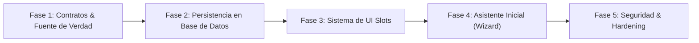

# Nest CRM — Hoja de Ruta Técnica (Roadmap)

**Versión del documento**: 2.1.0\
**Fecha de actualización**: 2026-11-09\
**Estado**: Plan de evolución técnica formalizado y aprobado\

---

## 1. Convenciones de Clasificación del Documento

- **[ACTUAL COMPROBADA]**: Funcionalidad implementada y verificada en el código.
- **[OBJETIVO APROBADO]**: Decisión arquitectónica aprobada, en especificación o planificación formal.
- **[PENDIENTE DE DECISIÓN]**: Propuesta técnica sujeta a análisis.
- **[NO IMPLEMENTADA]**: Diseñada conceptualmente pero sin código en el repositorio.

---

## 2. Estrategia de Evolución y Orden de Fases

Para preservar la estabilidad operativa comprobada en la auditoría técnica (v2.1.0), la evolución se estructura en cinco fases estrictamente secuenciales.

> [!IMPORTANT]
> **Regla de Precedencia Técnica:**
> No se avanzará a la implementación del Sistema de UI Slots (Fase 3) ni del Asistente Inicial (Fase 4) antes de haber formalizado y validado en tests los contratos de tipos y la fuente de verdad en base de datos (Fases 1 y 2).

---

## 3. Detalle de Fases Técnicas y Criterios de Aceptación

### Fase 1: Formalización de Contratos y Fuente Única de Verdad

**Objetivo:** Introducir los tipos formales [`TemplateDefinition`](file:///e:/Codigo/nest-crm/docs/PLANTILLAS.md#3-contrato-formal-unificado-templatedefinition-objetivo-aprobado) y [`ModuleDefinition`](file:///e:/Codigo/nest-crm/docs/MODULOS.md#32-contrato-objetivo-unificado-moduledefinition-objetivo-aprobado) en el código sin romper los módulos existentes, y resolver la contradicción entre `plantillas/inmobiliaria.ts` y `config/modulos.json`.

| Hito Técnico | Descripción | Clasificación | Análisis de Riesgos y Complejidad |
|---|---|---|---|
| **H1.1** Tipado de `TemplateDefinition` | Crear `src/lib/templates/types.ts` con el contrato unificado. | **[OBJETIVO APROBADO]** | **Riesgo Medio:** Requiere desacoplar el preset inmobiliario actual sin romper la validación con `esquemaConfig`. |
| **H1.2** Evolución de `ModuleDefinition` | Incorporar dependencias y capacidades en `src/lib/modules/types.ts` manteniendo retrocompatibilidad con `ManifiestoModulo`. | **[OBJETIVO APROBADO]** | **Riesgo Medio:** Debe preservar compatibilidad con los módulos existentes (`propiedades`, `visitas`, `ejemplo`). |
| **H1.3** Adaptación de plantilla inmobiliaria | Refactorizar `config/plantillas/inmobiliaria.ts` para que declare `modules.required: ["propiedades", "visitas"]`. | **[OBJETIVO APROBADO]** | **Riesgo Bajo:** Modificación declarativa en la carpeta `config/plantillas/`. |
| **H1.4** Validación en script de generación | Actualizar `scripts/generar-registro-modulos.mjs` para validar la coherencia entre módulos requeridos por la plantilla y módulos presentes. | **[OBJETIVO APROBADO]** | **Riesgo Medio:** Puede impactar el ciclo de build de Next.js si se introducen chequeos que fallen en frío. |

**Criterios de Aceptación Verificables de la Fase 1:**
1. `npm run typecheck` ejecuta en verde sin errores de tipos en `src/`, `config/` ni `modules/`.
2. `npm run build` genera el artefacto standalone sin advertencias de módulos no encontrados.
3. La suite de pruebas unitarias (`npm run test`) pasa al 100%.
4. `scripts/verificar-instancia.mjs` pasa en verde contra una base de datos de prueba.

---

### Fase 2: Persistencia de Configuración y Gestión de Módulos en Base de Datos

**Objetivo:** Trasladar la verdad operativa de la activación de módulos y personalizaciones hacia PostgreSQL (`crm_settings`), permitiendo la activación de módulos opcionales en tiempo de ejecución.

| Hito Técnico | Descripción | Clasificación | Análisis de Riesgos |
|---|---|---|---|
| **H2.1** Estructura en `crm_settings` | Definir el esquema JSON para `template_active_id`, `modules_active_list` y `customizations` con procedencia. | **[NO IMPLEMENTADA]** | **Riesgo Bajo:** Utiliza la tabla clave-valor existente en `schema.ts`. |
| **H2.2** Reconciliador de cuatro niveles | Implementar la cascada jerárquica con fusión no destructiva documentada en [`docs/CONFIGURACION.md`](file:///e:/Codigo/nest-crm/docs/CONFIGURACION.md). | **[NO IMPLEMENTADA]** | **Riesgo Alto:** Riesgo de sobreescritura accidental si el algoritmo de merge no discrimina correctamente la procedencia (`origin`). |
| **H2.3** Endpoint de activación de módulos | Crear `/api/settings/modules/[id]/toggle` que valide el DAG de dependencias y aplique migraciones SQL. | **[NO IMPLEMENTADA]** | **Riesgo Alto:** Requiere ejecutar DDL transaccional desde el runtime de la aplicación. |
| **H2.4** Mecanismo de respaldo previo | Implementar script CLI de volcado (*dump*) antes de cambios estructurales o de plantilla. | **[NO IMPLEMENTADA]** | **Riesgo Medio:** Dependencia de utilidades `pg_dump` disponibles en el entorno. |

**Criterios de Aceptación Verificables de la Fase 2:**
1. Desactivar un módulo desde el endpoint apaga sus rutas (`404 Not Found`) sin eliminar sus tablas relacionales en PostgreSQL.
2. Activar un módulo opcional aplica sus migraciones pendientes registradas en `public._migraciones`.
3. Un intento de activación con dependencias insatisfechas o dependencias circulares es rechazado con error `400 Bad Request`.
4. Los valores personalizados de la empresa prevalecen ante reinicios del contenedor.

---

### Fase 3: Sistema Controlado de Extensiones de Interfaz (UI Slots)

**Objetivo:** Habilitar los siete slots oficiales para que los módulos inyecten componentes visuales en vistas maestras del núcleo.

| Hito Técnico | Descripción | Clasificación | Análisis de Riesgos |
|---|---|---|---|
| **H3.1** Componente `SlotRenderer` | Desarrollar el despachador defensivo con `Suspense` y `ErrorBoundary` en `src/components/shared/SlotRenderer.tsx`. | **[NO IMPLEMENTADA]** | **Riesgo Bajo:** Aislamiento estricto de componentes React. |
| **H3.2** Puntos de inserción en el núcleo | Incorporar los anclajes para `dashboard.widgets`, `contact.detail/tabs`, `deal.detail/tabs` y `conversation.sidebar`. | **[NO IMPLEMENTADA]** | **Riesgo Medio:** Modificación de vistas maestras del núcleo (`src/app/`, `src/components/`). |
| **H3.3** Migración de widgets modulares | Exportar el buscador rápido de `propiedades` para `conversation.sidebar` y el calendario de `visitas` para `dashboard.widgets`. | **[NO IMPLEMENTADA]** | **Riesgo Bajo:** Refactorización interna de componentes de módulos. |

**Criterios de Aceptación Verificables de la Fase 3:**
1. Si un componente inyectado en un slot arroja un error en tiempo de renderizado, el error queda confinado a su contenedor y la pantalla principal del CRM continúa 100% operativa.
2. Los slots no renderizan componentes si el módulo asociado está inactivo en la base de datos.
3. El filtrado visual de roles oculta el slot a usuarios no autorizados, y los endpoints subyacentes validan permisos en servidor.

---

### Fase 4: Asistente Inicial de Configuración (Onboarding Wizard)

**Objetivo:** Permitir que una empresa configure su instalación en 8 pasos guiados sin edición de código fuente.

| Hito Técnico | Descripción | Clasificación | Análisis de Riesgos |
|---|---|---|---|
| **H4.1** Flujo de 8 pasos en `/onboarding` | Interfaz asistida para marca, plantilla, módulos, pipeline, campos, equipo e integraciones. | **[NO IMPLEMENTADA]** | **Riesgo Medio:** Interfaz amplia con múltiples estados intermedios. |
| **H4.2** Gate de activación | Transicionar el estado de la instalación a `ACTIVE` solo tras pasar la verificación de integridad. | **[NO IMPLEMENTADA]** | **Riesgo Bajo:** Control de estado en `crm_settings`. |

**Criterios de Aceptación Verificables de la Fase 4:**
1. Una instalación recién desplegada redirige automáticamente a `/onboarding` hasta que se completa el proceso.
2. El asistente permite configurar la marca, elegir la plantilla y validar las credenciales de canales sin requerir un commit en Git.

---

### Fase 5: Seguridad Avanzada, Hardening y Madurez Operativa

**Objetivo:** Abordar las recomendaciones pendientes de la auditoría integral de seguridad.

| Hito Técnico | Descripción | Clasificación | Análisis de Riesgos |
|---|---|---|---|
| **H5.1** Cifrado simétrico de credenciales | Implementar AES-256-GCM para tokens de Meta en `whatsapp_accounts`. | **[PENDIENTE DE DECISIÓN / NO IMPLEMENTADA]** | **Riesgo Medio:** Gestión de llave maestra y migración de tokens existentes. |
| **H5.2** Limitador de tasa (*Rate Limiting*) | Rate limiting por IP/token en Next.js Middleware para endpoints de webhooks públicos. | **[PENDIENTE DE DECISIÓN / NO IMPLEMENTADA]** | **Riesgo Bajo:** Mitigación de abusos DoS en rutas de captación. |
| **H5.3** Suite de pruebas E2E con Playwright | Pruebas automáticas en CI para flujos críticos (login, kanban, chat). | **[OBJETIVO APROBADO / NO IMPLEMENTADA]** | **Riesgo Bajo:** Automatización de calidad continua. |
| **H5.4** Unificación de conector Meta | Consolidar la ingesta de Meta Cloud API bajo la interfaz `WebhookConector`. | **[OBJETIVO APROBADO / NO IMPLEMENTADA]** | **Riesgo Medio:** Refactorización de endpoints legados de WhatsApp. |

---

## 4. Próxima Fase Técnica Inmediata: Fase 1

La próxima fase a ejecutar por el equipo de desarrollo debe ser **exclusivamente la Fase 1**:
- Permite formalizar los contratos [`TemplateDefinition`](file:///e:/Codigo/nest-crm/docs/PLANTILLAS.md#3-contrato-formal-unificado-templatedefinition-objetivo-aprobado) y [`ModuleDefinition`](file:///e:/Codigo/nest-crm/docs/MODULOS.md#32-contrato-objetivo-unificado-moduledefinition-objetivo-aprobado) en TypeScript.
- Resuelve la contradicción técnica entre `config/plantillas/inmobiliaria.ts` y `config/modulos.json`.
- Establece la base tipada inmutable para las fases posteriores de persistencia y UI Slots sin alterar la base de datos de producción.
